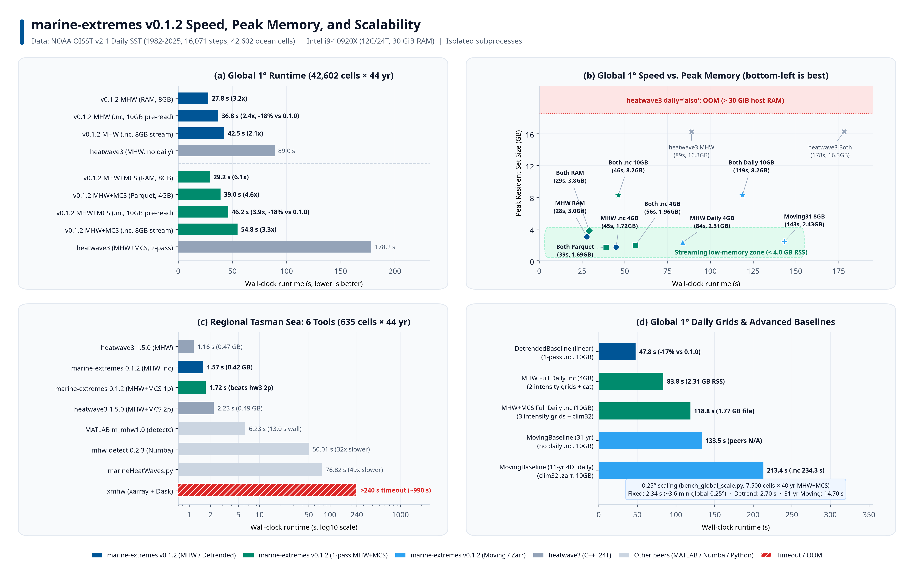

# marine-extremes

[](https://github.com/Radianjayjay/marine-extremes/actions/workflows/ci.yml)
[](https://pypi.org/project/marine-extremes/)
[](https://doi.org/10.5281/zenodo.24579203)
[](https://github.com/Radianjayjay/marine-extremes/blob/main/LICENSE)
[](https://github.com/Radianjayjay/marine-extremes/blob/main/pyproject.toml)
[](https://github.com/Radianjayjay/marine-extremes/blob/main/Cargo.toml)

**English** | [简体中文](https://github.com/Radianjayjay/marine-extremes/blob/main/README.zh-CN.md)

`marine-extremes` is a Rust-accelerated Python package for detecting marine heatwaves (MHWs), marine cold spells (MCSs), and general scalar marine extremes such as salinity anomalies. It works on 1D station records, 3D surface grids (NOAA OISST, OSTIA), 4D depth-resolved ocean reanalyses (GLORYS, ORAS5, Argo), and multi-calendar CMIP6 simulations.

An interactive architecture walkthrough is available in [docs/marine_extremes_overview.html](https://github.com/Radianjayjay/marine-extremes/blob/main/docs/marine_extremes_overview.html).

## What it does

- Parallel Rust core with Rayon. Releases the Python GIL (`py.detach()`), skips land pixels, and uses a `float32` tile fast path (`working_dtype="auto"`) with internal `f64` accumulation so memory drops by half without precision loss.
- Single-pass MHW and MCS detection. Passing `event="both"` computes the climatology once and detects upper and lower events together.
- Memory-bounded out-of-core streaming. Reads multi-file NetCDF or Zarr globs (for example yearly `sst.day.mean.*.nc`) in spatial or depth tiles under a user-defined `memory_limit`.
- Single-target output across seven formats. Passing `out=...` writes one standalone `.nc`, `.mat` (v7.3 HDF5 without the 2 GB cap, or v5 `detectc` cell layout), `.zarr`, `.npz`, `.parquet`, `.feather`, or `.csv` target with no sidecar files.
- CSR-indexed grid lookup and columnar analytics. Events are stored sorted by flattened grid index alongside `int64` CSR `grid_offsets` inside `.nc`, `.mat`, `.zarr`, `.npz`, and `.parquet`, giving O(1) lazy disk-backed `res.events.sel(...)` / `isel(...)` and zero-scan `count_map()`.
- Multiple baseline definitions. Supports `FixedBaseline` (including external `clim_data`), `DetrendedBaseline` (linear or quadratic OLS detrending before climatology and detection), `MovingBaseline` (sliding multi-year window with `clamp` or `shrink` boundaries), `FixedThreshold`, and `ExternalClimatology`.
- Multi-calendar and monthly support. Handles Gregorian and CMIP6 `cftime` calendars (`standard`, `proleptic_gregorian`, `noleap`/`365_day`, `360_day`, `all_leap`/`366_day`) as well as `freq="monthly"` detection (Jacox et al., 2020).
- Explicit cross-tool compatibility profiles. Choose `compat="standard"`, `"m_mhw"`, `"m_mhw_python"`, `"oliver"`, or `"heatwaveR"` to match the quantile rule, threshold inequality, Feb 29 handling, and variance `ddof` of a specific reference tool.
- Edge and sea-ice safeguards. Includes detection-only `max_pad_length`, `min_valid_fraction` filtering (without NaN bleed during circular smoothing), `truncated_start`/`truncated_end` flags, and `lower_bound` handling (`flag`, `mask`, or `floor` with zero-division protection).

## Installation

Install prebuilt wheels from PyPI (no Rust toolchain required on Linux, macOS, or Windows):

```bash
# Core package (NumPy, Pandas, PyArrow, Xarray)
pip install marine-extremes

# Recommended: include all I/O backends (NetCDF4, HDF5/MAT, Zarr, cftime, Dask)
pip install "marine-extremes[io]"
```

Optional dependency groups in [pyproject.toml](https://github.com/Radianjayjay/marine-extremes/blob/main/pyproject.toml):

- `marine-extremes[netcdf]`: `netCDF4`, `h5netcdf`, `cftime`, `dask`
- `marine-extremes[mat]`: `h5py`, `scipy` (MATLAB v7.3 and v5 `.mat`)
- `marine-extremes[zarr]`: `zarr>=3.0`, `cftime`, `dask`
- `marine-extremes[io]`: all of the above
- `marine-extremes[dev]`: `pytest`, `maturin`

To build from source instead (requires a Rust toolchain):

```bash
git clone https://github.com/Radianjayjay/marine-extremes.git
cd marine-extremes
pip install maturin
maturin develop --release --extras io
```

## Quick start

```python
import marine_extremes as mx

res = mx.detect(
    "data/OISST_1982_2025_r360x180.nc",
    var="sst",
    squeeze_singleton="zlev",        # drop singleton depth dims (e.g., OISST zlev=1)
    event="both",                    # "high" | "low" | "both" (aliases: "mhw" | "mcs")
    baseline=mx.MovingBaseline(window_years=31, center=True, boundary="clamp"),
    lower_bound=-1.8,
    bound_policy="flag",
    working_dtype="auto",            # auto-uses compact float32 tiles for float32/int16 NetCDF
    intensity_dtype="float32",       # halves intensity_ts RAM and disk size
    memory_limit="8GB",
    out="outputs/oisst_mhw.nc",      # .nc | .mat | .zarr | .npz | .parquet | .feather | .csv
)

# O(1) single-grid lookup (lazy disk-backed on .nc / .mat v7.3 / .zarr / .parquet)
df_point = res.events.sel(lat=-42.5, lon=148.0)

# Spatial event count map from CSR offsets (no table scan)
counts = res.events.count_map()

# Full columnar DataFrame
df_all = res.events.to_pandas()

# Reopen any saved output directly
res2 = mx.open("outputs/oisst_mhw.nc")

# Export to standalone MATLAB .mat (v5 detectc cell or v7.3 HDF5) or Zarr
res.to_mat("outputs/oisst_detectc.mat", layout="detectc")
res.to_mat("outputs/oisst_v73.mat", layout="v73")
res.save("outputs/oisst_mhw.zarr")
```

To run the standalone demo without external data:

```bash
python examples/quickstart.py
```

## Benchmarks and verification




Measured on real NOAA OISST v2.1 daily SST (1982-2025, 16,071 daily steps, 1982-2011 baseline) on Linux (Intel Core i9-10920X, 12C/24T @ 3.5 GHz, 30 GiB RAM) using isolated subprocesses (`perf_counter` wall time and `/usr/bin/time -v` peak RSS). Peer versions: `heatwave3 1.5.0` (24 threads, `roundClm=False`), MATLAB R2025b `m_mhw1.0` (`detectc.m`), `mhw-detect 0.2.3` (Numba `0.68.1`), `ecjoliver/marineHeatWaves.py` (patched for NumPy 2), and `xmhw`.

With `heatwave3` and `xmhw`, 290-300 days of the year agree to `0.0 °C`; the `<= 0.008 °C` edge differences sit inside the `±15`-day smoothing halo around Jan 1 and Feb 29 because both wrap `1982-01-01` directly to `2011-12-31` in a fixed `366 x n_years` matrix and interpolate non-leap Feb 29 before taking the `±5`-day window.

### Feature comparison

| Capability | `marine-extremes` | `heatwave3` | `m_mhw1.0` | `heatwaveR` | `marineHeatWaves` | `xmhw` | `mhw-detect` |
| --- | :---: | :---: | :---: | :---: | :---: | :---: | :---: |
| Core engine | Rust + Rayon | C++ + OpenMP | MATLAB | R + Rcpp | Python | xarray + Dask | Python + Numba |
| Single-pass MHW + MCS | Yes | No (2 passes) | No (2 passes) | No (2 passes) | No (2 passes) | No (2 passes) | No |
| Memory-bounded streaming | Yes (`memory_limit`) | Partial (~16 GB global) | No (in-RAM) | No (1D) | No (1D) | Dask (slow) | Manual `mhw-cut` |
| Grid dimensions | 1D-4D | 3D-4D | 3D | 1D | 1D | 3D | 3D |
| Baselines | Fixed / Linear / Quad / Moving / Ext | Fixed / Linear | Fixed / Ext | Fixed | Fixed / Ext | Fixed | Fixed / Ext |
| CMIP6 calendars & monthly | Yes (`cftime` + monthly) | Gregorian | Gregorian | Gregorian | `Ly` approx | Partial | Gregorian |
| Single-target output | `.nc/.mat/.zarr/.npz/.parquet/.csv` | `.nc/.zarr` (multi-file) | `.mat` | R data.frame | Python dict | xarray | `.parquet/.csv` |
| O(1) grid lookup (CSR) | Yes (lazy disk-backed) | No | Cell array (RAM) | No | No | No | No |
| Cross-tool `compat` profiles | 5 profiles | Fixed (`heatwaveR`) | 2 (`matlab`/`python`) | Fixed | Fixed | Fixed | Fixed |

## Baselines

| Baseline class | Description |
| --- | --- |
| `FixedBaseline(start, end, clim_data=None, ...)` | Standard Hobday et al. (2016) fixed climatology period; accepts external `clim_data` for cross-scenario detection (for example CMIP6 historical baseline applied to SSP projections). |
| `DetrendedBaseline(method="linear" \| "quadratic", start, end, fit_period)` | Fits per-pixel OLS trends (ignoring NaNs), subtracts the long-term trend while keeping the mean level, then runs climatology and detection. Exposes fitted coefficients in `res.trend`. |
| `MovingBaseline(window_years=31, center=True, boundary="clamp" \| "shrink")` | Sliding multi-year climatology window (such as centered 11-year or 31-year) executed through deduplicated Rust window schedules. |
| `FixedThreshold(threshold_high, threshold_low, climatology=0.0)` | Scalar or gridded physical or ecological thresholds (such as coral bleaching or salinity limits). |
| `ExternalClimatology(seas, thresh_high, thresh_low)` | Reuses climatologies from `mx.compute_climatology()` or external files (`doy`, `(year, doy)`, or `time`). |

## Output formats

Passing `out="path"` (or calling `res.save("path")`, `res.to_mat("path")`, or `res.events.save("path")`) infers the format from the file extension (or `out_format=...`) and writes a single target with no sidecar files:

| Extension | Contents | Streaming / lazy lookup | External readers |
| --- | --- | --- | --- |
| `.nc` / `.nc4` | Root group: grids, coords, attrs; `/events` group: event table and `grid_offsets` | Streaming + O(1) lazy slice | `xarray.open_dataset`, MATLAB `ncread`, CDO, Panoply |
| `.mat` (`mat_layout="v73"`) | Grids, `events` struct (`Nx1` column vectors), `grid_offsets`, coords (no 2 GB cap) | Streaming + O(1) lazy slice | MATLAB `load()` / `matfile()`, `h5py` |
| `.mat` (`mat_layout="detectc"`) | `m_mhw1.0`-compatible `MHW{i,j}` cell plus `mclim`, `m90`, `m10`, `mhw_ts`, `category_ts` (2 GB guard) | Buffered v5 | MATLAB `m_mhw1.0` scripts, `scipy.io.loadmat` |
| `.zarr` | Single Zarr store: root zstd-chunked grids plus `/events` subgroup and `grid_offsets` | Streaming + O(1) lazy slice | `xarray.open_zarr(..., consolidated=False)`, `zarr` |
| `.npz` | Compressed NumPy archive with grids, events, `grid_offsets`, and metadata | Buffered | Plain `numpy.load()` |
| `.parquet` | Event table only (CSR `grid_offsets` and coords stored in Parquet footer) | Streaming + O(1) lazy slice | Pandas, Polars, DuckDB, PyArrow, R Arrow |
| `.feather` / `.csv` | Event table only (Feather stores spatial schema metadata; CSV is RFC-4180) | Streaming | Excel, R, Pandas, Polars |

## Cross-tool compatibility profiles

| Profile | Quantile | Exceedance | Feb 29 mode | Variance `ddof` | Reference tool |
| --- | --- | --- | --- | --- | --- |
| `"standard"` (default) | Type-7 | `>` / `<` | `interp_59_61` | `1` | Hobday (2016/2018) with sample std |
| `"m_mhw"` | Type-5 (Hazen) | `>=` / `<=` | `interp_59_61` | `1` | MATLAB `m_mhw1.0` (`detect.m` / `detectc.m`) |
| `"m_mhw_python"` | Type-7 | `>=` / `<=` | `interp_59_61` | `1` | Python port of `m_mhw` |
| `"oliver"` | Type-7 | `>` / `<` | `interp_59_61` | `0` | `ecjoliver/marineHeatWaves.py` |
| `"heatwaveR"` | Type-7 | `>` / `<` | `heatwaver_series` | `1` | R `heatwaveR` / C++ `heatwave3` |

## Project structure

```text
marine-extremes/
├── Cargo.toml                        # Rust crate config (PyO3 0.30, rust-numpy 0.30, Rayon 1.12)
├── pyproject.toml                    # Python packaging & maturin build config
├── LICENSE                           # MIT License
├── CITATION.cff                      # Citation metadata (GitHub & Zenodo)
├── README.md                         # English documentation (default)
├── README.zh-CN.md                   # Simplified Chinese documentation
├── src/                              # Rust parallel core
│   ├── lib.rs                        # Compiled stateful PyO3 plans (FixedPlan, MovingPlan, CurvesPlan) & f64/f32 dispatch
│   ├── compat.rs                     # Compatibility enums & kernel options
│   ├── quantile.rs                   # Type-7 & Type-5 (Hazen) quantiles
│   ├── baseline.rs                   # OLS detrending, WindowPlan, MovingSchedule, circular smoothing
│   └── detect.rs                     # Padding, threshold scan, transitive gap merge, metrics & categories
├── python/marine_extremes/           # Python orchestration & persistence modules
│   ├── __init__.py                   # Public exports (detect, compute_climatology, open, baselines)
│   ├── api.py                        # Public entry points (detect, compute_climatology)
│   ├── baselines.py                  # Baseline specifications & PreparedBaseline adapters
│   ├── calendar.py                   # Unified Gregorian/cftime encoding, period slicing & date/CF-time codecs
│   ├── catalog.py                    # Canonical EventSchema, EventStore seam & CSR grid-indexed EventCatalog
│   ├── compat.py                     # Cross-tool compatibility presets
│   ├── io_formats.py                 # OutputSpec, ResultSink seam & 8 single-file format adapters
│   ├── result.py                     # DetectResult container (save, to_mat, open, to_dataset)
│   └── streaming.py                  # Multi-file glob reader, singleton squeeze & memory tiling
├── tests/                            # Unit, parity, adversarial, streaming & MATLAB R2025b tests
├── examples/quickstart.py            # Standalone runnable quickstart
├── benchmarks/bench_global_scale.py  # Synthetic global-scale throughput benchmark
├── docs/
│   ├── figures/                      # Bilingual README speed & accuracy figures
│   └── marine_extremes_overview.html # Interactive illustrated HTML overview
└── .github/workflows/ci.yml          # Multi-Python CI & cross-platform wheel builds
```

## Scope

`marine-extremes` handles point-wise 1D-4D extreme event detection and single-target output. It does not perform 3D/4D spatial connected-component object tracking, vertical ocean heat content integration, or vertical subtype classification.

## Development and testing

```bash
# Rust unit tests
cargo test --lib

# Build release extension and install optional dependencies
maturin develop --release --extras io,dev

# Full Python test suite (includes MATLAB R2025b checks when installed)
pytest -v

# Synthetic scale benchmark
python benchmarks/bench_global_scale.py
```

## Issues

Small numerical differences between MHW/MCS tools (MATLAB `m_mhw1.0`, Python `marineHeatWaves` / `xmhw`, R `heatwaveR`, C++ `heatwave3`) come from different conventions for quantile interpolation (Type-5 Hazen vs. Type-7), threshold inequality (`>=` vs. `>`), Feb 29 handling, intensity variance `ddof` (`0` vs. `1`), and year-boundary window wrapping. To match a specific reference implementation, pass `compat="m_mhw"`, `"oliver"`, `"heatwaveR"`, or `"standard"` (see [Cross-tool compatibility profiles](#cross-tool-compatibility-profiles) and [Benchmarks and verification](#benchmarks-and-verification)).

If you hit a bug, a calendar edge case, or an I/O issue, open a report on [GitHub Issues](https://github.com/Radianjayjay/marine-extremes/issues) with your `marine-extremes` version, Python and OS details, and a minimal reproducer.

## Contributing

Bug fixes, calendar or I/O adapters, parity tests, and documentation edits are welcome:

1. Fork the repository and branch from `main`.
2. Run both the Rust and Python tests locally before opening a pull request:
   ```bash
   cargo test --lib
   maturin develop --release --extras io,dev
   pytest -v
   ```
3. Add unit or regression tests under `tests/` for behavioral changes or bug fixes.
4. Open a pull request or start a discussion on [GitHub Issues](https://github.com/Radianjayjay/marine-extremes/issues).

## Citation

If you use `marine-extremes` in research or operational work, cite the package alongside the underlying methodology papers (for example Hobday et al., 2016; Hobday et al., 2018; Schlegel et al., 2021):

```bibtex
@software{marine_extremes,
  author  = {Ren, Jie},
  title   = {marine-extremes: Rust-Accelerated Marine Heatwave, Cold Spell, and Marine Extreme Detection},
  version = {0.1.0},
  year    = {2026},
  doi     = {10.5281/zenodo.24579203},
  url     = {https://github.com/Radianjayjay/marine-extremes}
}
```

## References

- Hobday, A. J., Alexander, L. V., Perkins, S. E., Smale, D. A., Straub, S. C., Oliver, E. C. J., Benthuysen, J. A., Burrows, M. T., Donat, M. G., Feng, M., Holbrook, N. J., Moore, P. J., Scannell, H. A., Sen Gupta, A., & Wernberg, T. (2016). A hierarchical approach to defining marine heatwaves. *Progress in Oceanography*, 141, 227-238.
- Schlegel, R. W., Oliver, E. C. J., Wernberg, T., & Smit, A. J. (2017). Nearshore and offshore co-occurrences of marine heatwaves and cold-spells. *Progress in Oceanography*, 151, 189-205.
- Hobday, A. J., Oliver, E. C. J., Sen Gupta, A., Benthuysen, J. A., Burrows, M. T., Donat, M. G., Holbrook, N. J., Moore, P. J., Thomsen, M. S., Wernberg, T., & Smale, D. A. (2018). Categorizing and naming marine heatwaves. *Oceanography*, 31(2), 162-173.
- Schlegel, R. W., & Smit, A. J. (2018). heatwaveR: A central algorithm for the detection of heatwaves and cold-spells. *Journal of Open Source Software*, 3(27), 821.
- Oliver, E. C. J., Lago, V., Hobday, A. J., Holbrook, N. J., Ling, S. D., & Mundy, C. N. (2018). Marine heatwaves off eastern Tasmania: Trends, interannual variability, and predictability. *Progress in Oceanography*, 161, 116-130.
- Zhao, Z., & Marin, M. (2019). A MATLAB toolbox to detect and analyze marine heatwaves. *Journal of Open Source Software*, 4(33), 1124.
- Jacox, M. G., Alexander, M. A., Bograd, S. J., & Scott, J. D. (2020). Thermal displacement by marine heatwaves. *Nature*, 584, 82-86.
- Schlegel, R. W., Darmaraki, S., Benthuysen, J. A., Filbee-Dexter, K., & Oliver, E. C. J. (2021). Marine cold-spells. *Progress in Oceanography*, 198, 102684.
- Reynolds, R. W., Smith, T. M., Liu, C., Chelton, D. B., Casey, K. S., & Schlax, M. G. (2007). Daily high-resolution-blended analyses for sea surface temperature. *Journal of Climate*, 20(22), 5473-5496.

## Author

Jie Ren, South China Sea Institute of Oceanology, Chinese Academy of Sciences / University of Chinese Academy of Sciences.

- Email: `renjie22@mails.ucas.ac.cn`
- ORCID: [0009-0000-2806-6771](https://orcid.org/0009-0000-2806-6771)
- ResearchGate: [Jie Ren](https://www.researchgate.net/profile/Jie-Ren-126)

## License

MIT License. See [LICENSE](https://github.com/Radianjayjay/marine-extremes/blob/main/LICENSE).
