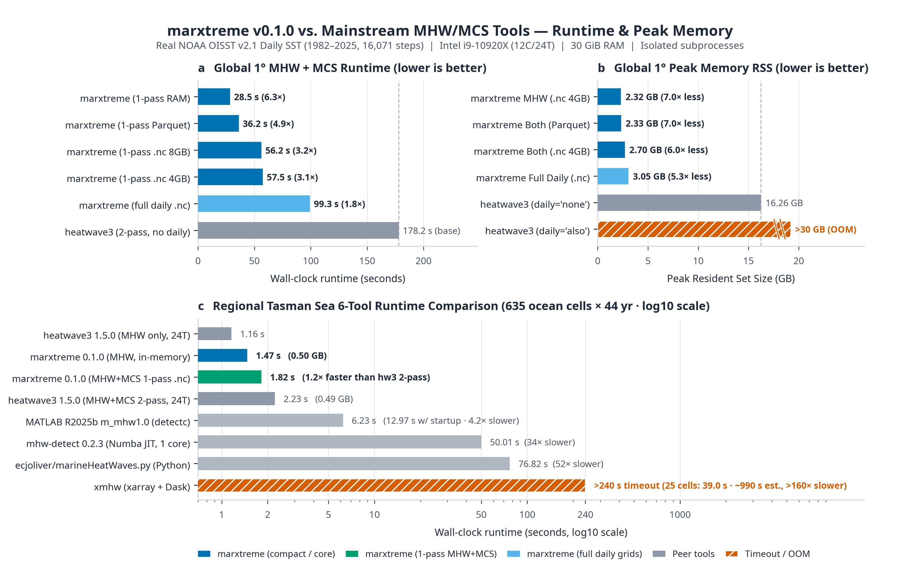

# marxtreme

[](https://github.com/Radianjayjay/marxtreme/actions/workflows/ci.yml)
[](LICENSE)
[](pyproject.toml)
[](Cargo.toml)

**English** | [简体中文](README.zh-CN.md)

**`marxtreme`** (*Marine Extremes*) is a high-performance, Rust-accelerated Python package for detecting **Marine Heatwaves (MHWs)**, **Marine Cold Spells (MCSs)**, and general scalar marine extremes (e.g., high/low salinity) across 1D station records, 3D surface grids (NOAA OISST, OSTIA), 4D depth-resolved ocean reanalyses (GLORYS, ORAS5, Argo), and multi-calendar CMIP6 climate simulations.

> For a visual architecture & benchmark walkthrough, open [docs/marxtreme_overview.html](docs/marxtreme_overview.html) in any browser.

---

## Highlights

- **Rust + Rayon Parallel Core**: Releases the Python GIL (`py.detach()`) and parallelizes across active ocean pixels with a compact `float32` fast path (`working_dtype="auto"`, internal `f64` accumulation) and automatic land-mask skipping.
- **Single-Pass MHW + MCS Detection**: `event="both"` computes climatology and detects upper & lower extremes in one pass at nearly the cost of a single run.
- **Memory-Bounded Out-of-Core Streaming**: Handles multi-file NetCDF/Zarr globs (e.g., yearly `sst.day.mean.*.nc`) in spatial/depth tiles within a configurable `memory_limit`.
- **Self-Contained Multi-Format Output**: Choose `.nc` (streaming NetCDF4), `.mat` (MATLAB v7.3 HDF5 with no 2 GB limit, or MATLAB v5 `detectc` cell), `.zarr` (streaming chunked Zarr store), `.npz`, `.parquet`, `.feather`, or `.csv` simply via the extension of `out=...` — with zero loose sidecar files.
- **CSR-Indexed O(1) Grid Lookup + Columnar Analytics**: Stores events sorted by flattened grid index paired with `int64` CSR `grid_offsets` (embedded inside `.nc`, `.mat`, `.zarr`, `.npz`, `.parquet`), enabling O(1) lazy disk-backed `res.events.sel(...)` / `isel(...)` and zero-scan `count_map()` without an in-memory cell array.
- **Flexible Baselines**: `FixedBaseline` (including external `clim_data`), `DetrendedBaseline` (linear/quadratic OLS detrending *before* climatology and detection), customizable `MovingBaseline` (e.g., centered 11-year or 31-year with `clamp`/`shrink`), `FixedThreshold`, and `ExternalClimatology`.
- **Multi-Calendar & Monthly Support**: Native Gregorian and CMIP6 `cftime` calendars (`standard`, `proleptic_gregorian`, `noleap`/`365_day`, `360_day`, `all_leap`/`366_day`), plus `freq="monthly"` mode (Jacox et al. 2020).
- **Explicit Cross-Tool Compatibility Profiles**: `compat="standard"`, `"m_mhw"`, `"m_mhw_python"`, `"oliver"`, and `"heatwaveR"` make quantile, inequality, leap-day, and variance-`ddof` conventions transparent and reproducible.
- **Physical Safeguards**: Detection-only `max_pad_length`, `min_valid_fraction` sea-ice margin guard (without NaN bleed during circular smoothing), `truncated_start`/`truncated_end` flags, and `lower_bound` (`flag`/`mask`/`floor` + division-by-zero protection).

---

## Installation

### From Source (Rust toolchain required)

```bash
git clone https://github.com/Radianjayjay/marxtreme.git
cd marxtreme

# Install with all optional I/O backends (NetCDF4, HDF5/MAT, Zarr, cftime, Dask)
pip install maturin
maturin develop --release --extras io
```

Optional dependency groups in [pyproject.toml](pyproject.toml):
- `marxtreme[netcdf]` — `netCDF4`, `h5netcdf`, `cftime`, `dask`
- `marxtreme[mat]` — `h5py`, `scipy` (MATLAB v7.3 & v5 `.mat`)
- `marxtreme[zarr]` — `zarr>=3.0`, `cftime`, `dask`
- `marxtreme[io]` — all of the above
- `marxtreme[dev]` — `pytest`, `maturin`

---

## Quick Start

```python
import marxtreme as mx

res = mx.detect(
    "data/OISST_1982_2025_r360x180.nc",
    var="sst",
    squeeze_singleton="zlev",        # drop singleton depth dims (e.g., OISST zlev=1)
    event="both",                    # "high" | "low" | "both" (aliases: "mhw" | "mcs")
    baseline=mx.MovingBaseline(window_years=31, center=True, boundary="clamp"),
    lower_bound=-1.8,
    bound_policy="flag",
    working_dtype="auto",            # auto-uses compact float32 tiles for float32/int16 NetCDF
    intensity_dtype="float32",       # halves intensity_ts RAM and disk size
    memory_limit="8GB",
    out="outputs/oisst_mhw.nc",      # .nc | .mat | .zarr | .npz | .parquet | .feather | .csv
)

# O(1) single-grid lookup (lazy disk-backed on .nc / .mat v7.3 / .zarr / .parquet)
df_point = res.events.sel(lat=-42.5, lon=148.0)

# Instant spatial count map (zero table scan)
counts = res.events.count_map()

# Full columnar DataFrame
df_all = res.events.to_pandas()

# Reopen any saved output directly
res2 = mx.open("outputs/oisst_mhw.nc")

# Export to standalone MATLAB .mat (v5 detectc cell or v7.3 HDF5) or Zarr/NPZ
res.to_mat("outputs/oisst_detectc.mat", layout="detectc")
res.to_mat("outputs/oisst_v73.mat", layout="v73")
res.save("outputs/oisst_mhw.zarr")
```

Run the self-contained demo script with zero external files:

```bash
python examples/quickstart.py
```

---

## Baselines

| Baseline Class | Description |
| --- | --- |
| `FixedBaseline(start, end, clim_data=None, ...)` | Classic Hobday et al. (2016) fixed climatology period; accepts external `clim_data` for cross-scenario detection (e.g., CMIP6 historical baseline applied to SSP projections). |
| `DetrendedBaseline(method="linear" \| "quadratic", start, end, fit_period)` | Fits per-pixel OLS trend (ignoring NaNs), subtracts secular trend while preserving mean level, then computes climatology and detects events. Returns fitted `res.trend` coefficients. |
| `MovingBaseline(window_years=31, center=True, boundary="clamp" \| "shrink")` | Sliding multi-year climatology window (e.g., centered 11-year or 31-year) with deduplicated Rust schedules. |
| `FixedThreshold(threshold_high, threshold_low, climatology=0.0)` | Explicit scalar or gridded physical/ecological thresholds (e.g., coral bleaching or salinity bounds). |
| `ExternalClimatology(seas, thresh_high, thresh_low)` | Reuses precomputed climatologies from `mx.compute_climatology()` or external files (`doy`, `(year, doy)`, or `time`). |

---

## Output Formats

Passing `out="path"` (or calling `res.save("path")`, `res.to_mat("path")`, `res.events.save("path")`) infers the format from the file extension (or explicit `out_format=...`), producing a single self-contained target with no scattered metadata or sidecar files:

| Extension | Contents | Streaming / Lazy Lookup | Direct External Readers |
| --- | --- | --- | --- |
| `.nc` / `.nc4` | Root group: grids + coords + attrs; `/events` group: event table + `grid_offsets` | Streaming + O(1) lazy slice | `xarray.open_dataset`, MATLAB `ncread`, CDO, Panoply |
| `.mat` (`mat_layout="v73"`) | Grids + `events` struct (`Nx1` column vectors) + `grid_offsets` + coords (no 2 GB limit) | Streaming + O(1) lazy slice | MATLAB `load()` & `matfile()`, `h5py` |
| `.mat` (`mat_layout="detectc"`) | `m_mhw1.0`-compatible `MHW{i,j}` cell + `mclim`, `m90`, `m10`, `mhw_ts`, `category_ts` (< 2 GB guard) | Buffered v5 | MATLAB `m_mhw1.0` workflows, `scipy.io.loadmat` |
| `.zarr` | Single Zarr store: root chunked zstd grids + `/events` subgroup + `grid_offsets` | Streaming + O(1) lazy slice | `xarray.open_zarr(..., consolidated=False)`, `zarr` |
| `.npz` | Compressed NumPy archive containing grids, events, `grid_offsets`, and metadata | Buffered | Plain `numpy.load()` (zero extra deps) |
| `.parquet` | Event table only (CSR `grid_offsets` & coords embedded in Parquet footer) | Streaming + O(1) lazy slice | Pandas, Polars, DuckDB, PyArrow, R Arrow |
| `.feather` / `.csv` | Event table only (Feather embeds spatial schema metadata; CSV is plain RFC-4180) | Streaming | Excel, R, Pandas, Polars |

---

## Cross-Tool Compatibility Profiles (`compat=...`)

| Profile | Quantile | Exceedance | Feb 29 Mode | Variance `ddof` | Reference Tool |
| --- | --- | --- | --- | --- | --- |
| `"standard"` (default) | Type-7 | `>` / `<` | `interp_59_61` | `1` | Hobday (2016/2018) with sample std |
| `"m_mhw"` | Type-5 (Hazen) | `>=` / `<=` | `interp_59_61` | `1` | MATLAB `m_mhw1.0` (`detect.m` / `detectc.m`) |
| `"m_mhw_python"` | Type-7 | `>=` / `<=` | `interp_59_61` | `1` | Python port of `m_mhw` |
| `"oliver"` | Type-7 | `>` / `<` | `interp_59_61` | `0` | `ecjoliver/marineHeatWaves.py` |
| `"heatwaveR"` | Type-7 | `>` / `<` | `heatwaver_series` | `1` | R `heatwaveR` |

---

## Benchmarks & Cross-Tool Verification



All accuracy and performance measurements below were run on real **NOAA OISST v2.1** daily SST (`1982–2025`, `16,071` daily steps, `1982–2011` climatology) on Linux (**Intel Core i9-10920X**, 12 cores / 24 threads @ 3.5 GHz, 30 GiB RAM). Each timing run executed in an isolated subprocess on warm OS page cache with wall time (`perf_counter`) and Peak RSS measured via `/usr/bin/time -v`.

Versions tested: `marxtreme 0.1.0` (Rust + Rayon), `heatwave3 1.5.0` (C++ OpenMP, `n_threads=24`), MATLAB R2025b `m_mhw1.0` (`detectc.m`), `mhw-detect 0.2.3` (Numba `0.68.1`), `ecjoliver/marineHeatWaves.py` (with a 2-line NumPy 2 compatibility shim for `np.NaN` and 1-element scalar assignment), and `xmhw` (xarray + Dask).

### 1. Numerical Accuracy & Scientific Parity

Verified on real OISST v2.1 (**Tasman Sea**: `lat 45°S–20°S, lon 145°E–175°E`, `635` ocean cells × `44 yr`, unless noted):

| Reference Tool | `marxtreme` Profile | Scope / Event | Events (`marxtreme` / Ref) | Exact Event Match | Max `\|clim\|` Diff (°C) | Max `\|int_max\|` Diff (°C) |
| --- | --- | --- | --- | --- | --- | --- |
| **MATLAB `m_mhw1.0`** (`detectc.m`) | `compat="m_mhw"` | Tasman 635 cells, MHW | **72,198 / 72,198** | **100.00%** (dates, dur, cat) | `2.13e-14` | `1.78e-14` |
| **MATLAB `m_mhw1.0`** (`detectc.m`) | `compat="m_mhw"` | Tasman 635 cells, MCS | **42,052 / 42,052** | **100.00%** (dates, dur, cat) | `2.13e-14` | `2.13e-14` |
| **`marineHeatWaves.py`** | `compat="oliver"` | Tasman 635 cells, MHW | **72,814 / 72,814** | **100.00%** (dates, dur) | `2.49e-14` | `2.13e-14` (`1.42e-14` rates) |
| **`marineHeatWaves.py`** | `compat="oliver"` | 1D (`42°S, 150°E`), MHW & MCS | **103/103** & **71/71** | **100.00%** (all metrics) | `1.07e-14` | `7.11e-15` (`4.11e-15` rates) |
| **`mhw-detect 0.2.3`** (Numba) | `compat="oliver"` | Tasman 635 cells, MHW | **72,814 / 72,814** | **100.00%** (dates, dur) | — | `2.38e-7` *(peer `f32` kernel)* |
| **`heatwave3 1.5.0`** (`roundClm=False`) | `compat="heatwaveR"` | Tasman 635 cells, MHW | **72,826 / 72,822** | **99.82%** (median diff `0.0`) | `4.57e-3` *(290/366 DOYs `0.0`)* | median `0.0` (max `4.57e-3`) |
| **`heatwave3 1.5.0`** (`roundClm=False`) | `compat="heatwaveR"` | Tasman 635 cells, MCS | **42,439 / 42,445** | **99.87%** (median diff `0.0`) | `4.57e-3` *(290/366 DOYs `0.0`)* | median `0.0` (max `4.57e-3`) |
| **`xmhw`** (xarray + Dask) | `compat="oliver"` | Tasman 5×5 (25 cells), MHW | **2,946 / 2,946** | **98.64%** (median diff `1e-14`) | `8.31e-3` *(300/366 DOYs `0.0`)* | median `1.07e-14` (max `8.31e-3`) |
| **`marxtreme` `f32` vs `f64`** (`auto`) | `compat="standard"` | Tasman 635 cells, MHW + MCS | **115,243 / 115,243** | **100.00%** (bit-exact) | **`0.0`** | **`0.0`** |

> **Why `heatwave3` and `xmhw` show `0.0` across 290–300 DOYs and `≤ 0.008 °C` elsewhere:** Both wrap `1982-01-01` directly to `2011-12-31` in a strict `366 × n_years` matrix (omitting adjacent `2012-01-01..05` buffer days) and interpolate non-leap Feb 29 *before* taking the `±5`-day window; the 31-day smoother propagates those edge differences strictly within `±15` days of Jan 1 / Dec 31 and Feb 29.
> **Zero precision loss on the `float32` fast path:** Because OISST is stored as `float32` and `marxtreme`'s Rust core promotes each tile value to `f64` for accumulation, `working_dtype="auto"` (`float32` tiles) reproduces `working_dtype="float64"` with **exact `0.0` difference** across all 115,243 Tasman MHW+MCS events while halving tile RAM.

### 2. Global 1° NOAA OISST v2.1 Speed & Peak Memory (`42,602` ocean cells × `44 yr`)

Input: 7.9 GiB NetCDF4 (`16,071 × 1 × 181 × 360`, 4.0 GB `float32` `sst`), yielding **4.38M MHW** and **3.17M MCS** events (**7.55M** total).

| Task | Tool & Configuration | Runtime | Peak RSS | vs. `heatwave3` |
| --- | --- | --- | --- | --- |
| **Global MHW** (events + clim) | **`marxtreme`** (in-memory, `memory_limit="8GB"`) | **27.4 s** | **4.01 GB** | **3.2× faster · 4.1× less RAM** |
| **Global MHW** (events + clim) | **`marxtreme`** (streaming `.nc`, `8GB`, `complevel=4`) | **45.0 s** | **3.83 GB** | **2.0× faster · 4.2× less RAM** |
| **Global MHW** (events + clim) | **`marxtreme`** (streaming `.nc`, `4GB`, `complevel=4`) | **48.1 s** | **2.32 GB** | **1.9× faster · 7.0× less RAM** |
| **Global MHW** (events + clim) | `heatwave3 1.5.0` (`daily="none"`, `compression=1`, 24T) | 89.0 s | 16.26 GB | 1.0× baseline |
| **Global MHW + daily grids** | **`marxtreme`** (full `intensity_ts` + `category_ts` `.nc`, `4GB`) | **88.8 s** | **2.79 GB** | **Still faster than `hw3` w/o daily** |
| **Global MHW + daily grids** | `heatwave3 1.5.0` (`daily="also"`, 24T) | OOM (>30 GiB) | >30 GB | Exhausted 30 GiB host RAM |
| **Global MHW + MCS** (events + clim) | **`marxtreme`** (1 pass, in-memory, `8GB`) | **28.5 s** | **4.72 GB** | **6.3× faster · 3.4× less RAM** |
| **Global MHW + MCS** (events + CSR) | **`marxtreme`** (1 pass, streaming `.parquet`, `4GB`) | **36.2 s** | **2.33 GB** | **4.9× faster · 7.0× less RAM** |
| **Global MHW + MCS** (events + clim) | **`marxtreme`** (1 pass, streaming `.nc`, `8GB`, `complevel=4`) | **56.2 s** | **4.40 GB** | **3.2× faster · 3.7× less RAM** |
| **Global MHW + MCS** (events + clim) | **`marxtreme`** (1 pass, streaming `.nc`, `4GB`, `complevel=4`) | **57.5 s** | **2.70 GB** | **3.1× faster · 6.0× less RAM** |
| **Global MHW + MCS + daily grids** | **`marxtreme`** (1 pass, full daily `.nc`, `4GB`) | **99.3 s** | **3.05 GB** | **1.8× faster than `hw3` w/o daily** |
| **Global MHW + MCS** (events + clim) | `heatwave3 1.5.0` (2 passes: MHW `89.0 s` + MCS `89.2 s`, 24T) | 178.2 s | 16.26 GB | 1.0× baseline |
| **Global Detrended MHW + MCS** | **`marxtreme`** (`DetrendedBaseline("linear")`, 1 pass `.nc`, `8GB`) | **57.3 s** | **3.48 GB** | Fused OLS + clim (+1.1 s vs Fixed) |
| **Global 31-yr Moving MHW + MCS** | **`marxtreme`** (`MovingBaseline(31)`, 1 pass `.nc`, `8GB`) | **145.9 s** | **3.74 GB** | Not supported by peers |

> On `benchmarks/bench_global_scale.py` (`7,500` active ocean cells × `40 yr`, in-memory MHW+MCS), `marxtreme` finishes `FixedBaseline` in **2.31 s** (extrapolating to **~3.6 min** for 0.25° global OISST's ~700k ocean pixels), `DetrendedBaseline("linear")` in **2.65 s**, and 31-year `MovingBaseline` in **14.70 s**.

### 3. Regional Tasman Sea Speed & Peak Memory (`635` ocean cells × `44 yr`)

Clean 3D NetCDF (`16,071 × 26 × 31`, 635 ocean cells), `1982–2011` climatology:

| Tool | Task | Runtime | Peak RSS | Speedup (`marxtreme` MHW) |
| --- | --- | --- | --- | --- |
| **`marxtreme 0.1.0`** (Rust + Rayon) | MHW (in-memory) | **1.47 s** | **0.50 GB** | **1.0×** |
| **`marxtreme 0.1.0`** (Rust + Rayon) | MHW (streaming `.nc`, events + clim) | **1.70 s** | **0.50 GB** | — |
| **`marxtreme 0.1.0`** (Rust + Rayon) | MHW + MCS (1 pass, `.nc`, events + clim) | **1.82 s** | **0.51 GB** | **1.2× faster than `hw3` MHW+MCS** |
| `heatwave3 1.5.0` (C++ OpenMP, 24T) | MHW / MHW + MCS (2 passes, `daily="none"`) | 1.16 s / 2.23 s | 0.47 / 0.49 GB | 0.8× (MHW) / 1.2× slower (MHW+MCS) |
| MATLAB R2025b `m_mhw1.0` (`detectc.m`) | MHW (compute / w/ MATLAB startup) | 6.23 s (12.97 s wall) | 1.84 GB | **4.2×** (8.8× wall) |
| `mhw-detect 0.2.3` (Numba JIT, 1 core) | MHW (steady-state JIT / w/ warmup) | 50.01 s (51.99 s) | 0.57 GB | **34×** |
| `ecjoliver/marineHeatWaves.py` (Python) | MHW (635-cell loop) | 76.82 s | 0.53 GB | **52×** |
| `xmhw` (xarray + Dask) | MHW (25 cells / full 635 cells) | 39.04 s / >240 s timeout | 0.68 GB+ | **>160×** (~990 s extrapolated) |

### 4. Feature & Capability Comparison

| Capability | `marxtreme` | `heatwave3` | `m_mhw1.0` | `heatwaveR` | `marineHeatWaves` | `xmhw` | `mhw-detect` |
| --- | :---: | :---: | :---: | :---: | :---: | :---: | :---: |
| Core Engine | **Rust + Rayon** | C++ + OpenMP | MATLAB | R + Rcpp | Python | xarray + Dask | Python + Numba |
| Single-Pass MHW + MCS | **Yes** | No (2 passes) | No (2 passes) | No (2 passes) | No (2 passes) | No (2 passes) | No |
| Memory-Bounded Streaming | **Yes (`memory_limit`)** | Partial (~16 GB global) | No (in-RAM) | No (1D) | No (1D) | Dask (slow) | Manual `mhw-cut` |
| 1D / 3D / 4D Depth Grids | **Yes (1D–4D)** | Yes (3D–4D) | 3D only | 1D only | 1D only | 3D | 3D |
| Moving & Detrended Baselines | **Fixed / Linear / Quad / Moving / Ext** | Fixed / Linear | Fixed / Ext | Fixed | Fixed / Ext | Fixed | Fixed / Ext |
| CMIP6 Calendars & Monthly Mode | **Yes (`cftime` + monthly)** | Gregorian | Gregorian | Gregorian | `Ly` approx | Partial | Gregorian |
| Multi-Format Single-File I/O | **`.nc/.mat/.zarr/.npz/.parquet/.csv`** | `.nc` / `.zarr` (multi-file) | `.mat` | R data.frame | Python dict | xarray | `.parquet/.csv` |
| O(1) Grid Lookup (`CSR` Index) | **Yes (lazy disk-backed)** | No | Cell array (RAM) | No | No | No | No |
| Explicit Cross-Tool `compat` | **5 profiles** | Fixed (`heatwaveR`) | 2 (`matlab`/`python`) | Fixed | Fixed | Fixed | Fixed |

---

## Project Structure

```text
marxtreme/
├── Cargo.toml                        # Rust crate config (PyO3 0.30, rust-numpy 0.30, Rayon 1.12)
├── pyproject.toml                    # Python packaging & maturin build config
├── LICENSE                           # MIT License
├── README.md                         # English documentation (default)
├── README.zh-CN.md                   # Simplified Chinese documentation
├── src/                              # Rust parallel core
│   ├── lib.rs                        # Compiled stateful PyO3 plans (FixedPlan, MovingPlan, CurvesPlan) & unified f64/f32 dispatch
│   ├── compat.rs                     # Compatibility enums & kernel options
│   ├── quantile.rs                   # Type-7 & Type-5 (Hazen) quantiles
│   ├── baseline.rs                   # OLS detrending, WindowPlan, MovingSchedule, circular smoothing
│   └── detect.rs                     # Padding, threshold scan, transitive gap merge, metrics & categories
├── python/marxtreme/                 # Python orchestration & persistence modules
│   ├── __init__.py                   # Public exports (detect, compute_climatology, open, baselines)
│   ├── api.py                        # Public entry points (detect, compute_climatology)
│   ├── baselines.py                  # Baseline specifications & polymorphic PreparedBaseline adapters
│   ├── calendar.py                   # Unified Gregorian/cftime encoding, period slicing & date/CF-time codecs
│   ├── catalog.py                    # Canonical EventSchema, EventStore seam & CSR grid-indexed EventCatalog
│   ├── compat.py                     # Cross-tool compatibility presets
│   ├── io_formats.py                 # OutputSpec, ResultSink seam & 8 cohesive single-file format adapters
│   ├── result.py                     # DetectResult container (save, to_mat, open, to_dataset)
│   └── streaming.py                  # Multi-file glob reader, singleton squeeze & memory tiling
├── tests/                            # Unit, parity, adversarial, streaming & MATLAB R2025b tests
├── examples/quickstart.py            # Self-contained runnable quickstart
├── benchmarks/bench_global_scale.py  # Synthetic global-scale throughput benchmark
├── docs/
│   ├── figures/                      # Publication-grade bilingual README benchmark charts
│   └── marxtreme_overview.html       # Interactive illustrated HTML overview
└── .github/workflows/ci.yml          # Multi-Python CI & cross-platform wheel builds
```

---

## Scope & Non-Goals

`marxtreme` focuses on fast, transparent, point-wise 1D–4D extreme event detection and self-contained persistence. It intentionally does **not** perform 3D/4D spatial connected-component object tracking, vertical ocean heat content integration, or automated vertical subtype classification.

---

## Development & Testing

```bash
# Rust unit tests
cargo test --lib

# Build release extension + install optional dependencies
maturin develop --release --extras io,dev

# Full Python test suite (includes MATLAB R2025b verification when installed)
pytest -v

# Synthetic scale benchmark
python benchmarks/bench_global_scale.py
```

---

## Issues

Small numerical differences between MHW/MCS tools (MATLAB `m_mhw1.0`, Python `marineHeatWaves` / `xmhw`, R `heatwaveR`, C++ `heatwave3`) stem from distinct conventions for quantile interpolation (Type-5 Hazen vs. Type-7), threshold inequality (`>=` vs. `>`), February 29 handling, intensity variance degrees of freedom (`ddof=0` vs. `ddof=1`), and year-boundary window wrapping. To reproduce a specific reference tool, pass `compat="m_mhw"`, `"oliver"`, `"heatwaveR"`, or `"standard"` (see [Cross-Tool Compatibility Profiles](#cross-tool-compatibility-profiles-compat) and [Numerical Accuracy & Scientific Parity](#1-numerical-accuracy--scientific-parity)).

Found a bug, calendar edge case, or I/O compatibility issue? Please report it on [GitHub Issues](https://github.com/Radianjayjay/marxtreme/issues) with your `marxtreme` version, Python/OS environment, and a minimal reproducible example.

---

## Contributing to `marxtreme`

Contributions — including bug fixes, calendar/I/O adapters, parity tests, and documentation improvements — are warmly welcome:

1. Fork the repository and create a feature or bug-fix branch from `main`.
2. Verify both the Rust core and Python suite locally before opening a pull request:
   ```bash
   cargo test --lib
   maturin develop --release --extras io,dev
   pytest -v
   ```
3. Include unit or regression tests under `tests/` for any behavioral change or bug fix.
4. Open a Pull Request or start a discussion on [GitHub Issues](https://github.com/Radianjayjay/marxtreme/issues).

---

## Citation

If you use `marxtreme` in academic research or operational workflows, please cite this software alongside the underlying methodological papers (e.g., Hobday et al., 2016; Hobday et al., 2018; Schlegel et al., 2021):

```bibtex
@software{marxtreme,
  author  = {Radianjayjay and marxtreme contributors},
  title   = {marxtreme: Rust-Accelerated Marine Heatwave, Cold Spell, and Marine Extreme Detection},
  version = {0.1.0},
  year    = {2026},
  url     = {https://github.com/Radianjayjay/marxtreme}
}
```

---

## References

- Hobday, A. J., Alexander, L. V., Perkins, S. E., Smale, D. A., Straub, S. C., Oliver, E. C. J., Benthuysen, J. A., Burrows, M. T., Donat, M. G., Feng, M., Holbrook, N. J., Moore, P. J., Scannell, H. A., Sen Gupta, A., & Wernberg, T. (2016). A hierarchical approach to defining marine heatwaves. *Progress in Oceanography*, 141, 227–238.
- Schlegel, R. W., Oliver, E. C. J., Wernberg, T., & Smit, A. J. (2017). Nearshore and offshore co-occurrences of marine heatwaves and cold-spells. *Progress in Oceanography*, 151, 189–205.
- Hobday, A. J., Oliver, E. C. J., Sen Gupta, A., Benthuysen, J. A., Burrows, M. T., Donat, M. G., Holbrook, N. J., Moore, P. J., Thomsen, M. S., Wernberg, T., & Smale, D. A. (2018). Categorizing and naming marine heatwaves. *Oceanography*, 31(2), 162–173.
- Schlegel, R. W., & Smit, A. J. (2018). heatwaveR: A central algorithm for the detection of heatwaves and cold-spells. *Journal of Open Source Software*, 3(27), 821.
- Oliver, E. C. J., Lago, V., Hobday, A. J., Holbrook, N. J., Ling, S. D., & Mundy, C. N. (2018). Marine heatwaves off eastern Tasmania: Trends, interannual variability, and predictability. *Progress in Oceanography*, 161, 116–130.
- Zhao, Z., & Marin, M. (2019). A MATLAB toolbox to detect and analyze marine heatwaves. *Journal of Open Source Software*, 4(33), 1124.
- Jacox, M. G., Alexander, M. A., Bograd, S. J., & Scott, J. D. (2020). Thermal displacement by marine heatwaves. *Nature*, 584, 82–86.
- Schlegel, R. W., Darmaraki, S., Benthuysen, J. A., Filbee-Dexter, K., & Oliver, E. C. J. (2021). Marine cold-spells. *Progress in Oceanography*, 198, 102684.
- Reynolds, R. W., Smith, T. M., Liu, C., Chelton, D. B., Casey, K. S., & Schlax, M. G. (2007). Daily high-resolution-blended analyses for sea surface temperature. *Journal of Climate*, 20(22), 5473–5496.

## License

MIT License — see [LICENSE](LICENSE).
