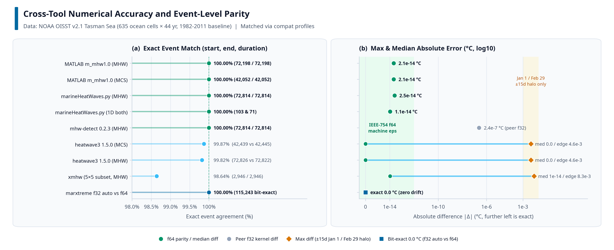

# marine-extremes

[](https://github.com/Radianjayjay/marine-extremes/actions/workflows/ci.yml)
[](https://pypi.org/project/marine-extremes/)
[](https://doi.org/10.5281/zenodo.24579203)
[](https://github.com/Radianjayjay/marine-extremes/blob/main/LICENSE)
[](https://github.com/Radianjayjay/marine-extremes/blob/main/pyproject.toml)
[](https://github.com/Radianjayjay/marine-extremes/blob/main/Cargo.toml)

**English** | [简体中文](https://github.com/Radianjayjay/marine-extremes/blob/main/README.zh-CN.md)

`marine-extremes` is a Rust-accelerated Python package for detecting upper-tail (`"high"`) and lower-tail (`"low"`) extremes across 1D to 4D scalar ocean variables. For seawater temperature, these correspond to marine heatwaves (MHWs, alias `"mhw"`) and marine cold spells (MCSs, alias `"mcs"`); the same engine works on salinity, ocean acidity (pH), dissolved oxygen (hypoxia and deoxygenation), carbon dioxide (`pCO2` / `CO2`), and chlorophyll across 1D station records, 3D surface grids (NOAA OISST, OSTIA), 4D depth-resolved reanalyses (GLORYS, ORAS5, Argo), and multi-calendar CMIP6 simulations.

See [docs/marine_extremes_overview.html](https://github.com/Radianjayjay/marine-extremes/blob/main/docs/marine_extremes_overview.html) for an interactive architecture walkthrough.

## What it does

- Parallel Rust core with Rayon. Releases the Python GIL (`py.detach()`), skips land pixels, and uses a `float32` tile fast path (`working_dtype="auto"`) with internal `f64` accumulation so memory drops by half without precision loss.
- Single-pass MHW and MCS detection. Setting `event="both"` computes the climatology once and detects upper and lower events together.
- Memory-bounded out-of-core streaming. Reads multi-file NetCDF or Zarr globs (for example `sst.day.mean.*.nc`) in spatial or depth tiles under a chosen `memory_limit`, or switches to single-pass pre-read when the raw array fits inside 45% of `memory_limit`.
- Single-target output across seven formats. Passing `out=...` writes one standalone `.nc`, `.mat` (v7.3 HDF5 without the 2 GB cap, or v5 `detectc` cell layout), `.zarr`, `.npz`, `.parquet`, `.feather`, or `.csv` target with no sidecar files.
- CSR-indexed grid lookup and columnar analytics. Events are stored sorted by flattened grid index alongside `int64` CSR `grid_offsets` inside `.nc`, `.mat`, `.zarr`, `.npz`, and `.parquet`, giving O(1) lazy disk-backed `res.events.sel(...)` / `isel(...)` and zero-scan `count_map()`.
- Five baseline definitions. Supports `FixedBaseline` (including external `clim_data`), `DetrendedBaseline` (linear or quadratic OLS detrending), `MovingBaseline` (sliding multi-year window with `clamp` or `shrink` boundaries), `FixedThreshold`, and `ExternalClimatology`.
- Multi-calendar and monthly support. Handles Gregorian and CMIP6 `cftime` calendars (`standard`, `proleptic_gregorian`, `noleap`/`365_day`, `360_day`, `all_leap`/`366_day`) as well as `freq="monthly"` detection (Jacox et al., 2020).
- Explicit cross-tool compatibility profiles. Choose `compat="standard"`, `"m_mhw"`, `"m_mhw_python"`, `"oliver"`, or `"heatwaveR"` to match the quantile rule, threshold inequality, Feb 29 handling, and variance `ddof` of a reference tool.
- Edge and sea-ice safeguards. Includes detection-only `max_pad_length`, `min_valid_fraction` filtering (without NaN bleed during circular smoothing), `truncated_start`/`truncated_end` flags, and `lower_bound` handling (`flag`, `mask`, or `floor` with zero-division protection).
- CF-aware input resolution. Built-in CF metadata resolver (with optional `cf-xarray` support) infers non-`time` dimensions (`valid_time`, `time_counter`, `ocean_time`), skips `*_bnds`/`grid_mapping`/`ancillary_variables`, matches `standard_name` and marine aliases, and warns on Kelvin vs. Celsius `lower_bound` mismatches.
- AI agent skill and MCP server. Ships an Agent Skill ([skills/marine-extremes/SKILL.md](https://github.com/Radianjayjay/marine-extremes/blob/main/skills/marine-extremes/SKILL.md)) and an optional local stdio MCP server (`marine-extremes-mcp`) with four tools: `inspect_dataset`, `detect_extremes`, `query_events`, and `summarize_result`.

## Installation

Install prebuilt wheels from PyPI (no Rust toolchain required on Linux, macOS, or Windows):

```bash
# Core package (NumPy, Pandas, PyArrow, Xarray)
pip install marine-extremes

# Recommended: include all I/O backends (NetCDF4, HDF5/MAT, Zarr, cftime, Dask, cf-xarray)
pip install "marine-extremes[io]"
```

On older HPC Linux hosts (`glibc < 2.28`, such as CentOS 7), `pyarrow>=21` has no `manylinux2014` wheel and falls back to a slow Arrow C++ source build. Pin `pyarrow<21` with binary wheels only:

```bash
pip install --only-binary=:all: "pyarrow<21" "marine-extremes[io]"
```

Optional dependency groups in [pyproject.toml](https://github.com/Radianjayjay/marine-extremes/blob/main/pyproject.toml):

- `marine-extremes[netcdf]`: `netCDF4`, `h5netcdf`, `cftime`, `dask`
- `marine-extremes[mat]`: `h5py`, `scipy` (MATLAB v7.3 and v5 `.mat`)
- `marine-extremes[zarr]`: `zarr>=3.0`, `cftime`, `dask`
- `marine-extremes[cf]`: `cf-xarray` (optional CF accessor and custom criteria support)
- `marine-extremes[mcp]`: `mcp` (optional stdio MCP server `marine-extremes-mcp` for AI clients)
- `marine-extremes[io]`: all I/O backends (`netcdf`, `mat`, `zarr`, `cf`; excludes `mcp`)
- `marine-extremes[dev]`: `pytest`, `maturin`

To build from source instead (requires a Rust toolchain):

```bash
git clone https://github.com/Radianjayjay/marine-extremes.git
cd marine-extremes
pip install maturin
maturin develop --release --extras io,mcp   # omit ,mcp if you do not need the MCP server
```

## Quick start

```python
import marine_extremes as mx

res = mx.detect(
    "data/OISST_1982_2025_r360x180.nc",
    var="sst",
    squeeze_singleton="zlev",        # drop singleton depth dims (e.g., OISST zlev=1)
    event="both",                    # "high" | "low" | "both" (aliases: "mhw" | "mcs")
    baseline=mx.MovingBaseline(window_years=31, center=True, boundary="clamp"),
    lower_bound=-1.8,
    bound_policy="flag",
    working_dtype="auto",            # auto-uses compact float32 tiles for float32/int16 NetCDF
    clim_dtype="float32",            # halves 4D MovingBaseline clim/thresh RAM, disk size & write time
    intensity_dtype="float32",       # halves intensity_ts / intensity_high_ts / intensity_low_ts RAM and disk size
    memory_limit="8GB",              # use "10GB" on ~4 GB global 1° inputs for single-pass pre-read
    out="outputs/oisst_mhw.nc",      # .nc | .mat | .zarr | .npz | .parquet | .feather | .csv
)

# Separate high/low intensity grids sit in res.intensity_high_ts and res.intensity_low_ts
# O(1) single-grid lookup (lazy disk-backed on .nc / .mat v7.3 / .zarr / .parquet)
df_point = res.events.sel(lat=-42.5, lon=148.0)

# Spatial event count map from CSR offsets (no table scan)
counts = res.events.count_map()

# Bounded-chunk run summary (safe on multi-million-row catalogs)
stats = res.summary()

# Full columnar DataFrame (small/medium catalogs)
df_all = res.events.to_pandas()

# Reopen any saved output directly
res2 = mx.open("outputs/oisst_mhw.nc")

# Export to standalone MATLAB .mat (v5 detectc cell or v7.3 HDF5) or Zarr
res.to_mat("outputs/oisst_detectc.mat", layout="detectc")
res.to_mat("outputs/oisst_v73.mat", layout="v73")
res.save("outputs/oisst_mhw.zarr")
```

To run the standalone demo without external data:

```bash
python examples/quickstart.py
```

## Use with AI agents (Skill and MCP)

### Agent Skill (recommended for coding agents)

For coding agents that can run local Python (Claude Code, Codex, Cursor, Antigravity, Windsurf, OpenCode), install `marine-extremes[io]` and put [skills/marine-extremes/SKILL.md](https://github.com/Radianjayjay/marine-extremes/blob/main/skills/marine-extremes/SKILL.md) into your agent's skills directory:

```bash
# From a local clone (keep whichever path matches your agent)
mkdir -p ~/.claude/skills/marine-extremes ~/.codex/skills/marine-extremes
cp skills/marine-extremes/SKILL.md ~/.claude/skills/marine-extremes/SKILL.md
cp skills/marine-extremes/SKILL.md ~/.codex/skills/marine-extremes/SKILL.md

# Or download directly if you installed from PyPI without cloning
curl -fsSL https://raw.githubusercontent.com/Radianjayjay/marine-extremes/main/skills/marine-extremes/SKILL.md \
  -o ~/.claude/skills/marine-extremes/SKILL.md
```

Once installed, talk to your agent in plain language without memorizing parameter names:

> "Use `marine-extremes` to detect MHWs and MCSs from my SST file (or yearly NetCDF folder) at `data/sst_*.nc`, and save the output as `.nc` (or `.zarr` / `.mat` / `.npz`) under `outputs/`."

You do not need to mention `var`, `squeeze_singleton`, `lower_bound`, or `memory_limit` in your prompt. The skill inspects dataset headers and host hardware in one quick pass (without running slow trial detections first), then offers concise choices for climatology baseline, `compat` preset, physical bounds, precision, output format, and compute target (local background run, SSH compute node, or PBS/Slurm Rayon job or spatial-shard array). For long gridded runs, it writes a standalone script, launches it non-blocking, checks startup, and asks whether to set up periodic progress check-ins; if you already specified all choices or asked for defaults, it runs immediately.

If you have not installed the skill file yet, you can still send a short plain-language request and point the agent to the package:

> "Use the Python package `marine-extremes` (`import marine_extremes as mx`) to detect MHWs and MCSs on `data/sst_*.nc` and save the result to `outputs/`. Inspect the file's variables, units, and time range first, then ask me which baseline, compatibility preset, and output format to use before running."

### Optional stdio MCP server (for desktop/chat AI clients)

If your AI client cannot run local Python scripts directly (for example Claude Desktop or Cherry Studio), install the optional MCP extra (compatible with MCP Python SDK v1 and v2):

```bash
pip install "marine-extremes[io,mcp]"
```

Add the local stdio server to your MCP client config:

```json
{
  "mcpServers": {
    "marine-extremes": {
      "command": "marine-extremes-mcp"
    }
  }
}
```

If a desktop client does not inherit your Conda/virtualenv `PATH`, point directly to that environment's Python interpreter instead:

```json
{
  "mcpServers": {
    "marine-extremes": {
      "command": "/path/to/your/env/bin/python",
      "args": ["-m", "marine_extremes.mcp_server"]
    }
  }
}
```

| MCP tool | Purpose |
| --- | --- |
| `inspect_dataset` | Inspect variables, dims, 1D coordinate ranges (flagging curvilinear grids), CF calendar, singleton dims, and Kelvin vs. Celsius notes before running detection. |
| `detect_extremes` | Run streamed detection across fixed, detrended, moving, or fixed-threshold baselines (`region` slicing, `clim_dtype`, split `intensity_high_ts` / `intensity_low_ts`) into one `out` file. Returns metadata, warnings, and up to 50 sample rows while refusing to overwrite inputs or non-Zarr dirs. |
| `query_events` | Look up one grid cell in O(1) via CSR `coords` or `indices`, or filter in chunks (type, duration, category, `YYYY` / `YYYY-MM` / `YYYY-MM-DD` dates) with top-k sorting (up to 500 rows) or `limit=0` counts. |
| `summarize_result` | Aggregate pixel coverage, counts by type, category, and start year, duration stats, and peak absolute intensity in bounded chunks without loading the full table. |

`detect_extremes` writes gridded fields to `out` and returns compact metadata and sample rows, keeping large arrays out of model context. For multi-decade high-resolution global runs (such as 0.25° OISST or OSTIA), run a Python script via the Skill instead of MCP to avoid client timeouts.

## Benchmarks and verification




Measured on NOAA OISST v2.1 daily SST (1982-2025, 16,071 daily steps, 42,602 active ocean cells, 1982-2011 baseline) on Linux (Intel Core i9-10920X, 12C/24T @ 3.5 GHz, 30 GiB RAM) using isolated subprocesses (`perf_counter` wall time and `/usr/bin/time -v` peak RSS). Peer versions: `heatwave3 1.5.0` (24 threads, `roundClm=False`), MATLAB R2025b `m_mhw1.0` (`detectc.m`), `mhw-detect 0.2.3` (Numba `0.68.1`), `ecjoliver/marineHeatWaves.py` (patched for NumPy 2), and `xmhw`.

With `heatwave3` and `xmhw`, 290-300 days of the year agree to `0.0 °C`. The `<= 0.008 °C` differences sit inside the `±15`-day smoothing halo around Jan 1 and Feb 29 because both wrap `1982-01-01` directly to `2011-12-31` in a `366 x n_years` matrix and interpolate non-leap Feb 29 before taking the `±5`-day window.

### v0.1.2 vs. v0.1.0 summary

| Workload (OISST 1982-2025, `16071 x 181 x 360`) | `v0.1.0` | `v0.1.2` | Notes |
| --- | --- | --- | --- |
| Global 1° MHW `.nc` (`8GB` / `4GB` / `10GB`) | `45.0 s (3.83 GB)` / `48.1 s (2.32 GB)` | `42.5 s (2.72 GB)` / `44.9 s (1.72 GB)` / **`36.8 s`** | `10GB` triggers single-pass pre-read (-18% vs `0.1.0`) |
| Global 1° MHW+MCS 1-pass `.nc` (`8GB` / `4GB` / `10GB`) | `56.2 s (4.40 GB)` / `57.5 s (2.70 GB)` | `54.8 s (3.06 GB)` / `56.2 s (1.96 GB)` / **`46.2 s`** | 26-30% lower streaming Peak RSS (`7,554,466` events) |
| Global 1° MHW+MCS (`RAM 8GB` / `Parquet 4GB`) | `28.5 s (4.72 GB)` / `36.2 s (2.33 GB)` | `29.2 s (3.76 GB)` / `39.0 s (1.69 GB)` | 20-27% lower Peak RSS (`both_pq`: `808 MB`) |
| Global 1° Full Daily MHW `.nc` (`4GB`, `float32`) | `88.8 s (2.79 GB, 1 int. grid)` | **`83.8 s (2.31 GB)`** (`1.19 GB` file) | Faster despite 2 intensity grids + CF attrs |
| Global 1° Full Daily MHW+MCS (`4GB` / `10GB clim32`) | `99.3 s (3.05 GB, 1 int. grid)` | `141.1 s (2.45 GB)` / **`118.8 s`** (`1.77 GB`) | Writes 3 intensity grids (`ts`, `high_ts`, `low_ts`) |
| Global 1° Detrended linear `.nc` (`8GB` / `10GB`) | `57.3 s (3.48 GB)` | `57.6 s (2.61 GB)` / **`47.8 s`** (`901 MB`) | `10GB` pre-read cuts runtime by 17% |
| Global 1° MovingBaseline 31-yr (`.nc`, `8GB` / `10GB`) | `145.9 s (3.74 GB)` | `143.2 s (2.43 GB)` / **`133.5 s`** (`607 MB`) | 35% lower streaming RSS |
| Global 1° MovingBaseline 11-yr 4D `clim32` + Daily (`10GB`) | N/A | **`213.4 s`** (`.zarr`) / `234.3 s` (`.nc`) | `1993-2025` full 4D `clim` + 3 split daily grids |
| Regional Tasman Sea (`635 cells`, MHW `.nc` / Both `.nc`) | `1.70 s` / `1.82 s` | **`1.57 s (0.42 GB)`** / **`1.72 s (0.43 GB)`** | `f32` vs `f64` bit-exact `115,243 / 115,243` (`0.0 °C`) |
| Synthetic `bench_global_scale.py` (`7,500 cells x 40 yr`) | `2.31 s` / `2.65 s` / `14.70 s` | `2.34 s` / `2.70 s` / `14.70 s` | Fixed / Linear Detrend / 31-yr Moving |

### Feature comparison

| Capability | `marine-extremes` | `heatwave3` | `m_mhw1.0` | `heatwaveR` | `marineHeatWaves` | `xmhw` | `mhw-detect` |
| --- | :---: | :---: | :---: | :---: | :---: | :---: | :---: |
| Core engine | Rust + Rayon | C++ + OpenMP | MATLAB | R + Rcpp | Python | xarray + Dask | Python + Numba |
| Single-pass MHW + MCS | Yes | No (2 passes) | No (2 passes) | No (2 passes) | No (2 passes) | No (2 passes) | No |
| Memory-bounded streaming | Yes (`memory_limit`) | Partial (~16 GB global) | No (in-RAM) | No (1D) | No (1D) | Dask (slow) | Manual `mhw-cut` |
| Grid dimensions | 1D-4D | 3D-4D | 3D | 1D | 1D | 3D | 3D |
| Baselines | Fixed / Linear / Quad / Moving / Ext | Fixed / Linear | Fixed / Ext | Fixed | Fixed / Ext | Fixed | Fixed / Ext |
| CMIP6 calendars & monthly | Yes (`cftime` + monthly) | Gregorian | Gregorian | Gregorian | `Ly` approx | Partial | Gregorian |
| Single-target output | `.nc/.mat/.zarr/.npz/.parquet/.csv` | `.nc/.zarr` (multi-file) | `.mat` | R data.frame | Python dict | xarray | `.parquet/.csv` |
| O(1) grid lookup (CSR) | Yes (lazy disk-backed) | No | Cell array (RAM) | No | No | No | No |
| Cross-tool `compat` profiles | 5 profiles | Fixed (`heatwaveR`) | 2 (`matlab`/`python`) | Fixed | Fixed | Fixed | Fixed |

## Supported inputs

`mx.detect(data, ...)` and `mx.compute_climatology(data, ...)` accept seven input forms and normalize them into a labeled array with one time axis and zero or more spatial or depth axes:

| Input form | Example | How it is opened |
| --- | --- | --- |
| Single NetCDF file (`.nc`, `.nc4`, `.cdf`) | `"data/OISST_1982_2025.nc"` | Opened lazily with `xr.open_dataset`; reads CF metadata, packed `int16`/`float32` scaling, and `cftime` calendars without loading all tiles into memory. |
| Multi-file glob or sequence of paths | `"data/sst.*.nc"` or `["2020.nc", "2021.nc"]` | Opened lazily along coordinates via `xr.open_mfdataset(..., combine="by_coords")`. |
| Zarr store or Zarr glob/list | `"data/oisst.zarr"` | Opened lazily with `xr.open_zarr(..., consolidated=False)` (or `open_mfdataset` with `engine="zarr"`). |
| `xarray.DataArray` | `ds["sst"]` | Uses the array directly (in-memory NumPy or Dask-backed chunks) with existing dimension names and attributes. |
| `xarray.Dataset` | `xr.open_dataset(...)` | Picks `var`, or selects the single remaining science variable after excluding CF auxiliary variables (`bounds`, `climatology`, `ancillary_variables`, `coordinates`, `grid_mapping`, `cell_measures`). |
| `pandas.Series` | `pd.Series(sst, index=dates)` | Treated as a 1D station record; uses `series.index` by default or `time=...` if supplied. |
| `numpy.ndarray` (1D to N-D) | `arr` with `time=dates` | Requires explicit 1D `time=...`. Multi-dimensional arrays auto-match `len(time)` to axis `0` (Python/CF order) or axis `-1` (MATLAB `m_mhw` order). |

Time coordinates accept `numpy.datetime64` (`[D]`, `[s]`, `[ms]`, `[us]`, `[ns]`), timezone-aware `pandas.DatetimeIndex` or `datetime` objects (normalized to naive UTC), `xarray.CFTimeIndex`, `cftime.datetime`, undecoded numeric CF coordinates with `<unit> since ...` metadata, 8-digit `YYYYMMDD` integers, ISO date strings, and Python `datetime.date` or `datetime.datetime`. Timestamps must be strictly increasing with no duplicates or `NaT`, and `freq="daily"` rejects multiple timestamps falling on the same calendar day (resample sub-daily inputs to daily first).

## Detection parameters

`mx.detect(data, **kwargs)` accepts the arguments below. `mx.compute_climatology(...)` accepts the subset covering input selection, `baseline`, percentiles, smoothing, `compat`, `calendar`, `working_dtype`, and `memory_limit`, and returns an `xr.Dataset` without detecting events.

### Input, time, and dimension options

| Parameter | Default | Options and meaning |
| --- | --- | --- |
| `data` | Required | Input path, glob pattern, path sequence, `xarray.DataArray`, `xarray.Dataset`, `pandas.Series`, or `numpy.ndarray`. |
| `var` | `None` | Exact variable name in the file (for example `sst`, `thetao`, `so`, `ph`, `o2`, `spco2`), CF `standard_name`, or built-in marine alias (`"sst"`, `"temp"`, `"salinity"`, `"chlorophyll"`, `"oxygen"`). Optional when only one science variable exists; required for multi-variable datasets such as NOAA OISST (`sst`, `anom`, `err`, `ice`). |
| `time` | `None` | 1D coordinate array of timestamps. Required for raw `numpy.ndarray` inputs and optional override for `pandas.Series`. |
| `time_dim` | `"auto"` | Name of the time dimension. `"auto"` checks CF `axis="T"`, `cartesian_axis="T"`, `standard_name="time"`, CF time units, datetime dtypes, and common names (`time`, `valid_time`, `time_counter`, `ocean_time`, `t`, `date`, `dates`). |
| `squeeze_singleton` | `False` | Drop length-1 non-time dimensions before detection: `False` keeps all dims; `True` drops every length-1 non-time dim; a name (such as `"zlev"`) or list of names drops those specific dims and raises `ValueError` if their length is not `1`. |
| `calendar` | `None` | Override time calendar (`"standard"`, `"gregorian"`, `"proleptic_gregorian"`, `"noleap"`, `"365_day"`, `"360_day"`, `"all_leap"`, `"366_day"`, `"julian"`). `None` reads the `cftime` calendar or assumes Gregorian for `datetime64`. |
| `freq` | `"daily"` | Time step resolution. `"daily"` sets Hobday (2016) defaults (`window_half_width=5`, `smooth_width=31`, `min_duration=5`, `max_gap=2`); `"monthly"` sets Jacox (2020) defaults (`window_half_width=0`, `smooth_width=1`, `min_duration=1`, `max_gap=0`). |
| `detect_period` | `None` | Tuple `(start, end)` (date strings, integer years, or `None` for open end) limiting the contiguous period over which events and daily grids are computed, independent of the climatology period. `None` detects over the full input span. |

### Event, baseline, and algorithm options

| Parameter | Default | Options and meaning |
| --- | --- | --- |
| `event` | `"high"` | Detection direction (`"high"`, `"low"`, or `"both"`). The parameter uses variable-neutral names `"high"` and `"low"` because the same interface detects salinity, ocean acidity (pH), dissolved oxygen, `pCO2`/`CO2`, and chlorophyll extremes alongside temperature: `"high"` (alias `"mhw"`) finds upper-tail events such as MHWs, high salinity, or high `pCO2`; `"low"` (alias `"mcs"`) finds lower-tail events such as MCSs, low salinity, low-pH acidification, or low-oxygen hypoxia; `"both"` computes climatology once and detects upper and lower events in a single pass. |
| `baseline` | `None` | Climatology specification: `None` uses the full input span as `FixedBaseline()`; a 2-tuple `(start, end)` is shorthand for `FixedBaseline(start, end)`; or pass `FixedBaseline`, `DetrendedBaseline`, `MovingBaseline`, `FixedThreshold`, or `ExternalClimatology`. |
| `pctile_high` | `0.90` | Upper percentile threshold when `event` is `"high"` or `"both"`. Accepts `[0, 1]` (for example `0.90`) or `(1, 100]` (for example `90`). Ignored when `event="low"`. |
| `pctile_low` | `0.10` | Lower percentile threshold when `event` is `"low"` or `"both"`. Accepts `[0, 1]` or `(1, 100]`. Must satisfy `pctile_low < pctile_high` when `event="both"`. |
| `window_half_width` | `None` | Pooling half-width around each calendar step (`+/- w`) when sampling values for climatology and thresholds. `None` resolves to `5` (11-day window) for `"daily"` and `0` for `"monthly"`; must be `>= 0`. |
| `smooth_width` | `None` | Circular moving-average window width across days of year for smoothing climatology and thresholds. `None` resolves to `31` for `"daily"` and `1` (no smoothing) for `"monthly"`; must be `>= 1`. |
| `min_duration` | `None` | Minimum consecutive exceeding steps required to form an event. `None` resolves to `5` for `"daily"` and `1` for `"monthly"`; must be `>= 1`. |
| `max_gap` | `None` | Maximum non-exceeding gap (in steps) merged transitively between consecutive qualifying runs. `None` resolves to `2` for `"daily"` and `0` (no merging) for `"monthly"`; must be `>= 0`. |
| `compat` | `"standard"` | Reference convention preset (`"standard"`, `"m_mhw"`, `"m_mhw_python"`, `"oliver"`, `"heatwaveR"`) or a custom `mx.CompatProfile(...)` instance. |

For `"low"` (`"mcs"`, low pH, low oxygen, low salinity) events, intensity columns (`int_max`, `int_mean`, `int_cum`, `int_max_rel_thresh`, `int_mean_rel_thresh`, `int_cum_rel_thresh`), gridded `intensity_ts` and `intensity_low_ts`, and gridded category series (`daily_category_ts`, `event_category_ts`) are negative, while `int_std`, `int_var`, `rate_onset`, `rate_decline`, and `category_max` are non-negative magnitudes.

### Missing-data and physical-bound safeguards

| Parameter | Default | Options and meaning |
| --- | --- | --- |
| `max_pad_length` | `0` | Maximum internal `NaN` run length (in steps) linearly interpolated during event detection only (does not fill climatology estimation, leading/trailing `NaN`s, or longer gaps). `0` disables interpolation. |
| `min_valid_fraction` | `0.0` | Minimum finite sample fraction (`0.0` to `1.0`) required in a DOY pool to compute climatology and thresholds (for example `0.5` near seasonal sea ice). Sparse DOYs become `NaN` without leaking into neighbors during circular smoothing. |
| `lower_bound` | `None` | Physical lower limit in the units of `data` (such as `-1.8` for Celsius seawater freezing point, `271.35` for Kelvin SST, or `0.0` for non-negative salinity, dissolved oxygen, or chlorophyll). Warns if units look Kelvin while `lower_bound` looks Celsius. |
| `bound_policy` | `"flag"` | Rule when `lower_bound` is set: `"flag"` runs normal detection and marks events within `0.05` (or `abs(thresh - clim) <= 1e-6`) with `near_lower_bound=True`; `"mask"` skips steps where `clim <= lb + 1e-9` or `thresh <= lb + 1e-9`; `"floor"` clamps observations, `clim`, and thresholds up to `lower_bound`. |

### Returned grids, precision, memory, and output options

| Parameter | Default | Options and meaning |
| --- | --- | --- |
| `return_clim` | `True` | Include `clim`, `thresh_high`, and `thresh_low` in returned/written grids (when produced by the baseline and supported by the output format). |
| `return_intensity_ts` | `True` | Include step-by-step Hobday intensity arrays (`value - clim` inside active events, `0.0` on non-event ocean steps, `NaN` on land/missing): combined `intensity_ts` plus separate `intensity_high_ts` (when `event` is `"high"` or `"both"`) and `intensity_low_ts` (when `event` is `"low"` or `"both"`). Set `False` to save memory and disk space. |
| `return_daily_category_ts` | `True` | Include signed `int8` Hobday (2018) category grid `daily_category_ts` (`+1` to `+4` for high, `-1` to `-4` for low, `0` non-event, `-128` land/missing). |
| `return_event_category_ts` | `False` | Include signed `int8` grid `event_category_ts` filling every step of each event with that event's peak category. |
| `working_dtype` | `"auto"` | Precision of input tile buffers passed to Rust (`"auto"`, `"float32"`, `"float64"`). `"auto"` uses `float32` buffers when input data or raw CF encoding is `float32`/`float16`/`int16`/`uint16` and accumulates internally in `f64`. |
| `clim_dtype` | `"float64"` | Storage dtype for `clim`, `thresh_high`, and `thresh_low`: `"float64"` or `"float32"` (`"float32"` halves climatology disk size and write time, useful for 4D `MovingBaseline` cubes). |
| `intensity_dtype` | `"float64"` | Storage dtype for `intensity_ts`, `intensity_high_ts`, and `intensity_low_ts`: `"float64"` or `"float32"` (halves intensity array RAM and file size). |
| `memory_limit` | `"4GB"` | Memory budget for spatial tile sizing, given as integer bytes or a string such as `"512MB"`, `"4GB"`, or `"8GiB"`. |
| `out` | `None` | Destination path for single-target output (`.nc`, `.mat`, `.zarr`, `.npz`, `.parquet`, `.feather`, `.csv`). `None` keeps results in memory as a `DetectResult`. |
| `out_format` | `None` | Explicit format override when `out` lacks a standard suffix: `"netcdf"` (`"nc"`, `"nc4"`, `"netcdf4"`), `"mat"` (`"mat73"`, `"matlab"`), `"mat_detectc"` (`"mat_cell"`, `"detectc"`, `"mat5"`), `"zarr"`, `"npz"` (`"numpy"`), `"parquet"` (`"pq"`), `"feather"` (`"ipc"`, `"arrow"`), or `"csv"`. |
| `mat_layout` | `"v73"` | Layout used when writing `.mat`: `"v73"` streams HDF5 v7.3 with no 2 GB cap and O(1) lazy CSR lookup; `"detectc"` writes a buffered v5 `m_mhw1.0` cell layout with a 2 GB limit check. |

## Baselines

| Baseline class | Arguments and behavior |
| --- | --- |
| `FixedBaseline(start=None, end=None, clim_data=None, clim_time=None, clim_var=None)` | Fixed climatology period (classic Hobday et al., 2016). `start` and `end` default to the full series. Pass `clim_data` (with optional `clim_time` and `clim_var`) to derive climatology and thresholds from an external dataset (such as a CMIP6 historical run applied to SSP projections). |
| `DetrendedBaseline(method="linear", start=None, end=None, fit_period=None)` | Fits per-pixel OLS trends (`method="linear"` or `"quadratic"`, ignoring `NaN`s) over `fit_period` (defaults to the full series), removes the trend while preserving the mean level, runs fixed climatology on `(start, end)` and detection, and stores regression coefficients in `res.trend`. |
| `MovingBaseline(window_years=31, center=True, boundary="clamp", clim_data=None, clim_time=None, clim_var=None)` | Sliding multi-year climatology window (for example 11-year or 31-year). `center=True` centers the window symmetrically on each year (`center=False` uses trailing windows). `boundary="clamp"` keeps constant `window_years` width near series edges; `"shrink"` shortens edge windows to available years. Optionally accepts external `clim_data`, `clim_time`, and `clim_var`. |
| `FixedThreshold(threshold_high=None, threshold_low=None, climatology=0.0)` | Explicit constant or spatial thresholds (`float`, `numpy.ndarray`, or `xr.DataArray`) paired with a reference `climatology` (scalar or spatial array), suited to fixed coral bleaching or salinity thresholds. |
| `ExternalClimatology(seas, thresh_high=None, thresh_low=None)` | Reuses precomputed `seas`, `thresh_high`, and `thresh_low` arrays or NetCDF/Zarr file paths laid out by `doy`, `(year, doy)`, or `time`. Call `ExternalClimatology.from_dataset(clim_ds)` to build directly from `mx.compute_climatology(...)`. |

## Cross-tool compatibility profiles

Pass a preset name below to `compat=...`, or construct a custom `mx.CompatProfile(quantile_method=..., strict_inequality=..., feb29_mode=..., smooth_nan_policy=..., var_ddof=...)`:

| Profile | Quantile | Exceedance | Feb 29 mode | Variance `ddof` | Reference tool |
| --- | --- | --- | --- | --- | --- |
| `"standard"` (default) | Type-7 | `>` / `<` | `interp_59_61` | `1` | Hobday (2016/2018) with sample std |
| `"m_mhw"` | Type-5 (Hazen) | `>=` / `<=` | `interp_59_61` | `1` | MATLAB `m_mhw1.0` (`detect.m` / `detectc.m`) |
| `"m_mhw_python"` | Type-7 | `>=` / `<=` | `interp_59_61` | `1` | Python port of `m_mhw` |
| `"oliver"` | Type-7 | `>` / `<` | `interp_59_61` | `0` | `ecjoliver/marineHeatWaves.py` |
| `"heatwaveR"` | Type-7 | `>` / `<` | `heatwaver_series` | `1` | R `heatwaveR` / C++ `heatwave3` |

## Output formats

Setting `out="path"` (or calling `res.save("path")`, `res.to_mat("path")`, or `res.events.save("path")`) infers the format from the suffix (unless `out_format=...` is given) and writes one self-contained target with no sidecar files:

| Extension / `out_format` | What it stores and when to use it | Streaming / lazy lookup | External readers |
| --- | --- | --- | --- |
| `out=None` (in-memory) | `DetectResult` holding gridded `xr.DataArray` fields and an in-memory `EventCatalog`; suited to 1D series or small grids. | In-memory | Python (`res.events.to_pandas()`, `res.to_dataset()`) |
| `.nc` / `.nc4` / `.cdf` (`"netcdf"`) | Recommended default for gridded runs: root group holds grids, coordinates, and run attributes; `/events` group holds the event catalog and CSR `grid_offsets`. | Streaming write + O(1) lazy `sel()`/`isel()` | `xarray.open_dataset`, MATLAB `ncread`, CDO, Panoply |
| `.mat` (`"mat"`, `mat_layout="v73"`) | HDF5-backed MATLAB v7.3 file storing grids, `events` struct (`Nx1` column vectors), `grid_offsets`, and coordinates without the 2 GB file limit. | Streaming write + O(1) lazy `sel()`/`isel()` | MATLAB `load()` / `matfile()`, `h5py` |
| `.mat` (`"mat_detectc"`, `mat_layout="detectc"`) | Buffered MATLAB v5 `m_mhw1.0` layout containing `MHW{i,j}` cell arrays plus `mclim`, `m90`, `m10`, `mhw_ts`, and `category_ts` (guarded against the 2 GB v5 limit). | Buffered v5 | MATLAB `m_mhw1.0` scripts, `scipy.io.loadmat` |
| `.zarr` (`"zarr"`) | Single Zarr v3 directory store with zstd-compressed gridded arrays at root, `/events` subgroup, and CSR `grid_offsets`. | Streaming write + O(1) lazy `sel()`/`isel()` | `xarray.open_zarr(..., consolidated=False)`, `zarr` |
| `.npz` (`"npz"`) | Compressed NumPy archive containing gridded arrays, event columns, `grid_offsets`, and JSON metadata. | Buffered | `numpy.load()` |
| `.parquet` / `.pq` (`"parquet"`) | Event catalog only (no gridded time series); embeds CSR `grid_offsets` and spatial coordinates in Parquet schema metadata. | Streaming write + O(1) lazy `sel()`/`isel()` | Pandas, Polars, DuckDB, PyArrow, R Arrow |
| `.feather` / `.ipc` (`"feather"`) | Event catalog only in Apache Arrow IPC format with embedded spatial schema metadata; zero-copy load into Arrow/Polars. | Streaming write | PyArrow, Polars, R Arrow |
| `.csv` (`"csv"`) | Plain RFC-4180 CSV event table without gridded arrays or CSR `grid_offsets`; useful for spreadsheets and quick tabular inspection. | Streaming write | Excel, R, Pandas, Polars |

### Gridded variables and `DetectResult` fields

Grid-capable outputs (`.nc`, `.mat`, `.zarr`, `.npz`) store the enabled variables below under the root group with CF `long_name`, `units`, and `description` attributes, matching the fields and `res.summary()` / `res.events.summary()` methods on `res = mx.detect(...)` or `mx.open(...)`. For a 3D surface input `(time, lat, lon)`, `clim`, `thresh_high`, and `thresh_low` are 3D `(lat, lon, doy)` under `FixedBaseline` or `DetrendedBaseline`, and 4D `(lat, lon, year, doy)` under `MovingBaseline` because each year has its own moving window; time-series grids stay 3D `(lat, lon, time)` (or 1D for station inputs, 4D for depth inputs).

| Variable / field | Dimensions | Dtype | Meaning |
| --- | --- | --- | --- |
| `clim` | `(*spatial, doy)` or `(*spatial, year, doy)` | `float64` or `float32` | Seasonal climatology per DOY (`1..366`/`365`/`360` or `1..12`), with a `year` axis when `MovingBaseline` is used (precision controlled by `clim_dtype`). |
| `thresh_high` | Same as `clim` | `float64` or `float32` | Upper percentile or physical threshold (written when `event` is `"high"` or `"both"`). |
| `thresh_low` | Same as `clim` | `float64` or `float32` | Lower percentile or physical threshold (written when `event` is `"low"` or `"both"`). |
| `intensity_ts` | `(*spatial, time)` | `float64` or `float32` | Combined Hobday intensity (`value - clim`) inside active high or low events, `0.0` on non-event active steps, and `NaN` on land or missing steps (active exceedance overrides opposite-tail gaps; high wins on gap ties; threshold-relative exceedance is stored in event columns `int_*_rel_thresh`). |
| `intensity_high_ts` | `(*spatial, time)` | `float64` or `float32` | High-tail / MHW Hobday intensity (`value - clim`, positive) inside active high events, `0.0` on non-event steps, and `NaN` on land/missing (written when `event` is `"high"` or `"both"`). |
| `intensity_low_ts` | `(*spatial, time)` | `float64` or `float32` | Low-tail / MCS Hobday intensity (`value - clim`, negative) inside active low events, `0.0` on non-event steps, and `NaN` on land/missing/masked steps (written when `event` is `"low"` or `"both"`). |
| `daily_category_ts` | `(*spatial, time)` | `int8` | Hobday (2018) step severity: `+1..+4` high, `-1..-4` low, `0` non-event, `-128` (`mx.CATEGORY_MISSING`) land/missing via `missing_value_code` attribute (NetCDF `_FillValue` is omitted so `xarray` keeps compact `int8` instead of upcasting to float). |
| `event_category_ts` | `(*spatial, time)` | `int8` | Same severity codes assigned across all steps of an event using its peak signed category (enabled via `return_event_category_ts=True`). |
| `trend_intercept`, `trend_slope_per_step`, `trend_quadratic_per_step2` | `(*spatial)` | `float64` | OLS regression coefficients saved by `DetrendedBaseline` (`res.trend` dataset exposes `intercept`, `slope_per_step`, `quadratic_per_step2`). |
| `grid_offsets` | `(n_pixels + 1,)` | `int64` | Internal CSR row offsets written into `.nc`, `.mat` v7.3, `.zarr`, `.npz`, and `.parquet` for O(1) `res.events.sel(...)` and zero-scan `count_map()`. |

### Event catalog columns

Every format writes `res.events` with the same schema (on-disk spatial columns are omitted for 1D inputs):

| Column | Dtype | Meaning |
| --- | --- | --- |
| `pixel_idx` | `int64` | 0-based flattened index in `spatial_shape` (row-major order). |
| `event_type` | `dictionary<high, low>` | `"high"` for upper-tail extremes (such as MHWs, high salinity, or high `pCO2`/`CO2`) or `"low"` for lower-tail extremes (such as MCSs, low salinity, low-pH acidification, or low-oxygen hypoxia). |
| `<dim>_idx`, `<dim>` | `int32`, coord dtype | Integer index and coordinate value along each spatial/depth dimension in `spatial_dims`. |
| `date_start`, `date_peak`, `date_end` | Date / string | Date-only midnight timestamp (`YYYY-MM-DD 00:00:00`) stored uniformly across in-memory results and saved files: `datetime64[ns]` for Gregorian years `1678` to `2261` (extract years with `.dt.year`, not `.str[:4]`), `datetime64[s]` for Gregorian years outside `1678..2261`, and `"YYYY-MM-DD"` ISO string for non-Gregorian `cftime` calendars. |
| `index_start`, `index_peak`, `index_end` | `int32` | 0-based time-step indices inside `detect_period`. |
| `duration` | `int32` | Number of time steps spanned by the event (`index_end - index_start + 1`). |
| `int_max`, `int_mean`, `int_cum` | `float64` | Peak anomaly (`value - clim` with largest magnitude), mean anomaly, and cumulative anomaly over finite steps in the event; positive for `"high"` events and negative for `"low"` events. |
| `int_std`, `int_var` | `float64` | Non-negative standard deviation and variance of `value - clim` over finite steps in the event (using `compat` `var_ddof`). |
| `int_max_rel_thresh`, `int_mean_rel_thresh`, `int_cum_rel_thresh` | `float64` | Peak, mean, and cumulative anomaly relative to the exceedance threshold (`value - thresh`); positive for `"high"` events and negative for `"low"` events. |
| `rate_onset`, `rate_decline` | `float64` | Positive magnitude of intensity change rate (units per step) from onset to peak (`rate_onset`) and from peak to end (`rate_decline`) for both `"high"` and `"low"` events, using half-step neighbor interpolation when open steps exist outside the event. |
| `category_max` | `int8` | Unsigned peak Hobday (2018) severity category (`1` Moderate, `2` Strong, `3` Severe, `4` Extreme) for both `"high"` and `"low"` events (gridded `daily_category_ts` and `event_category_ts` store `+1` to `+4` for `"high"` and `-1` to `-4` for `"low"`). |
| `p_moderate`, `p_strong`, `p_severe`, `p_extreme` | `float64` | Fraction (`0.0` to `1.0`) of event steps falling in each severity category. |
| `truncated_start`, `truncated_end` | `bool` | `True` when the event reaches step `0` or the final step of `detect_period`. |
| `near_lower_bound` | `bool` | `True` when `lower_bound` is set and any event step has value or threshold within `0.05` of `lower_bound`, or `abs(thresh - clim) <= 1e-6`. |

## Project structure

```text
marine-extremes/
├── Cargo.toml                        # Rust crate config (PyO3 0.30, rust-numpy 0.30, Rayon 1.12)
├── pyproject.toml                    # Python packaging & maturin build config
├── LICENSE                           # MIT License
├── CITATION.cff                      # Citation metadata (GitHub & Zenodo)
├── README.md                         # English documentation (default)
├── README.zh-CN.md                   # Simplified Chinese documentation
├── src/                              # Rust parallel core
│   ├── lib.rs                        # Compiled stateful PyO3 plans (FixedPlan, MovingPlan, CurvesPlan) & f64/f32 dispatch
│   ├── compat.rs                     # Compatibility enums & kernel options
│   ├── quantile.rs                   # Type-7 & Type-5 (Hazen) quantiles
│   ├── baseline.rs                   # OLS detrending, WindowPlan, MovingSchedule, circular smoothing
│   └── detect.rs                     # Padding, threshold scan, transitive gap merge, metrics & categories
├── python/marine_extremes/           # Python orchestration & persistence modules
│   ├── __init__.py                   # Public exports (detect, compute_climatology, open, baselines)
│   ├── api.py                        # Public entry points (detect, compute_climatology)
│   ├── baselines.py                  # Baseline specifications & PreparedBaseline adapters
│   ├── calendar.py                   # Unified Gregorian/cftime encoding, period slicing & date/CF-time codecs
│   ├── catalog.py                    # Canonical EventSchema, EventStore seam & CSR grid-indexed EventCatalog
│   ├── cf.py                         # Built-in lightweight CF resolver & optional cf-xarray support
│   ├── compat.py                     # Cross-tool compatibility presets
│   ├── io_formats.py                 # OutputSpec, ResultSink seam & 8 single-file format adapters
│   ├── mcp_server.py                 # Optional stdio MCP server (4 tools for AI clients)
│   ├── result.py                     # DetectResult container (save, to_mat, open, to_dataset)
│   └── streaming.py                  # Multi-file glob reader, singleton squeeze & memory tiling
├── skills/marine-extremes/SKILL.md   # Agent Skill guide for Claude Code / Codex / Cursor / etc.
├── tests/                            # Unit, CF, MCP, parity, adversarial, streaming & MATLAB R2025b tests
├── examples/quickstart.py            # Standalone runnable quickstart
├── benchmarks/bench_global_scale.py  # Synthetic global-scale throughput benchmark
├── docs/
│   ├── figures/                      # Bilingual README speed & accuracy figures
│   └── marine_extremes_overview.html # Interactive illustrated HTML overview
└── .github/workflows/                # Multi-Python CI & cross-platform PyPI release workflows
```

## Scope

`marine-extremes` handles point-wise 1D-4D extreme event detection and single-target output. It does not include 3D/4D spatial connected-component object tracking, vertical ocean heat content integration, or vertical subtype classification.

## Development and testing

```bash
# Rust unit tests
cargo test --lib

# Build release extension and install optional dependencies
maturin develop --release --extras io,mcp,dev

# Full Python test suite (includes MATLAB R2025b checks when installed)
pytest -v

# Synthetic scale benchmark
python benchmarks/bench_global_scale.py
```

## Issues

Small numerical differences between MHW/MCS tools (MATLAB `m_mhw1.0`, Python `marineHeatWaves` / `xmhw`, R `heatwaveR`, C++ `heatwave3`) come from different conventions for quantile interpolation (Type-5 Hazen vs. Type-7), threshold inequality (`>=` vs. `>`), Feb 29 handling, intensity variance `ddof` (`0` vs. `1`), and year-boundary window wrapping. To match a specific reference implementation, pass `compat="m_mhw"`, `"oliver"`, `"heatwaveR"`, or `"standard"` (see [Cross-tool compatibility profiles](#cross-tool-compatibility-profiles) and [Benchmarks and verification](#benchmarks-and-verification)).

If you hit a bug, a calendar edge case, or an I/O issue, open a report on [GitHub Issues](https://github.com/Radianjayjay/marine-extremes/issues) with your `marine-extremes` version, Python and OS details, and a minimal reproducer.

## Contributing

Bug fixes, calendar or I/O adapters, parity tests, and documentation edits are welcome:

1. Fork the repository and branch from `main`.
2. Run both the Rust and Python tests locally before opening a pull request:
   ```bash
   cargo test --lib
   maturin develop --release --extras io,mcp,dev
   pytest -v
   ```
3. Add unit or regression tests under `tests/` for behavioral changes or bug fixes.
4. Open a pull request or start a discussion on [GitHub Issues](https://github.com/Radianjayjay/marine-extremes/issues).

## Citation

If you use `marine-extremes` in research or operational work, cite the package alongside the underlying methodology papers (for example Hobday et al., 2016; Hobday et al., 2018; Schlegel et al., 2021):

> Ren, J. (2026). *marine-extremes: Rust-accelerated detection of marine heatwaves, marine cold spells, and marine extremes* (Version 0.1.2) [Computer software]. Zenodo. https://doi.org/10.5281/zenodo.24579203

```bibtex
@software{marine_extremes,
  author    = {Ren, Jie},
  title     = {marine-extremes: Rust-accelerated detection of marine heatwaves, marine cold spells, and marine extremes},
  version   = {0.1.2},
  year      = {2026},
  publisher = {Zenodo},
  doi       = {10.5281/zenodo.24579203},
  url       = {https://github.com/Radianjayjay/marine-extremes}
}
```

## References

- Hobday, A. J., Alexander, L. V., Perkins, S. E., Smale, D. A., Straub, S. C., Oliver, E. C. J., Benthuysen, J. A., Burrows, M. T., Donat, M. G., Feng, M., Holbrook, N. J., Moore, P. J., Scannell, H. A., Sen Gupta, A., & Wernberg, T. (2016). A hierarchical approach to defining marine heatwaves. *Progress in Oceanography*, 141, 227-238.
- Schlegel, R. W., Oliver, E. C. J., Wernberg, T., & Smit, A. J. (2017). Nearshore and offshore co-occurrences of marine heatwaves and cold-spells. *Progress in Oceanography*, 151, 189-205.
- Hobday, A. J., Oliver, E. C. J., Sen Gupta, A., Benthuysen, J. A., Burrows, M. T., Donat, M. G., Holbrook, N. J., Moore, P. J., Thomsen, M. S., Wernberg, T., & Smale, D. A. (2018). Categorizing and naming marine heatwaves. *Oceanography*, 31(2), 162-173.
- Schlegel, R. W., & Smit, A. J. (2018). heatwaveR: A central algorithm for the detection of heatwaves and cold-spells. *Journal of Open Source Software*, 3(27), 821.
- Oliver, E. C. J., Lago, V., Hobday, A. J., Holbrook, N. J., Ling, S. D., & Mundy, C. N. (2018). Marine heatwaves off eastern Tasmania: Trends, interannual variability, and predictability. *Progress in Oceanography*, 161, 116-130.
- Zhao, Z., & Marin, M. (2019). A MATLAB toolbox to detect and analyze marine heatwaves. *Journal of Open Source Software*, 4(33), 1124.
- Jacox, M. G., Alexander, M. A., Bograd, S. J., & Scott, J. D. (2020). Thermal displacement by marine heatwaves. *Nature*, 584, 82-86.
- Schlegel, R. W., Darmaraki, S., Benthuysen, J. A., Filbee-Dexter, K., & Oliver, E. C. J. (2021). Marine cold-spells. *Progress in Oceanography*, 198, 102684.
- Reynolds, R. W., Smith, T. M., Liu, C., Chelton, D. B., Casey, K. S., & Schlax, M. G. (2007). Daily high-resolution-blended analyses for sea surface temperature. *Journal of Climate*, 20(22), 5473-5496.

## Author

Jie Ren, South China Sea Institute of Oceanology, Chinese Academy of Sciences / University of Chinese Academy of Sciences.

- Email: `renjie22@mails.ucas.ac.cn`
- ORCID: [0009-0000-2806-6771](https://orcid.org/0009-0000-2806-6771)
- ResearchGate: [Jie Ren](https://www.researchgate.net/profile/Jie-Ren-126)

## License

MIT License. See [LICENSE](https://github.com/Radianjayjay/marine-extremes/blob/main/LICENSE).
