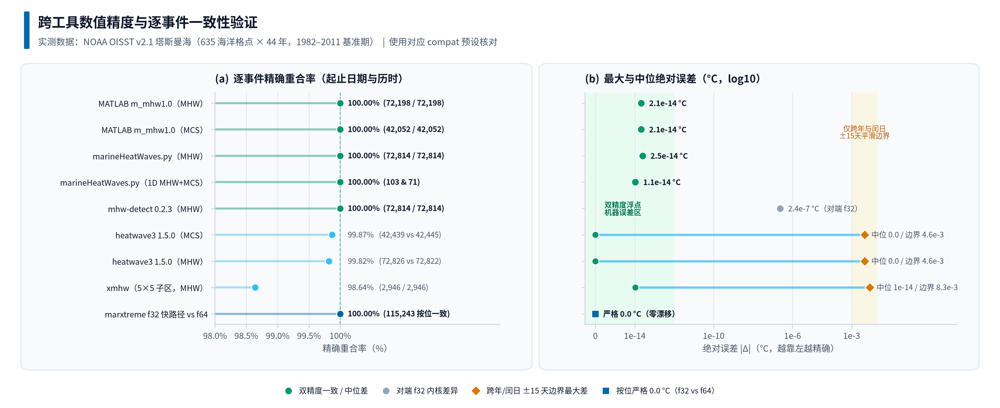

# marxtreme

[](https://github.com/Radianjayjay/marxtreme/actions/workflows/ci.yml)
[](LICENSE)
[](pyproject.toml)
[](Cargo.toml)

[English](README.md) | **简体中文**

`marxtreme`（*Marine Extremes*）是一个用 Rust 加速的 Python 海洋极端事件检测库，用于识别海洋热浪（MHW）、海洋冷事件（MCS）以及盐度异常等通用标量海洋极端事件。它适用于 1D 站点观测、3D 海表网格（NOAA OISST、OSTIA）、4D 带深度维海洋再分析数据（GLORYS、ORAS5、Argo）以及多日历 CMIP6 气候模式数据。

架构与模块图示可在浏览器中打开 [docs/marxtreme_overview.html](docs/marxtreme_overview.html) 查看。

## 主要功能

- Rust + Rayon 并行内核。通过 `py.detach()` 释放 Python GIL，跳过陆地格点，并在 `working_dtype="auto"` 下对 `float32`/打包 `int16` 数据使用紧凑 `float32` 读块与内部 `f64` 累加，内存减半且无精度漂移。
- 单遍同时识别 MHW 与 MCS。设置 `event="both"` 只计算一次气候态，一次扫描同时输出高值与低值事件。
- 受 `memory_limit` 约束的流式分块计算。可直接读取按年拆分的多文件 NetCDF 或 Zarr（如 `sst.day.mean.*.nc`），按空间或深度瓦片逐块处理，避免全球大网格爆内存。
- 7 种单目标输出格式。只需指定 `out=...` 扩展名，即可输出单个不含散落伴随文件的结果：`.nc`、`.mat`（无 2 GB 限制的 v7.3 HDF5，或兼容 `m_mhw1.0` 的 v5 `detectc` 元胞数组）、`.zarr`、`.npz`、`.parquet`、`.feather` 或 `.csv`。
- CSR 索引格点查表与列式分析。事件按展平格点索引有序存储，并在 `.nc`、`.mat`、`.zarr`、`.npz`、`.parquet` 中内嵌 `int64` CSR `grid_offsets`，支持磁盘懒加载 O(1) 单点查询 `res.events.sel(...)` / `isel(...)` 以及免扫描的 `count_map()`。
- 多种基线定义。内置 `FixedBaseline`（支持外置 `clim_data` 跨情景基准）、`DetrendedBaseline`（线性或二次 OLS 去趋势后再求气候态与识别事件）、`MovingBaseline`（可定制窗宽的滑动多年窗口，支持 `clamp`/`shrink` 边界）、`FixedThreshold` 和 `ExternalClimatology`。
- CMIP6 多日历与月尺度模式。支持公历及 `cftime` 日历（`standard`、`proleptic_gregorian`、`noleap`/`365_day`、`360_day`、`all_leap`/`366_day`），也支持 `freq="monthly"` 月尺度检测（Jacox et al., 2020）。
- 显式跨工具兼容预设。通过 `compat="standard"`、`"m_mhw"`、`"m_mhw_python"`、`"oliver"` 或 `"heatwaveR"` 指定分位数插值、阈值不等号、2 月 29 日插值与方差自由度 `ddof`，与主流工具逐项对齐。
- 边缘与海冰区保护。支持仅用于检测阶段的 `max_pad_length` 短缺测插值、`min_valid_fraction` 海冰边缘过滤（循环平滑阶段不产生 NaN 渗透）、`truncated_start`/`truncated_end` 截断标记，以及 `lower_bound`（`flag`/`mask`/`floor` 及除零保护）。

## 安装

从源码编译需要本机安装 Rust 工具链：

```bash
git clone https://github.com/Radianjayjay/marxtreme.git
cd marxtreme

# 编译安装 Release 扩展并附带全部可选 I/O 后端（NetCDF4、HDF5/MAT、Zarr、cftime、Dask）
pip install maturin
maturin develop --release --extras io
```

[pyproject.toml](pyproject.toml) 中的可选依赖组：

- `marxtreme[netcdf]`：`netCDF4`、`h5netcdf`、`cftime`、`dask`
- `marxtreme[mat]`：`h5py`、`scipy`（MATLAB v7.3 与 v5 `.mat`）
- `marxtreme[zarr]`：`zarr>=3.0`、`cftime`、`dask`
- `marxtreme[io]`：以上全部格式支持
- `marxtreme[dev]`：`pytest`、`maturin`

## 快速上手

```python
import marxtreme as mx

res = mx.detect(
    "data/OISST_1982_2025_r360x180.nc",
    var="sst",
    squeeze_singleton="zlev",        # 自动压缩长度为 1 的深度维（如 OISST zlev=1）
    event="both",                    # "high" | "low" | "both"（别名："mhw" | "mcs"）
    baseline=mx.MovingBaseline(window_years=31, center=True, boundary="clamp"),
    lower_bound=-1.8,
    bound_policy="flag",
    working_dtype="auto",            # 对 float32/int16 NetCDF 自动采用紧凑 float32 瓦片
    intensity_dtype="float32",       # 将逐日 intensity_ts 内存与磁盘体积减半
    memory_limit="8GB",
    out="outputs/oisst_mhw.nc",      # .nc | .mat | .zarr | .npz | .parquet | .feather | .csv
)

# O(1) 单格点检索（对 .nc / .mat v7.3 / .zarr / .parquet 自动磁盘懒切片）
df_point = res.events.sel(lat=-42.5, lon=148.0)

# 基于 CSR 偏移直接计算空间事件计数图（无需扫表）
counts = res.events.count_map()

# 导出完整列式 DataFrame
df_all = res.events.to_pandas()

# 直接重新打开任意已保存结果
res2 = mx.open("outputs/oisst_mhw.nc")

# 导出单文件 MATLAB .mat（v5 detectc 元胞或 v7.3 HDF5）或 Zarr
res.to_mat("outputs/oisst_detectc.mat", layout="detectc")
res.to_mat("outputs/oisst_v73.mat", layout="v73")
res.save("outputs/oisst_mhw.zarr")
```

运行无需外部数据的示例脚本：

```bash
python examples/quickstart.py
```

## 性能与精度验证




上述测试基于真实 NOAA OISST v2.1 逐日海温（1982-2025，16,071 天，基准期 1982-2011），在 Linux（Intel Core i9-10920X，12 核 24 线程 @ 3.5 GHz，30 GiB 内存）下以独立子进程执行，运行时间取 `perf_counter`，峰值内存由 `/usr/bin/time -v` 采集。参测工具版本：`heatwave3 1.5.0`（24 线程，`roundClm=False`）、MATLAB R2025b `m_mhw1.0`（`detectc.m`）、`mhw-detect 0.2.3`（Numba `0.68.1`）、`ecjoliver/marineHeatWaves.py`（修补 NumPy 2 兼容性后运行）及 `xmhw`。

与 `heatwave3`、`xmhw` 相比，全年 290-300 天的气候态差值为 `0.0 °C`；`<= 0.008 °C` 的差异只出现在 1 月 1 日与 2 月 29 日前后 `±15` 天的平滑边界区，原因是二者将气候态严格截取为 `366 × n_years` 矩阵直接首尾环绕，并在取 `±5` 天窗口前插入平年 2 月 29 日。

### 功能对比

| 能力维度 | `marxtreme` | `heatwave3` | `m_mhw1.0` | `heatwaveR` | `marineHeatWaves` | `xmhw` | `mhw-detect` |
| --- | :---: | :---: | :---: | :---: | :---: | :---: | :---: |
| 核心引擎 | Rust + Rayon | C++ + OpenMP | MATLAB | R + Rcpp | Python | xarray + Dask | Python + Numba |
| 单遍同步 MHW + MCS | 支持 | 否（两遍） | 否（两遍） | 否（两遍） | 否（两遍） | 否（两遍） | 否 |
| 内存有界流式分块 | 支持（`memory_limit`） | 部分（全球 ~16 GB） | 否（全内存） | 否（仅 1D） | 否（仅 1D） | Dask（偏慢） | 手动 `mhw-cut` |
| 网格维度 | 1D-4D | 3D-4D | 仅 3D | 仅 1D | 仅 1D | 3D | 3D |
| 基线支持 | 固定 / 线性 / 二次 / 滑动 / 外部 | 固定 / 线性 | 固定 / 外部 | 固定 | 固定 / 外部 | 固定 | 固定 / 外部 |
| CMIP6 多日历与月尺度 | 支持（`cftime` + 月尺度） | 公历 | 公历 | 公历 | `Ly` 近似 | 部分 | 公历 |
| 单目标多格式输出 | `.nc/.mat/.zarr/.npz/.parquet/.csv` | `.nc/.zarr`（多文件） | `.mat` | R data.frame | Python dict | xarray | `.parquet/.csv` |
| O(1) 格点检索（CSR） | 支持（磁盘懒加载） | 否 | 元胞数组（内存） | 否 | 否 | 否 | 否 |
| 显式跨工具 `compat` 预设 | 5 套预设 | 固定（`heatwaveR`） | 2 套（`matlab`/`python`） | 固定 | 固定 | 固定 | 固定 |

## 基线类型

| 基线类 | 说明 |
| --- | --- |
| `FixedBaseline(start, end, clim_data=None, ...)` | 经典 Hobday et al. (2016) 固定参考期气候态；支持传入外部 `clim_data` 用于跨情景检测（例如用 CMIP6 历史基准检测 SSP 情景）。 |
| `DetrendedBaseline(method="linear" \| "quadratic", start, end, fit_period)` | 逐像元忽略 NaN 拟合线性或二次 OLS 趋势，保留均值水平并剥离长期趋势后再求气候态与识别事件，同时返回 `res.trend` 趋势系数。 |
| `MovingBaseline(window_years=31, center=True, boundary="clamp" \| "shrink")` | 可自定义宽度的滑动多年气候态窗口（如 11 年或 31 年中心滑动窗），在 Rust 端按去重调度表执行。 |
| `FixedThreshold(threshold_high, threshold_low, climatology=0.0)` | 显式标量或空间网格物理、生态阈值（如珊瑚白化温度或盐度限值）。 |
| `ExternalClimatology(seas, thresh_high, thresh_low)` | 复用 `mx.compute_climatology()` 或外部文件中的预计算气候态与阈值（支持 `doy`、`(year, doy)` 或 `time` 布局）。 |

## 输出格式

传入 `out="path"`（或调用 `res.save("path")`、`res.to_mat("path")`、`res.events.save("path")`）会按扩展名（或 `out_format=...`）生成单个目标文件，不产生伴随文件：

| 扩展名 | 包含内容 | 流式写入 / 懒查表 | 外部读取工具 |
| --- | --- | --- | --- |
| `.nc` / `.nc4` | 根组：格点场、坐标与属性；`/events` 子组：事件表与 `grid_offsets` | 流式写入 + O(1) 懒切片 | `xarray.open_dataset`、MATLAB `ncread`、CDO、Panoply |
| `.mat`（`mat_layout="v73"`） | 格点场、`events` 结构体（`Nx1` 列向量）、`grid_offsets` 与坐标（无 2 GB 上限） | 流式写入 + O(1) 懒切片 | MATLAB `load()` / `matfile()`、`h5py` |
| `.mat`（`mat_layout="detectc"`） | 兼容 `m_mhw1.0` 的 `MHW{i,j}` 元胞与 `mclim`、`m90`、`m10`、`mhw_ts`、`category_ts`（2 GB 防护） | 缓冲写入 v5 | MATLAB `m_mhw1.0` 脚本、`scipy.io.loadmat` |
| `.zarr` | 单个 Zarr 存储：根组 zstd 分块格点场、`/events` 子组与 `grid_offsets` | 流式写入 + O(1) 懒切片 | `xarray.open_zarr(..., consolidated=False)`、`zarr` |
| `.npz` | 压缩 NumPy 归档，包含格点场、事件表、`grid_offsets` 与元数据 | 缓冲写入 | 纯 `numpy.load()` |
| `.parquet` | 纯事件表（Parquet 页脚内嵌 CSR `grid_offsets` 与空间坐标） | 流式写入 + O(1) 懒切片 | Pandas、Polars、DuckDB、PyArrow、R Arrow |
| `.feather` / `.csv` | 纯事件表（Feather 内嵌空间 schema 元数据；CSV 为 RFC-4180） | 流式写入 | Excel、R、Pandas、Polars |

## 跨工具兼容预设

| 预设名 | 分位数算法 | 超阈值判据 | 闰日（2 月 29 日）处理 | 方差 `ddof` | 对标参考工具 |
| --- | --- | --- | --- | --- | --- |
| `"standard"`（默认） | Type-7 | `>` / `<` | `interp_59_61` | `1` | Hobday (2016/2018) + 样本标准差 |
| `"m_mhw"` | Type-5 (Hazen) | `>=` / `<=` | `interp_59_61` | `1` | MATLAB `m_mhw1.0`（`detect.m` / `detectc.m`） |
| `"m_mhw_python"` | Type-7 | `>=` / `<=` | `interp_59_61` | `1` | `m_mhw` Python 移植口径 |
| `"oliver"` | Type-7 | `>` / `<` | `interp_59_61` | `0` | `ecjoliver/marineHeatWaves.py` |
| `"heatwaveR"` | Type-7 | `>` / `<` | `heatwaver_series` | `1` | R `heatwaveR` / C++ `heatwave3` |

## 项目结构

```text
marxtreme/
├── Cargo.toml                        # Rust crate 配置（PyO3 0.30、rust-numpy 0.30、Rayon 1.12）
├── pyproject.toml                    # Python 打包与 maturin 构建配置
├── LICENSE                           # MIT 许可证
├── README.md                         # 英文文档（默认）
├── README.zh-CN.md                   # 简体中文文档
├── src/                              # Rust 并行计算核心
│   ├── lib.rs                        # 编译态 PyO3 执行计划（FixedPlan、MovingPlan、CurvesPlan）与 f64/f32 分发
│   ├── compat.rs                     # 跨工具数值兼容枚举与内核参数
│   ├── quantile.rs                   # Type-7 与 Type-5（Hazen）分位数实现
│   ├── baseline.rs                   # OLS 去趋势、WindowPlan、MovingSchedule 与循环平滑
│   └── detect.rs                     # 短缺测插值、阈值扫描、传递合并间隙、事件指标与分级
├── python/marxtreme/                 # Python 编排与单文件持久化层
│   ├── __init__.py                   # 公共导出接口（detect、compute_climatology、open、各类基线）
│   ├── api.py                        # 高层入口（detect、compute_climatology）
│   ├── baselines.py                  # 基线规格定义与 PreparedBaseline 执行适配器
│   ├── calendar.py                   # 公历/cftime 统一编码、时段切片与日期/CF 时间编解码
│   ├── catalog.py                    # 规范 EventSchema、EventStore 抽象与 CSR 索引 EventCatalog
│   ├── compat.py                     # 跨工具数值兼容预设
│   ├── io_formats.py                 # OutputSpec、ResultSink 抽象与 8 套单文件格式适配器
│   ├── result.py                     # DetectResult 结果容器（save、to_mat、open、to_dataset）
│   └── streaming.py                  # 多文件通配符懒加载、单维压缩与内存分块
├── tests/                            # 单元测试、精度对标、边界压测、流式 I/O 与 MATLAB R2025b 验证
├── examples/quickstart.py            # 无需外部数据的快速入门脚本
├── benchmarks/bench_global_scale.py  # 合成全球规模吞吐量基准脚本
├── docs/
│   ├── figures/                      # 双语 README 性能与精度对比图表
│   └── marxtreme_overview.html       # 交互式图文架构总览页面
└── .github/workflows/ci.yml          # 多 Python 版本 CI 与跨平台 wheel 构建流程
```

## 适用范围

`marxtreme` 负责逐格点 1D-4D 海洋极端事件检测与单文件持久化，不包含 3D/4D 空间连通体目标追踪、垂向海洋热含量积分或自动垂向模态分类。

## 开发与测试

```bash
# 运行 Rust 单元测试
cargo test --lib

# 构建 Release 扩展并安装可选 I/O 与开发依赖
maturin develop --release --extras io,dev

# 运行完整 Python 测试套件（若本机已安装 MATLAB 则自动包含 R2025b 核对）
pytest -v

# 运行合成规模吞吐基准
python benchmarks/bench_global_scale.py
```

## 常见问题（Issues）

不同海洋极端事件工具（MATLAB `m_mhw1.0`、Python `marineHeatWaves` / `xmhw`、R `heatwaveR`、C++ `heatwave3`）之间的细微数值差异，来自各工具在分位数插值（Type-5 Hazen 与 Type-7）、超阈值不等号（`>=` 与 `>`）、2 月 29 日插值时机、事件方差自由度（`ddof=0` 与 `ddof=1`）以及跨年边界窗口环绕上的不同约定。如需复现特定工具结果，可显式传入 `compat="m_mhw"`、`"oliver"`、`"heatwaveR"` 或 `"standard"`（见[跨工具兼容预设](#跨工具兼容预设)与[性能与精度验证](#性能与精度验证)）。

如遇到缺陷、特殊日历边界或 I/O 兼容问题，可在 [GitHub Issues](https://github.com/Radianjayjay/marxtreme/issues) 提交反馈，并附上 `marxtreme` 版本、Python 与系统环境以及最小复现示例。

## 参与贡献

欢迎提交缺陷修复、日历或文件格式适配器、跨工具对标测试及文档修订：

1. Fork 本仓库并基于 `main` 创建分支。
2. 提交 Pull Request 前在本地跑通 Rust 与 Python 测试：
   ```bash
   cargo test --lib
   maturin develop --release --extras io,dev
   pytest -v
   ```
3. 涉及行为变更或缺陷修复时，在 `tests/` 中补充单元测试或回归测试。
4. 通过 Pull Request 提交代码，或先在 [GitHub Issues](https://github.com/Radianjayjay/marxtreme/issues) 发起讨论。

## 引用方式

若你在学术论文或业务工作流中使用了 `marxtreme`，请在引用基础方法学文献（如 Hobday et al., 2016；Hobday et al., 2018；Schlegel et al., 2021）的同时引用本软件包：

```bibtex
@software{marxtreme,
  author  = {Radianjayjay and marxtreme contributors},
  title   = {marxtreme: Rust-Accelerated Marine Heatwave, Cold Spell, and Marine Extreme Detection},
  version = {0.1.0},
  year    = {2026},
  url     = {https://github.com/Radianjayjay/marxtreme}
}
```

## 参考文献

- Hobday, A. J., Alexander, L. V., Perkins, S. E., Smale, D. A., Straub, S. C., Oliver, E. C. J., Benthuysen, J. A., Burrows, M. T., Donat, M. G., Feng, M., Holbrook, N. J., Moore, P. J., Scannell, H. A., Sen Gupta, A., & Wernberg, T. (2016). A hierarchical approach to defining marine heatwaves. *Progress in Oceanography*, 141, 227-238.
- Schlegel, R. W., Oliver, E. C. J., Wernberg, T., & Smit, A. J. (2017). Nearshore and offshore co-occurrences of marine heatwaves and cold-spells. *Progress in Oceanography*, 151, 189-205.
- Hobday, A. J., Oliver, E. C. J., Sen Gupta, A., Benthuysen, J. A., Burrows, M. T., Donat, M. G., Holbrook, N. J., Moore, P. J., Thomsen, M. S., Wernberg, T., & Smale, D. A. (2018). Categorizing and naming marine heatwaves. *Oceanography*, 31(2), 162-173.
- Schlegel, R. W., & Smit, A. J. (2018). heatwaveR: A central algorithm for the detection of heatwaves and cold-spells. *Journal of Open Source Software*, 3(27), 821.
- Oliver, E. C. J., Lago, V., Hobday, A. J., Holbrook, N. J., Ling, S. D., & Mundy, C. N. (2018). Marine heatwaves off eastern Tasmania: Trends, interannual variability, and predictability. *Progress in Oceanography*, 161, 116-130.
- Zhao, Z., & Marin, M. (2019). A MATLAB toolbox to detect and analyze marine heatwaves. *Journal of Open Source Software*, 4(33), 1124.
- Jacox, M. G., Alexander, M. A., Bograd, S. J., & Scott, J. D. (2020). Thermal displacement by marine heatwaves. *Nature*, 584, 82-86.
- Schlegel, R. W., Darmaraki, S., Benthuysen, J. A., Filbee-Dexter, K., & Oliver, E. C. J. (2021). Marine cold-spells. *Progress in Oceanography*, 198, 102684.
- Reynolds, R. W., Smith, T. M., Liu, C., Chelton, D. B., Casey, K. S., & Schlax, M. G. (2007). Daily high-resolution-blended analyses for sea surface temperature. *Journal of Climate*, 20(22), 5473-5496.

## 许可证

MIT License，详见 [LICENSE](LICENSE)。
