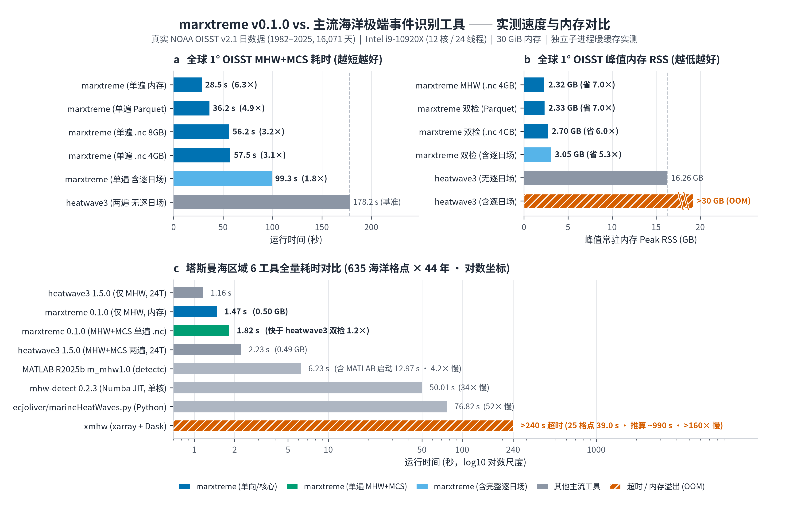

# marxtreme

[](https://github.com/Radianjayjay/marxtreme/actions/workflows/ci.yml)
[](LICENSE)
[](pyproject.toml)
[](Cargo.toml)

[English](README.md) | **简体中文**

**`marxtreme`**（*Marine Extremes*）是一个基于 Rust 加速的高性能 Python 海洋极端事件检测库，面向 **海洋热浪（MHW）**、**海洋冷事件（MCS）** 及通用标量海洋极端事件（如高/低盐度异常），全面支持 1D 站点观测、3D 海表网格（NOAA OISST、OSTIA）、4D 带深度维海洋再分析数据（GLORYS、ORAS5、Argo）以及多日历 CMIP6 气候模式模拟数据。

> 如需可视化浏览架构与模块说明，可用浏览器直接打开 [docs/marxtreme_overview.html](docs/marxtreme_overview.html)。

---

## 核心特性

- **Rust + Rayon 并行内核**：通过 `py.detach()` 释放 Python GIL，在有效海洋格点上多线程并行计算；自动跳过陆地格点，并对 `float32`/打包 `int16` 数据启用紧凑 `float32` 读块快路径（`working_dtype="auto"`，内部 `f64` 累加，零精度漂移）。
- **单遍同步识别 MHW + MCS**：`event="both"` 在单次气候态计算与扫描中同时完成高低双向极端事件检测，耗时几乎等同于单向运行。
- **可控内存流式分块（Out-of-Core）**：原生支持多文件 NetCDF/Zarr 通配符（如按年拆分的 `sst.day.mean.*.nc`），按 `memory_limit` 自动切分空间/深度瓦片，避免全球大网格爆内存。
- **自包含单文件多格式输出**：仅需指定 `out=...` 扩展名，即可输出单个无散落伴随文件的完整结果：`.nc`（流式 NetCDF4）、`.mat`（无 2 GB 限制的 MATLAB v7.3 HDF5，或兼容 `m_mhw1.0` 的 v5 `detectc` 元胞数组）、`.zarr`（流式分块 Zarr）、`.npz`、`.parquet`、`.feather` 或 `.csv`。
- **CSR 索引 O(1) 格点查表 + 列式分析**：事件按展平格点索引有序存储，并内嵌 `int64` CSR `grid_offsets`（支持 `.nc`/`.mat`/`.zarr`/`.npz`/`.parquet`），无需在内存中维护 cell 数组即可实现磁盘懒加载 O(1) 单点检索 `res.events.sel(...)` / `isel(...)` 与零扫描 `count_map()`。
- **多基线体系**：内置 `FixedBaseline`（支持外置 `clim_data` 跨情景基准）、`DetrendedBaseline`（线性/二次 OLS 去趋势后再求气候态并输出趋势系数）、可定制 `MovingBaseline`（如 11 年或 31 年中心滑动窗口，支持 `clamp`/`shrink` 边界）、`FixedThreshold` 及 `ExternalClimatology`。
- **CMIP6 多日历与月尺度模式**：原生兼容公历与 CMIP6 `cftime` 日历（`standard`、`proleptic_gregorian`、`noleap`/`365_day`、`360_day`、`all_leap`/`366_day`），并支持月尺度识别 `freq="monthly"`（Jacox et al. 2020）。
- **显式跨工具数值兼容预设**：通过 `compat="standard"`、`"m_mhw"`、`"m_mhw_python"`、`"oliver"`、`"heatwaveR"` 透明配置分位数定义、阈值不等号、2 月 29 日插值与方差自由度 `ddof`，确保与既有工具精确复现。
- **物理边界与边缘保护**：提供仅用于检测阶段的 `max_pad_length` 短缺测插值、`min_valid_fraction` 海冰边缘过滤（且平滑阶段无 NaN 渗透）、`truncated_start`/`truncated_end` 边界截断标记，以及 `lower_bound`（`flag`/`mask`/`floor` 与除零保护）。

---

## 安装

### 从源码构建（需 Rust 工具链）

```bash
git clone https://github.com/Radianjayjay/marxtreme.git
cd marxtreme

# 编译安装 Release 扩展并附带全部可选 I/O 后端（NetCDF4、HDF5/MAT、Zarr、cftime、Dask）
pip install maturin
maturin develop --release --extras io
```

[pyproject.toml](pyproject.toml) 中的可选依赖组：
- `marxtreme[netcdf]` — `netCDF4`、`h5netcdf`、`cftime`、`dask`
- `marxtreme[mat]` — `h5py`、`scipy`（MATLAB v7.3 与 v5 `.mat`）
- `marxtreme[zarr]` — `zarr>=3.0`、`cftime`、`dask`
- `marxtreme[io]` — 包含以上全部格式支持
- `marxtreme[dev]` — `pytest`、`maturin`

---

## 快速上手

```python
import marxtreme as mx

res = mx.detect(
    "data/OISST_1982_2025_r360x180.nc",
    var="sst",
    squeeze_singleton="zlev",        # 自动压缩长度为 1 的深度维（如 OISST zlev=1）
    event="both",                    # "high" | "low" | "both"（别名："mhw" | "mcs"）
    baseline=mx.MovingBaseline(window_years=31, center=True, boundary="clamp"),
    lower_bound=-1.8,
    bound_policy="flag",
    working_dtype="auto",            # 对 float32/int16 NetCDF 自动采用紧凑 float32 瓦片
    intensity_dtype="float32",       # 将逐日 intensity_ts 内存与磁盘体积减半
    memory_limit="8GB",
    out="outputs/oisst_mhw.nc",      # .nc | .mat | .zarr | .npz | .parquet | .feather | .csv
)

# O(1) 单格点检索（对 .nc / .mat v7.3 / .zarr / .parquet 自动磁盘懒切片）
df_point = res.events.sel(lat=-42.5, lon=148.0)

# 瞬时空间事件计数图（直接差分 CSR 偏移，零表扫描）
counts = res.events.count_map()

# 完整列式 DataFrame
df_all = res.events.to_pandas()

# 直接重新打开任意自包含输出文件
res2 = mx.open("outputs/oisst_mhw.nc")

# 一键导出为单文件 MATLAB .mat（v5 detectc 元胞或 v7.3 HDF5）或 Zarr/NPZ
res.to_mat("outputs/oisst_detectc.mat", layout="detectc")
res.to_mat("outputs/oisst_v73.mat", layout="v73")
res.save("outputs/oisst_mhw.zarr")
```

运行零外部数据依赖的自包含示例脚本：

```bash
python examples/quickstart.py
```

---

## 基线类型

| 基线类 | 说明 |
| --- | --- |
| `FixedBaseline(start, end, clim_data=None, ...)` | 经典 Hobday et al. (2016) 固定参考期气候态；支持传入外部 `clim_data` 用于跨情景检测（如用 CMIP6 历史基准检测 SSP 未来情景）。 |
| `DetrendedBaseline(method="linear" \| "quadratic", start, end, fit_period)` | 逐像元忽略 NaN 拟合线性或二次 OLS 趋势，保留物理均值水平并剥离长期趋势后再求气候态与识别事件，同步返回 `res.trend` 趋势系数。 |
| `MovingBaseline(window_years=31, center=True, boundary="clamp" \| "shrink")` | 可自定义宽度的滑动多年气候态窗口（如 11 年或 31 年中心滑动窗），Rust 端按去重调度表高效执行。 |
| `FixedThreshold(threshold_high, threshold_low, climatology=0.0)` | 显式标量或空间网格物理/生态阈值（如珊瑚白化温度阈值或盐度红线）。 |
| `ExternalClimatology(seas, thresh_high, thresh_low)` | 直接复用 `mx.compute_climatology()` 或外部文件中的预计算气候态与阈值（支持 `doy`、`(year, doy)` 或 `time` 布局）。 |

---

## 输出格式

传入 `out="path"`（或调用 `res.save("path")`、`res.to_mat("path")`、`res.events.save("path")`）会自动按扩展名（或显式 `out_format=...`）生成单个自包含目标文件，无任何零散元数据或伴随文件：

| 扩展名 | 包含内容 | 流式写入 / 懒查表 | 外部直接读取工具 |
| --- | --- | --- | --- |
| `.nc` / `.nc4` | 根组：格点场 + 坐标 + 属性；`/events` 子组：事件表 + `grid_offsets` | 流式写入 + O(1) 懒切片 | `xarray.open_dataset`、MATLAB `ncread`、CDO、Panoply |
| `.mat`（`mat_layout="v73"`） | 格点场 + `events` 结构体（`Nx1` 列向量）+ `grid_offsets` + 坐标（无 2 GB 上限） | 流式写入 + O(1) 懒切片 | MATLAB `load()` 与 `matfile()`、`h5py` |
| `.mat`（`mat_layout="detectc"`） | 兼容 `m_mhw1.0` 的 `MHW{i,j}` 元胞 + `mclim`、`m90`、`m10`、`mhw_ts`、`category_ts`（带 2 GB 防护） | 缓冲写入 v5 | MATLAB `m_mhw1.0` 工作流、`scipy.io.loadmat` |
| `.zarr` | 单个 Zarr 存储：根组 zstd 分块格点场 + `/events` 子组 + `grid_offsets` | 流式写入 + O(1) 懒切片 | `xarray.open_zarr(..., consolidated=False)`、`zarr` |
| `.npz` | 压缩 NumPy 归档，含格点场、事件表、`grid_offsets` 与元数据 | 缓冲写入 | 纯 `numpy.load()`（零额外依赖） |
| `.parquet` | 纯事件表（Parquet 页脚内嵌压缩 CSR `grid_offsets` 与空间坐标） | 流式写入 + O(1) 懒切片 | Pandas、Polars、DuckDB、PyArrow、R Arrow |
| `.feather` / `.csv` | 纯事件表（Feather 内嵌空间 schema 元数据；CSV 为标准 RFC-4180） | 流式写入 | Excel、R、Pandas、Polars |

---

## 跨工具数值兼容预设（`compat=...`）

| 预设名 | 分位数算法 | 超阈值判据 | 闰日（2 月 29 日）处理 | 方差 `ddof` | 对标参考工具 |
| --- | --- | --- | --- | --- | --- |
| `"standard"`（默认） | Type-7 | `>` / `<` | `interp_59_61` | `1` | Hobday (2016/2018) + 样本标准差 |
| `"m_mhw"` | Type-5 (Hazen) | `>=` / `<=` | `interp_59_61` | `1` | MATLAB `m_mhw1.0`（`detect.m` / `detectc.m`） |
| `"m_mhw_python"` | Type-7 | `>=` / `<=` | `interp_59_61` | `1` | `m_mhw` Python 移植口径 |
| `"oliver"` | Type-7 | `>` / `<` | `interp_59_61` | `0` | `ecjoliver/marineHeatWaves.py` |
| `"heatwaveR"` | Type-7 | `>` / `<` | `heatwaver_series` | `1` | R `heatwaveR` / C++ `heatwave3` |

---

## 实测精度与性能基准（真实 NOAA OISST v2.1）



以下全部精度与性能数据均基于真实 **NOAA OISST v2.1** 逐日海温数据（`1982–2025`，`16,071` 个日步长，基准期 `1982–2011`），测试环境为 Linux（**Intel Core i9-10920X**，12 核 / 24 线程 @ 3.5 GHz，30 GiB 内存）。每项测速均在暖页缓存下以独立子进程执行，运行时间取 `perf_counter`，峰值内存（Peak RSS）由 `/usr/bin/time -v` 采集。

参测版本：`marxtreme 0.1.0`（Rust + Rayon）、`heatwave3 1.5.0`（C++ OpenMP，`n_threads=24`）、MATLAB R2025b `m_mhw1.0`（`detectc.m`）、`mhw-detect 0.2.3`（Numba `0.68.1`）、`ecjoliver/marineHeatWaves.py`（在 NumPy 2.x 下修补 `np.NaN` 与单元素标量赋值两处兼容性问题后运行）及 `xmhw`（xarray + Dask）。

### 1. 数值精度与跨工具一致性验证

除注明外，均在真实 OISST v2.1 **塔斯曼海区域**（`lat 45°S–20°S, lon 145°E–175°E`，`635` 个海洋格点 × `44 年`）逐事件全量核对：

| 对标工具 | `marxtreme` 预设 | 测试范围 / 事件 | 检出事件数（`marxtreme` / 对标） | 逐事件精确重合 | 最大 `\|clim\|` 差 (°C) | 最大 `\|int_max\|` 差 (°C) |
| --- | --- | --- | --- | --- | --- | --- |
| **MATLAB `m_mhw1.0`**（`detectc.m`） | `compat="m_mhw"` | 塔斯曼海 635 格点，MHW | **72,198 / 72,198** | **100.00%**（起止/历时/分级） | `2.13e-14` | `1.78e-14` |
| **MATLAB `m_mhw1.0`**（`detectc.m`） | `compat="m_mhw"` | 塔斯曼海 635 格点，MCS | **42,052 / 42,052** | **100.00%**（起止/历时/分级） | `2.13e-14` | `2.13e-14` |
| **`marineHeatWaves.py`** | `compat="oliver"` | 塔斯曼海 635 格点，MHW | **72,814 / 72,814** | **100.00%**（起止/历时） | `2.49e-14` | `2.13e-14`（速率 `1.42e-14`） |
| **`marineHeatWaves.py`** | `compat="oliver"` | 单点（`42°S, 150°E`），MHW & MCS | **103/103** 与 **71/71** | **100.00%**（全指标） | `1.07e-14` | `7.11e-15`（速率 `4.11e-15`） |
| **`mhw-detect 0.2.3`**（Numba） | `compat="oliver"` | 塔斯曼海 635 格点，MHW | **72,814 / 72,814** | **100.00%**（起止/历时） | — | `2.38e-7` *（对端 `f32` 内核）* |
| **`heatwave3 1.5.0`**（`roundClm=False`） | `compat="heatwaveR"` | 塔斯曼海 635 格点，MHW | **72,826 / 72,822** | **99.82%**（中位差 `0.0`） | `4.57e-3` *（290/366 天 `0.0`）* | 中位 `0.0`（最大 `4.57e-3`） |
| **`heatwave3 1.5.0`**（`roundClm=False`） | `compat="heatwaveR"` | 塔斯曼海 635 格点，MCS | **42,439 / 42,445** | **99.87%**（中位差 `0.0`） | `4.57e-3` *（290/366 天 `0.0`）* | 中位 `0.0`（最大 `4.57e-3`） |
| **`xmhw`**（xarray + Dask） | `compat="oliver"` | 塔斯曼海 5×5（25 格点），MHW | **2,946 / 2,946** | **98.64%**（中位差 `1e-14`） | `8.31e-3` *（300/366 天 `0.0`）* | 中位 `1.07e-14`（最大 `8.31e-3`） |
| **`marxtreme` `f32` vs `f64`**（`auto`） | `compat="standard"` | 塔斯曼海 635 格点，MHW + MCS | **115,243 / 115,243** | **100.00%**（按位一致） | **`0.0`** | **`0.0`** |

> **关于 `heatwave3` 与 `xmhw` 的边界差异说明**：二者在全年 290–300 天中与 `marxtreme` 差值为 `0.0`，剩余 `≤ 0.008 °C` 差异仅出现在 **1 月 1 日 / 12 月 31 日** 及 **2 月 29 日** 前后 ±15 天平滑晕圈内，原因是二者将气候态严格截取到 `366 × n_years` 矩阵并跨年首尾环绕（不读取相邻 `2012-01-01..05` 缓冲日），且在取 ±5 天窗口前即插入平年 2 月 29 日。
> **`float32` 快路径零精度损失**：由于 OISST 原始存储即为 `float32`，而 `marxtreme` Rust 核心在累加气候态、分位数与事件指标时逐像元提升至 `f64`，因此默认的 `working_dtype="auto"`（`float32` 瓦片）在节省一半瓦片内存的同时，与 `working_dtype="float64"` 在全部 115,243 条 MHW+MCS 事件上差值严格为 **`0.0`**。

### 2. 全球 1° NOAA OISST v2.1 速度与峰值内存（`42,602` 海洋格点 × `44 年`）

输入文件：7.9 GiB NetCDF4（`16,071 × 1 × 181 × 360`，`sst` 为 4.0 GB `float32`），共检出 **438 万条 MHW** 与 **317 万条 MCS**（合计 **755 万条**事件）。

| 任务 | 工具与配置 | 耗时 | 峰值内存 RSS | 相对 `heatwave3` 提升 |
| --- | --- | --- | --- | --- |
| **全球 MHW**（事件 + 气候态） | **`marxtreme`**（内存返回，`memory_limit="8GB"`） | **27.4 s** | **4.01 GB** | **快 3.2× · 省内存 4.1×** |
| **全球 MHW**（事件 + 气候态） | **`marxtreme`**（流式 `.nc`，`8GB`，`complevel=4`） | **45.0 s** | **3.83 GB** | **快 2.0× · 省内存 4.2×** |
| **全球 MHW**（事件 + 气候态） | **`marxtreme`**（流式 `.nc`，`4GB`，`complevel=4`） | **48.1 s** | **2.32 GB** | **快 1.9× · 省内存 7.0×** |
| **全球 MHW**（事件 + 气候态） | `heatwave3 1.5.0`（`daily="none"`，`compression=1`，24 线程） | 89.0 s | 16.26 GB | 1.0× 基准 |
| **全球 MHW + 完整逐日场** | **`marxtreme`**（含 `intensity_ts` + `category_ts` `.nc`，`4GB`） | **88.8 s** | **2.79 GB** | **仍快于无逐日场的 `heatwave3`** |
| **全球 MHW + 完整逐日场** | `heatwave3 1.5.0`（`daily="also"`，24 线程） | OOM（>30 GiB） | >30 GB | 超出 30 GiB 主机内存上限 |
| **全球 MHW + MCS**（事件 + 气候态） | **`marxtreme`**（单遍，内存返回，`8GB`） | **28.5 s** | **4.72 GB** | **快 6.3× · 省内存 3.4×** |
| **全球 MHW + MCS**（事件 + CSR） | **`marxtreme`**（单遍，流式 `.parquet`，`4GB`） | **36.2 s** | **2.33 GB** | **快 4.9× · 省内存 7.0×** |
| **全球 MHW + MCS**（事件 + 气候态） | **`marxtreme`**（单遍，流式 `.nc`，`8GB`，`complevel=4`） | **56.2 s** | **4.40 GB** | **快 3.2× · 省内存 3.7×** |
| **全球 MHW + MCS**（事件 + 气候态） | **`marxtreme`**（单遍，流式 `.nc`，`4GB`，`complevel=4`） | **57.5 s** | **2.70 GB** | **快 3.1× · 省内存 6.0×** |
| **全球 MHW + MCS + 完整逐日场** | **`marxtreme`**（单遍，完整逐日 `.nc`，`4GB`） | **99.3 s** | **3.05 GB** | **仍快于无逐日场的 `heatwave3` 1.8×** |
| **全球 MHW + MCS**（事件 + 气候态） | `heatwave3 1.5.0`（两遍：MHW `89.0 s` + MCS `89.2 s`，24 线程） | 178.2 s | 16.26 GB | 1.0× 基准 |
| **全球线性去趋势 MHW + MCS** | **`marxtreme`**（`DetrendedBaseline("linear")`，单遍 `.nc`，`8GB`） | **57.3 s** | **3.48 GB** | 融合 OLS + 气候态（仅比固定基准多 1.1 s） |
| **全球 31 年滑动基准 MHW + MCS** | **`marxtreme`**（`MovingBaseline(31)`，单遍 `.nc`，`8GB`） | **145.9 s** | **3.74 GB** | 其余对标工具均不原生支持 |

> 在合成规模基准 [benchmarks/bench_global_scale.py](benchmarks/bench_global_scale.py)（`7,500` 个活跃海洋格点 × `40 年`，内存模式 MHW+MCS）中，`marxtreme` 完成 `FixedBaseline` 仅需 **2.31 s**（折合全球 0.25° OISST 约 70 万海洋格点耗时约 **3.6 分钟**），`DetrendedBaseline("linear")` 为 **2.65 s**，31 年 `MovingBaseline` 为 **14.70 s**。

### 3. 区域塔斯曼海 6 工具速度与峰值内存对比（`635` 海洋格点 × `44 年`）

输入文件：标准 3D NetCDF（`16,071 × 26 × 31`，635 个海洋格点），气候态基准期 `1982–2011`：

| 工具 | 任务 | 耗时 | 峰值内存 RSS | 加速比（相对 `marxtreme` MHW） |
| --- | --- | --- | --- | --- |
| **`marxtreme 0.1.0`**（Rust + Rayon） | MHW（内存返回） | **1.47 s** | **0.50 GB** | **1.0×** |
| **`marxtreme 0.1.0`**（Rust + Rayon） | MHW（流式 `.nc`，事件 + 气候态） | **1.70 s** | **0.50 GB** | — |
| **`marxtreme 0.1.0`**（Rust + Rayon） | MHW + MCS（单遍 `.nc`，事件 + 气候态） | **1.82 s** | **0.51 GB** | **比 `heatwave3` 双检快 1.2×** |
| `heatwave3 1.5.0`（C++ OpenMP，24 线程） | MHW / MHW + MCS（两遍，`daily="none"`） | 1.16 s / 2.23 s | 0.47 / 0.49 GB | MHW 快 0.8× / 双检慢 1.2× |
| MATLAB R2025b `m_mhw1.0`（`detectc.m`） | MHW（纯计算 / 含 MATLAB 启动） | 6.23 s（总计 12.97 s） | 1.84 GB | **快 4.2×**（含启动 8.8×） |
| `mhw-detect 0.2.3`（Numba JIT，单核） | MHW（稳态 JIT / 含编译预热） | 50.01 s（51.99 s） | 0.57 GB | **快 34×** |
| `ecjoliver/marineHeatWaves.py`（纯 Python） | MHW（635 格点循环） | 76.82 s | 0.53 GB | **快 52×** |
| `xmhw`（xarray + Dask） | MHW（25 格点 / 全量 635 格点） | 39.04 s / >240 s 超时 | 0.68 GB+ | **快 >160×**（推算约 ~990 s） |

### 4. 功能与能力全景对比

| 能力维度 | `marxtreme` | `heatwave3` | `m_mhw1.0` | `heatwaveR` | `marineHeatWaves` | `xmhw` | `mhw-detect` |
| --- | :---: | :---: | :---: | :---: | :---: | :---: | :---: |
| 核心引擎 | **Rust + Rayon** | C++ + OpenMP | MATLAB | R + Rcpp | Python | xarray + Dask | Python + Numba |
| 单遍同步 MHW + MCS | **支持** | 否（需两遍） | 否（需两遍） | 否（需两遍） | 否（需两遍） | 否（需两遍） | 否 |
| 内存有界流式分块 | **支持（`memory_limit`）** | 部分（全球 ~16 GB） | 否（全内存） | 否（仅 1D） | 否（仅 1D） | Dask（偏慢） | 需手动 `mhw-cut` |
| 1D / 3D / 4D 深度网格 | **支持（1D–4D）** | 支持（3D–4D） | 仅 3D | 仅 1D | 仅 1D | 3D | 3D |
| 滑动 / 去趋势 / 外部基线 | **固定 / 线性 / 二次 / 滑动 / 外部** | 固定 / 线性 | 固定 / 外部 | 固定 | 固定 / 外部 | 固定 | 固定 / 外部 |
| CMIP6 多日历与月尺度 | **支持（`cftime` + 月尺度）** | 公历 | 公历 | 公历 | `Ly` 近似 | 部分 | 公历 |
| 单文件多格式输出 | **`.nc/.mat/.zarr/.npz/.parquet/.csv`** | `.nc` / `.zarr`（多文件） | `.mat` | R data.frame | Python dict | xarray | `.parquet/.csv` |
| O(1) 格点检索（CSR 索引） | **支持（磁盘懒加载）** | 否 | 元胞数组（内存） | 否 | 否 | 否 | 否 |
| 显式跨工具 `compat` 预设 | **5 套预设** | 固定（`heatwaveR`） | 2 套（`matlab`/`python`） | 固定 | 固定 | 固定 | 固定 |

---

## 项目结构

```text
marxtreme/
├── Cargo.toml                        # Rust crate 配置（PyO3 0.30、rust-numpy 0.30、Rayon 1.12）
├── pyproject.toml                    # Python 打包与 maturin 构建配置
├── LICENSE                           # MIT 许可证
├── README.md                         # 英文文档（默认）
├── README.zh-CN.md                   # 简体中文文档
├── src/                              # Rust 并行计算核心
│   ├── lib.rs                        # 编译态 PyO3 执行计划（FixedPlan、MovingPlan、CurvesPlan）与 f64/f32 统一分发
│   ├── compat.rs                     # 跨工具数值兼容枚举与内核参数
│   ├── quantile.rs                   # Type-7 与 Type-5（Hazen）分位数实现
│   ├── baseline.rs                   # OLS 去趋势、WindowPlan、MovingSchedule 与循环平滑
│   └── detect.rs                     # 短缺测插值、阈值扫描、传递合并间隙、事件指标与分级
├── python/marxtreme/                 # Python 编排与单文件持久化层
│   ├── __init__.py                   # 公共导出接口（detect、compute_climatology、open、各类基线）
│   ├── api.py                        # 高层入口（detect、compute_climatology）
│   ├── baselines.py                  # 基线规格定义与多态 PreparedBaseline 执行适配器
│   ├── calendar.py                   # 公历/cftime 统一编码、时段切片与日期/CF 时间编解码
│   ├── catalog.py                    # 规范 EventSchema、EventStore 抽象与 CSR 索引 EventCatalog
│   ├── compat.py                     # 跨工具数值兼容预设
│   ├── io_formats.py                 # OutputSpec、ResultSink 抽象与 8 套单文件格式适配器
│   ├── result.py                     # DetectResult 结果容器（save、to_mat、open、to_dataset）
│   └── streaming.py                  # 多文件通配符懒加载、单维压缩与内存分块
├── tests/                            # 单元测试、精度对标、边界压测、流式 I/O 与 MATLAB R2025b 验证
├── examples/quickstart.py            # 零外部数据依赖的快速入门脚本
├── benchmarks/bench_global_scale.py  # 合成全球规模吞吐量基准脚本
├── docs/
│   ├── figures/                      # 双语 README 性能与内存对比高清图表
│   └── marxtreme_overview.html       # 交互式图文架构总览页面
└── .github/workflows/ci.yml          # 多 Python 版本 CI 与跨平台 wheel 构建流程
```

---

## 定位与非目标

`marxtreme` 专注高速、透明、可复现的逐格点 1D–4D 海洋极端事件检测与单文件持久化，刻意**不包含** 3D/4D 空间连通体目标追踪、垂向海洋热含量积分或自动垂向模态分类。

---

## 开发与测试

```bash
# 运行 Rust 单元测试
cargo test --lib

# 构建 Release 扩展并安装可选 I/O 与开发依赖
maturin develop --release --extras io,dev

# 运行完整 Python 测试套件（若本机已安装 MATLAB 则自动包含 R2025b 核对）
pytest -v

# 运行合成规模吞吐基准
python benchmarks/bench_global_scale.py
```

---

## 常见问题与注意事项（Issues）

不同海洋极端事件工具（MATLAB `m_mhw1.0`、Python `marineHeatWaves` / `xmhw`、R `heatwaveR`、C++ `heatwave3`）之间的细微数值差异，主要源于分位数插值规则（Type-5 Hazen vs. Type-7）、超阈值不等号（`>=` vs. `>`）、2 月 29 日插值时机、事件方差自由度（`ddof=0` vs. `ddof=1`）以及跨年边界窗口环绕策略的不同。如需精确复现特定工具口径，请显式传入 `compat="m_mhw"`、`"oliver"`、`"heatwaveR"` 或 `"standard"`（详见[跨工具数值兼容预设](#跨工具数值兼容预设compat)与[数值精度与跨工具一致性验证](#1-数值精度与跨工具一致性验证)）。

如遇到 Bug、特殊日历边界或 I/O 兼容问题，欢迎前往 [GitHub Issues](https://github.com/Radianjayjay/marxtreme/issues) 提交反馈，并附上 `marxtreme` 版本、Python/系统环境及最小可复现示例。

---

## 参与贡献（Contributing to `marxtreme`）

欢迎任何形式的贡献，包括缺陷修复、日历/文件格式适配器、跨工具对标测试及文档完善：

1. Fork 本仓库并基于 `main` 创建功能或修复分支。
2. 提交 Pull Request 前请在本地验证 Rust 核心与 Python 测试套件：
   ```bash
   cargo test --lib
   maturin develop --release --extras io,dev
   pytest -v
   ```
3. 涉及行为变更或 Bug 修复的提交，请在 `tests/` 中补充对应的单元测试或回归测试。
4. 通过 Pull Request 提交代码，或先在 [GitHub Issues](https://github.com/Radianjayjay/marxtreme/issues) 发起讨论。

---

## 引用方式（Citation）

若你在学术论文或业务工作流中使用了 `marxtreme`，请在引用基础方法学文献（如 Hobday et al., 2016；Hobday et al., 2018；Schlegel et al., 2021）的同时引用本软件包：

```bibtex
@software{marxtreme,
  author  = {Radianjayjay and marxtreme contributors},
  title   = {marxtreme: Rust-Accelerated Marine Heatwave, Cold Spell, and Marine Extreme Detection},
  version = {0.1.0},
  year    = {2026},
  url     = {https://github.com/Radianjayjay/marxtreme}
}
```

---

## 参考文献（References）

- Hobday, A. J., Alexander, L. V., Perkins, S. E., Smale, D. A., Straub, S. C., Oliver, E. C. J., Benthuysen, J. A., Burrows, M. T., Donat, M. G., Feng, M., Holbrook, N. J., Moore, P. J., Scannell, H. A., Sen Gupta, A., & Wernberg, T. (2016). A hierarchical approach to defining marine heatwaves. *Progress in Oceanography*, 141, 227–238.
- Schlegel, R. W., Oliver, E. C. J., Wernberg, T., & Smit, A. J. (2017). Nearshore and offshore co-occurrences of marine heatwaves and cold-spells. *Progress in Oceanography*, 151, 189–205.
- Hobday, A. J., Oliver, E. C. J., Sen Gupta, A., Benthuysen, J. A., Burrows, M. T., Donat, M. G., Holbrook, N. J., Moore, P. J., Thomsen, M. S., Wernberg, T., & Smale, D. A. (2018). Categorizing and naming marine heatwaves. *Oceanography*, 31(2), 162–173.
- Schlegel, R. W., & Smit, A. J. (2018). heatwaveR: A central algorithm for the detection of heatwaves and cold-spells. *Journal of Open Source Software*, 3(27), 821.
- Oliver, E. C. J., Lago, V., Hobday, A. J., Holbrook, N. J., Ling, S. D., & Mundy, C. N. (2018). Marine heatwaves off eastern Tasmania: Trends, interannual variability, and predictability. *Progress in Oceanography*, 161, 116–130.
- Zhao, Z., & Marin, M. (2019). A MATLAB toolbox to detect and analyze marine heatwaves. *Journal of Open Source Software*, 4(33), 1124.
- Jacox, M. G., Alexander, M. A., Bograd, S. J., & Scott, J. D. (2020). Thermal displacement by marine heatwaves. *Nature*, 584, 82–86.
- Schlegel, R. W., Darmaraki, S., Benthuysen, J. A., Filbee-Dexter, K., & Oliver, E. C. J. (2021). Marine cold-spells. *Progress in Oceanography*, 198, 102684.
- Reynolds, R. W., Smith, T. M., Liu, C., Chelton, D. B., Casey, K. S., & Schlax, M. G. (2007). Daily high-resolution-blended analyses for sea surface temperature. *Journal of Climate*, 20(22), 5473–5496.

## 许可证

MIT License — 详见 [LICENSE](LICENSE)。
