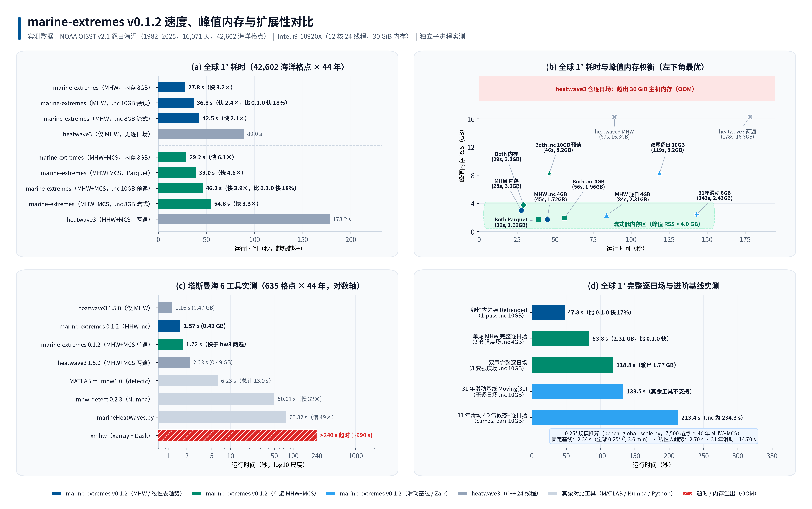

# marine-extremes

[](https://github.com/Radianjayjay/marine-extremes/actions/workflows/ci.yml)
[](https://pypi.org/project/marine-extremes/)
[](https://doi.org/10.5281/zenodo.24579203)
[](LICENSE)
[](pyproject.toml)
[](Cargo.toml)

[English](README.md) | **简体中文**

`marine-extremes` 是一个用 Rust 加速的 Python 海洋极端事件检测库，对 1D 至 4D 海洋标量数据同时支持上尾高值事件（`"high"`）与下尾低值事件（`"low"`）识别。用于海水温度时，二者对应海洋热浪（MHW，别名 `"mhw"`）和海洋冷事件（MCS，别名 `"mcs"`）；同一套引擎也适用于盐度、酸度（pH）、溶解氧（低氧/缺氧）、二氧化碳（`pCO2`/`CO2`）和叶绿素等多要素，涵盖 1D 站点观测、3D 海表网格（NOAA OISST、OSTIA）、4D 带深度维海洋再分析数据（GLORYS、ORAS5、Argo）以及多日历 CMIP6 气候模式数据。

架构与模块图示可在浏览器中打开 [docs/marine_extremes_overview.html](docs/marine_extremes_overview.html) 查看。

## 主要功能

- Rust + Rayon 并行内核。通过 `py.detach()` 释放 Python GIL，跳过陆地格点，并在 `working_dtype="auto"` 下对 `float32`/打包 `int16` 数据使用紧凑 `float32` 读块与内部 `f64` 累加，内存减半且无精度漂移。
- 单遍同时识别 MHW 与 MCS。设置 `event="both"` 只计算一次气候态，单次扫描同时输出高值与低值事件。
- 受 `memory_limit` 约束的流式分块与单遍预读。可直接读取按年拆分的多文件 NetCDF 或 Zarr（如 `sst.day.mean.*.nc`）；当原始数组能放入 `memory_limit` 的 45% 时自动走单遍顺序预读，否则按空间或深度瓦片流式计算，避免爆内存。
- 7 种单目标输出格式。只需指定 `out=...` 扩展名，即可输出单个不含伴随文件的结果：`.nc`、`.mat`（无 2 GB 限制的 v7.3 HDF5，或兼容 `m_mhw1.0` 的 v5 `detectc` 元胞数组）、`.zarr`、`.npz`、`.parquet`、`.feather` 或 `.csv`。
- CSR 索引格点查表与列式分析。事件按展平格点索引有序存储，并在 `.nc`、`.mat`、`.zarr`、`.npz`、`.parquet` 中内嵌 `int64` CSR `grid_offsets`，支持磁盘懒加载 O(1) 单点查询 `res.events.sel(...)` / `isel(...)` 以及免扫描的 `count_map()`。
- 五类基线定义。内置 `FixedBaseline`（支持外置 `clim_data` 跨情景基准）、`DetrendedBaseline`（线性或二次 OLS 去趋势）、`MovingBaseline`（滑动多年窗口，支持 `clamp`/`shrink` 边界）、`FixedThreshold` 和 `ExternalClimatology`。
- CMIP6 多日历与月尺度模式。支持公历及 `cftime` 日历（`standard`、`proleptic_gregorian`、`noleap`/`365_day`、`360_day`、`all_leap`/`366_day`），以及 `freq="monthly"` 月尺度检测（Jacox et al., 2020）。
- 显式跨工具兼容预设。通过 `compat="standard"`、`"m_mhw"`、`"m_mhw_python"`、`"oliver"` 或 `"heatwaveR"` 指定分位数规则、阈值不等号、2 月 29 日处理与方差 `ddof`，逐项对齐参考工具。
- 边缘与海冰区保护。支持仅用于检测阶段的 `max_pad_length` 短缺测插值、`min_valid_fraction` 海冰边缘过滤（循环平滑不渗入 NaN）、`truncated_start`/`truncated_end` 截断标记，以及 `lower_bound`（`flag`/`mask`/`floor` 及除零保护）。
- CF 元数据自动识别。内置轻量 CF 解析器（可选接入 `cf-xarray`），自动推断非 `time` 维度（如 `valid_time`、`time_counter`、`ocean_time`），跳过 `*_bnds`/`grid_mapping`/`ancillary_variables`，支持 `standard_name` 与海洋别名选参，并在开尔文/摄氏度与 `lower_bound` 冲突时发出提醒。
- AI Agent Skill 与 MCP 服务。附带 Agent Skill（[skills/marine-extremes/SKILL.md](skills/marine-extremes/SKILL.md)）和可选本地 stdio MCP 服务（`marine-extremes-mcp`），提供 `inspect_dataset`、`detect_extremes`、`query_events` 与 `summarize_result` 四个工具。

## 安装

直接从 PyPI 安装预编译包（Linux、macOS、Windows 均无需本机 Rust 工具链）：

```bash
# 核心包（NumPy、Pandas、PyArrow、Xarray）
pip install marine-extremes

# 推荐：附带全部 I/O 后端（NetCDF4、HDF5/MAT、Zarr、cftime、Dask、cf-xarray）
pip install "marine-extremes[io]"
```

在较老的 HPC Linux 节点（`glibc < 2.28`，例如 CentOS 7）上，`pyarrow>=21` 没有预编译 wheel，会退回耗时很久的 C++ 源码编译，建议加 `--only-binary=:all:` 并锁定版本：

```bash
pip install --only-binary=:all: "pyarrow<21" "marine-extremes[io]"
```

[pyproject.toml](pyproject.toml) 中的可选依赖组：

- `marine-extremes[netcdf]`：`netCDF4`、`h5netcdf`、`cftime`、`dask`
- `marine-extremes[mat]`：`h5py`、`scipy`（MATLAB v7.3 与 v5 `.mat`）
- `marine-extremes[zarr]`：`zarr>=3.0`、`cftime`、`dask`
- `marine-extremes[cf]`：`cf-xarray`（可选 CF accessor 与自定义准则支持）
- `marine-extremes[mcp]`：`mcp`（可选本地 stdio MCP 服务 `marine-extremes-mcp`，供 AI 客户端调用）
- `marine-extremes[io]`：全部 I/O 后端（`netcdf`、`mat`、`zarr`、`cf`，不含 `mcp`）
- `marine-extremes[dev]`：`pytest`、`maturin`

从源码编译安装（需本机 Rust 工具链）：

```bash
git clone https://github.com/Radianjayjay/marine-extremes.git
cd marine-extremes
pip install maturin
maturin develop --release --extras io,mcp   # 如不需要 MCP 服务可省略 ,mcp
```

## 快速上手

```python
import marine_extremes as mx

res = mx.detect(
    "data/OISST_1982_2025_r360x180.nc",
    var="sst",
    squeeze_singleton="zlev",        # 自动压缩长度为 1 的深度维（如 OISST zlev=1）
    event="both",                    # "high" | "low" | "both"（别名："mhw" | "mcs"）
    baseline=mx.MovingBaseline(window_years=31, center=True, boundary="clamp"),
    lower_bound=-1.8,
    bound_policy="flag",
    working_dtype="auto",            # 对 float32/int16 NetCDF 自动采用紧凑 float32 瓦片
    clim_dtype="float32",            # 将 4D MovingBaseline 的气候态/阈值内存、磁盘体积与写盘耗时减半
    intensity_dtype="float32",       # 将 intensity_ts / intensity_high_ts / intensity_low_ts 体积减半
    memory_limit="8GB",              # ~4 GB 全球 1° 输入设 "10GB" 可触发单遍顺序预读加速
    out="outputs/oisst_mhw.nc",      # .nc | .mat | .zarr | .npz | .parquet | .feather | .csv
)

# 分方向强度时间序列位于 res.intensity_high_ts 与 res.intensity_low_ts
# O(1) 单格点检索（对 .nc / .mat v7.3 / .zarr / .parquet 自动磁盘懒切片）
df_point = res.events.sel(lat=-42.5, lon=148.0)

# 基于 CSR 偏移直接计算空间事件计数图（无需扫表）
counts = res.events.count_map()

# 分块汇总统计（适合百万级以上超大事件表）
stats = res.summary()

# 导出完整列式 DataFrame（中小型结果）
df_all = res.events.to_pandas()

# 直接重新打开任意已保存结果
res2 = mx.open("outputs/oisst_mhw.nc")

# 导出单文件 MATLAB .mat（v5 detectc 元胞或 v7.3 HDF5）或 Zarr
res.to_mat("outputs/oisst_detectc.mat", layout="detectc")
res.to_mat("outputs/oisst_v73.mat", layout="v73")
res.save("outputs/oisst_mhw.zarr")
```

运行无需外部数据的示例脚本：

```bash
python examples/quickstart.py
```

## 结合 AI Agent 使用（Skill 与 MCP）

### Agent Skill（推荐用于编程 Agent）

如果你的编程 Agent 可以运行本地 Python（如 Claude Code、Codex、Cursor、Antigravity、Windsurf、OpenCode），安装 `marine-extremes[io]` 后，把 [skills/marine-extremes/SKILL.md](skills/marine-extremes/SKILL.md) 放进对应工具的 skills 目录即可：

```bash
# 从本地仓库复制（按实际使用的工具保留对应目录）
mkdir -p ~/.claude/skills/marine-extremes ~/.codex/skills/marine-extremes
cp skills/marine-extremes/SKILL.md ~/.claude/skills/marine-extremes/SKILL.md
cp skills/marine-extremes/SKILL.md ~/.codex/skills/marine-extremes/SKILL.md

# 若直接通过 PyPI 安装、本地未克隆仓库，可直接下载
curl -fsSL https://raw.githubusercontent.com/Radianjayjay/marine-extremes/main/skills/marine-extremes/SKILL.md \
  -o ~/.claude/skills/marine-extremes/SKILL.md
```

装好之后直接说人话就行，不需要手写一堆参数名：

> “请使用 Python 库 `marine-extremes`，帮我识别 MHW 和 MCS。我的 SST 文件（或按年拆分的 nc 文件夹）在 `data/sst_*.nc`，输出为 `.nc`（或 `.zarr` / `.mat` / `.npz`）文件保存到 `outputs/`。”

发送之后，Agent 会先快速读取文件头与宿主环境（不做耗时试跑），再弹出简洁选择题（无弹窗则用编号列表）逐项确认：气候态基线、兼容口径（`compat`）、物理下界与冰点处理、精度、输出格式，以及运行位置（当前/服务节点、SSH 计算节点，或 PBS/Slurm 单节点多线程及多节点空间分片作业）。遇到耗时较长的大网格任务时，Agent 会生成独立脚本并在后台启动，确认进程或作业正常跑起来后立即交还控制权，并询问是否设定定期巡检。若你在提问中已经写全参数或要求按默认值执行，则会跳过问答直接开跑。

如果暂不安装 Skill 文件，也可以直接发一段简短指令，让 Agent 先查数据再问你：

> “请用 Python 库 `marine-extremes`（`import marine_extremes as mx`）帮我识别 `data/sst_*.nc` 中的 MHW 和 MCS，结果保存到 `outputs/`。先检查文件里的变量名、单位和时间跨度，再把气候态基线、兼容口径和输出格式列成选项让我选，确认后再运行。”

### 可选本地 stdio MCP 服务（供桌面端/对话式 AI 客户端使用）

如果所用 AI 客户端不能直接执行本地 Python 脚本（如 Claude Desktop、Cherry Studio），可以安装可选 `mcp` 依赖（兼容 MCP Python SDK v1 与 v2）：

```bash
pip install "marine-extremes[io,mcp]"
```

在客户端 MCP 配置中加入：

```json
{
  "mcpServers": {
    "marine-extremes": {
      "command": "marine-extremes-mcp"
    }
  }
}
```

如果桌面端客户端未继承你的 Conda/虚拟环境 `PATH`，可直接指向该环境中的 Python 解释器：

```json
{
  "mcpServers": {
    "marine-extremes": {
      "command": "/path/to/your/env/bin/python",
      "args": ["-m", "marine_extremes.mcp_server"]
    }
  }
}
```

| MCP 工具 | 用途 |
| --- | --- |
| `inspect_dataset` | 检测前查看变量名、维度、1D 坐标范围（提示多维曲线坐标）、CF 日历、单长度维与开尔文/摄氏度提醒。 |
| `detect_extremes` | 按固定、去趋势、滑动或固定阈值基线流式检测（支持 1D `region` 裁剪、`clim_dtype` 与分方向 `intensity_high_ts` / `intensity_low_ts`），将结果写入单个 `out` 文件，返回元数据、警告与最多 50 条样本行，并拒绝覆盖输入文件或非 Zarr 目录。 |
| `query_events` | 用 CSR 索引按 `coords` 或 `indices` 做 O(1) 单点查询，或按事件类型、持续天数、等级与 `YYYY` / `YYYY-MM` / `YYYY-MM-DD` 日期分块筛选，支持 Top-K 排序（最多 500 条）和 `limit=0` 计数。 |
| `summarize_result` | 按有界分块统计像元覆盖、事件类型/等级/起始年份分布、持续时间与最大绝对强度，不把整张事件表载入内存。 |

`detect_extremes` 把格点结果直接落盘到 `out`，仅返回紧凑元数据与样本行，不占用模型上下文。多年代高分辨率全球网格（如 0.25° OISST 或 OSTIA）耗时较长，建议通过 Skill 生成 Python 脚本后台运行，避免触发 MCP 超时。

## 性能与精度验证




上述测试基于 NOAA OISST v2.1 逐日海温（1982–2025，16,071 天，42,602 海洋格点，基准期 1982–2011），在 Linux（Intel Core i9-10920X，12 核 24 线程 @ 3.5 GHz，30 GiB 内存）下以独立子进程实测，运行时间取 `perf_counter`，峰值内存由 `/usr/bin/time -v` 采集。参测工具版本：`heatwave3 1.5.0`（24 线程，`roundClm=False`）、MATLAB R2025b `m_mhw1.0`（`detectc.m`）、`mhw-detect 0.2.3`（Numba `0.68.1`）、`ecjoliver/marineHeatWaves.py`（修补 NumPy 2 兼容性后运行）及 `xmhw`。

与 `heatwave3`、`xmhw` 相比，全年 290–300 天的气候态差值为 `0.0 °C`；`<= 0.008 °C` 的差异只出现在 1 月 1 日与 2 月 29 日前后 `±15` 天的平滑边界区，原因是二者将气候态严格截取为 `366 × n_years` 矩阵直接首尾环绕，并在取 `±5` 天窗口前插入平年 2 月 29 日。

### v0.1.2 与 v0.1.0 实测对比

| 测试场景（OISST 1982–2025，`16071 × 181 × 360`） | `v0.1.0` | `v0.1.2` | 说明 |
| --- | --- | --- | --- |
| 全球 1° 单尾 MHW `.nc`（`8GB` / `4GB` / `10GB`） | `45.0 s (3.83 GB)` / `48.1 s (2.32 GB)` | `42.5 s (2.72 GB)` / `44.9 s (1.72 GB)` / **`36.8 s`** | `10GB` 触发单遍顺序预读（较 `0.1.0` 快 18%） |
| 全球 1° 单遍 MHW+MCS `.nc`（`8GB` / `4GB` / `10GB`） | `56.2 s (4.40 GB)` / `57.5 s (2.70 GB)` | `54.8 s (3.06 GB)` / `56.2 s (1.96 GB)` / **`46.2 s`** | 流式峰值内存降 26–30%（`7,554,466` 条事件） |
| 全球 1° MHW+MCS（`内存 8GB` / `Parquet 4GB`） | `28.5 s (4.72 GB)` / `36.2 s (2.33 GB)` | `29.2 s (3.76 GB)` / `39.0 s (1.69 GB)` | 峰值内存降 20–27%（`.parquet` 体积 `808 MB`） |
| 全球 1° MHW 完整逐日场 `.nc`（`4GB`，`float32`） | `88.8 s (2.79 GB，1 套强度)` | **`83.8 s (2.31 GB)`**（`1.19 GB` 文件） | 输出 2 套强度场 + CF 属性仍提速 5.6% |
| 全球 1° MHW+MCS 完整逐日场（`4GB` / `10GB clim32`） | `99.3 s (3.05 GB，1 套强度)` | `141.1 s (2.45 GB)` / **`118.8 s`**（`1.77 GB`） | 现同时写出 3 套强度场（`ts`、`high_ts`、`low_ts`） |
| 全球 1° 线性去趋势 `.nc`（`8GB` / `10GB`） | `57.3 s (3.48 GB)` | `57.6 s (2.61 GB)` / **`47.8 s`**（`901 MB`） | `10GB` 单遍预读提速 17% |
| 全球 1° 31 年滑动基线（`.nc`，`8GB` / `10GB`） | `145.9 s (3.74 GB)` | `143.2 s (2.43 GB)` / **`133.5 s`**（`607 MB`） | 流式峰值内存降 35% |
| 全球 1° 11 年滑动 4D `clim32` + 逐日场（`10GB`） | — | **`213.4 s`**（`.zarr`）/ `234.3 s`（`.nc`） | `1993–2025` 含 4D 气候态与 3 套分方向逐日场 |
| 塔斯曼海区域（`635 格点`，MHW `.nc` / Both `.nc`） | `1.70 s` / `1.82 s` | **`1.57 s (0.42 GB)`** / **`1.72 s (0.43 GB)`** | `f32` 与 `f64` 逐事件完全一致（`115,243` 条，`0.0 °C`） |
| 合成基准 `bench_global_scale.py`（`7,500 格点 × 40 年`） | `2.31 s` / `2.65 s` / `14.70 s` | `2.34 s` / `2.70 s` / `14.70 s` | 固定基线 / 线性去趋势 / 31 年滑动 |

### 功能对比

| 能力维度 | `marine-extremes` | `heatwave3` | `m_mhw1.0` | `heatwaveR` | `marineHeatWaves` | `xmhw` | `mhw-detect` |
| --- | :---: | :---: | :---: | :---: | :---: | :---: | :---: |
| 核心引擎 | Rust + Rayon | C++ + OpenMP | MATLAB | R + Rcpp | Python | xarray + Dask | Python + Numba |
| 单遍同步 MHW + MCS | 支持 | 否（两遍） | 否（两遍） | 否（两遍） | 否（两遍） | 否（两遍） | 否 |
| 内存有界流式分块 | 支持（`memory_limit`） | 部分（全球 ~16 GB） | 否（全内存） | 否（仅 1D） | 否（仅 1D） | Dask（偏慢） | 手动 `mhw-cut` |
| 网格维度 | 1D-4D | 3D-4D | 仅 3D | 仅 1D | 仅 1D | 3D | 3D |
| 基线支持 | 固定 / 线性 / 二次 / 滑动 / 外部 | 固定 / 线性 | 固定 / 外部 | 固定 | 固定 / 外部 | 固定 | 固定 / 外部 |
| CMIP6 多日历与月尺度 | 支持（`cftime` + 月尺度） | 公历 | 公历 | 公历 | `Ly` 近似 | 部分 | 公历 |
| 单目标多格式输出 | `.nc/.mat/.zarr/.npz/.parquet/.csv` | `.nc/.zarr`（多文件） | `.mat` | R data.frame | Python dict | xarray | `.parquet/.csv` |
| O(1) 格点检索（CSR） | 支持（磁盘懒加载） | 否 | 元胞数组（内存） | 否 | 否 | 否 | 否 |
| 显式跨工具 `compat` 预设 | 5 套预设 | 固定（`heatwaveR`） | 2 套（`matlab`/`python`） | 固定 | 固定 | 固定 | 固定 |

## 支持的输入类型

`mx.detect(data, ...)` 与 `mx.compute_climatology(data, ...)` 接受以下七类输入，内部统一整理为带一个时间维和零至多个空间/深度维的数组：

| 输入形式 | 示例 | 打开与解析方式 |
| --- | --- | --- |
| 单个 NetCDF 文件（`.nc`、`.nc4`、`.cdf`） | `"data/OISST_1982_2025.nc"` | 通过 `xr.open_dataset` 懒加载，自动读取 CF 元数据、打包整型缩放及 `cftime` 日历，不一次性载入全网格。 |
| 多文件通配符或路径列表 | `"data/sst.*.nc"` 或 `["2020.nc", "2021.nc"]` | 通过 `xr.open_mfdataset(..., combine="by_coords")` 按坐标懒合并读取。 |
| Zarr 存储目录（或 Zarr 列表/通配符） | `"data/oisst.zarr"` | 通过 `xr.open_zarr(..., consolidated=False)`（多存储时加 `engine="zarr"`）懒加载。 |
| `xarray.DataArray` | `ds["sst"]` | 直接使用内存或 Dask 分块数组，沿用已有维度名与属性。 |
| `xarray.Dataset` | `xr.open_dataset(...)` | 按 `var` 选取变量；若剔除 CF 辅助变量（`bounds`、`climatology`、`ancillary_variables`、`coordinates`、`grid_mapping`、`cell_measures`）后只剩一个主变量，可自动选中。 |
| `pandas.Series` | `pd.Series(sst, index=dates)` | 按 1D 站点序列处理；默认取 `series.index` 为时间轴，也可用 `time=...` 覆盖。 |
| `numpy.ndarray`（1D 至 N-D） | `arr` 配合 `time=dates` | 必须显式传入一维 `time=...`。多维数组会按 `len(time)` 自动匹配第 `0` 轴（Python/CF 排列）或第 `-1` 轴（MATLAB `m_mhw` 排列）。 |

时间轴支持 `numpy.datetime64`（`[D]`、`[s]`、`[ms]`、`[us]`、`[ns]`）、带时区的 `pandas.DatetimeIndex` 或 Python `datetime`（自动换算为无时区 UTC）、`xarray.CFTimeIndex`、`cftime.datetime`、带 `<unit> since ...` 属性的未解码 CF 数值坐标、8 位整数 `YYYYMMDD`、ISO 日期字符串以及 Python `datetime.date` / `datetime.datetime`。时间戳必须严格递增且无 `NaT`，`freq="daily"` 会拒绝同一天内的多条次日内记录（请先重采样到逐日）。

## 检测参数说明

下面列出 `mx.detect(data, **kwargs)` 的全部参数。`mx.compute_climatology(...)` 接受其中输入选择、`baseline`、分位数、平滑窗、`compat`、`calendar`、`working_dtype` 与 `memory_limit` 参数，只输出气候态数据集，不做事件检测。

### 输入、时间与维度参数

| 参数名 | 默认值 | 可选值与含义 |
| --- | --- | --- |
| `data` | 必填 | 输入路径、通配符、路径序列、`xarray.DataArray`、`xarray.Dataset`、`pandas.Series` 或 `numpy.ndarray`。 |
| `var` | `None` | 精确变量名（如 `sst`、`thetao`、`so`、`ph`、`o2`、`spco2`）、CF `standard_name` 或常用海洋别名（`"sst"`、`"temp"`、`"salinity"`、`"chlorophyll"`、`"oxygen"`）。单科学变量文件可省略；多变量文件（如含 `sst`、`anom`、`err`、`ice` 的 OISST）必须指定。 |
| `time` | `None` | 一维时间坐标数组。传入原始 `numpy.ndarray` 时必填；传入 `pandas.Series` 时可用它替换默认索引。 |
| `time_dim` | `"auto"` | 时间维度名。`"auto"` 依次检查 CF `axis="T"`、`cartesian_axis="T"`、`standard_name="time"`、CF 时间单位、`datetime` 类型及常见名（`time`、`valid_time`、`time_counter`、`ocean_time`、`t`、`date`、`dates`）。 |
| `squeeze_singleton` | `False` | 压缩长度为 1 的非时间维：`False` 保留全部维度；`True` 压缩所有长度为 1 的非时间维；传入维度名（如 `"zlev"`）或名称列表仅压缩指定维度（长度不为 1 时报错）。 |
| `calendar` | `None` | 显式指定日历（`"standard"`、`"gregorian"`、`"proleptic_gregorian"`、`"noleap"`、`"365_day"`、`"360_day"`、`"all_leap"`、`"366_day"`、`"julian"`）。`None` 自动读取 `cftime` 日历或对 `datetime64` 使用公历。 |
| `freq` | `"daily"` | 时间步长尺度。`"daily"` 对应 Hobday (2016) 逐日默认参数（`window_half_width=5`、`smooth_width=31`、`min_duration=5`、`max_gap=2`）；`"monthly"` 对应 Jacox (2020) 逐月默认参数（`window_half_width=0`、`smooth_width=1`、`min_duration=1`、`max_gap=0`）。 |
| `detect_period` | `None` | 传入 `(start, end)`（日期字符串、整数年份或 `None` 表示不封顶）限定输出事件与逐日时间序列的连续时段，与气候态计算基准期相互独立；`None` 对全时段检测。 |

### 事件、基线与算法参数

| 参数名 | 默认值 | 可选值与含义 |
| --- | --- | --- |
| `event` | `"high"` | 检测方向（`"high"`、`"low"` 或 `"both"`）。参数采用变量中性的 `"high"` 与 `"low"`，方便把温度和盐度、酸度（pH）、溶解氧、`pCO2`/`CO2`、叶绿素等要素放在同一接口下处理：`"high"`（别名 `"mhw"`）识别高值事件（如海洋热浪、高盐或高 `pCO2` 事件），`"low"`（别名 `"mcs"`）识别低值事件（如海洋冷事件、低盐、极端酸化低 pH 或低氧事件），`"both"` 单次计算气候态并同时输出高值与低值事件。 |
| `baseline` | `None` | 气候态基线定义：`None` 以全时段构建 `FixedBaseline()`；传入 `(start, end)` 二元组等价于 `FixedBaseline(start, end)`；或传入 `FixedBaseline`、`DetrendedBaseline`、`MovingBaseline`、`FixedThreshold`、`ExternalClimatology` 实例。 |
| `pctile_high` | `0.90` | `"high"` 与 `"both"` 模式使用的上百分位阈值，支持 `[0, 1]`（如 `0.90`）或 `(1, 100]`（如 `90`）；仅设 `event="low"` 时忽略。 |
| `pctile_low` | `0.10` | `"low"` 与 `"both"` 模式使用的下百分位阈值，支持 `[0, 1]` 或 `(1, 100]`；`event="both"` 时须满足 `pctile_low < pctile_high`。 |
| `window_half_width` | `None` | 计算逐日/逐月气候态与分位阈值时，每个年内日序前后取样的半窗宽（`+/- w`）。`None` 在 `"daily"` 下取 `5`（11 天窗），在 `"monthly"` 下取 `0`；须 `>= 0`。 |
| `smooth_width` | `None` | 对季节气候态与阈值做跨年循环滑动平均的窗宽。`None` 在 `"daily"` 下取 `31`，在 `"monthly"` 下取 `1`（不平滑）；须 `>= 1`。 |
| `min_duration` | `None` | 构成一次事件所需的最少连续超阈值步数。`None` 在 `"daily"` 下取 `5`，在 `"monthly"` 下取 `1`；须 `>= 1`。 |
| `max_gap` | `None` | 相邻满足时长事件之间允许传递合并的最大非超阈值间隔步数。`None` 在 `"daily"` 下取 `2`，在 `"monthly"` 下取 `0`（不合并）；须 `>= 0`。 |
| `compat` | `"standard"` | 数值兼容性预设名（`"standard"`、`"m_mhw"`、`"m_mhw_python"`、`"oliver"`、`"heatwaveR"`）或自定义 `mx.CompatProfile(...)` 实例。 |

对于 `"low"`（`"mcs"`、低 pH、低氧、低盐等）事件，事件表强度列（`int_max`、`int_mean`、`int_cum`、`int_max_rel_thresh`、`int_mean_rel_thresh`、`int_cum_rel_thresh`）以及格点 `intensity_ts`、`intensity_low_ts`、`daily_category_ts`、`event_category_ts` 均为负值；`int_std`、`int_var`、`rate_onset`、`rate_decline` 与 `category_max` 为非负幅值。

### 缺测与物理下界保护参数

| 参数名 | 默认值 | 可选值与含义 |
| --- | --- | --- |
| `max_pad_length` | `0` | 仅在事件检测阶段对内部短 `NaN` 缺测做线性插值的最大步长（不影响气候态估计，也不填充首尾或更长缺测）；`0` 关闭插值。 |
| `min_valid_fraction` | `0.0` | 某日序取样窗内要求的最少有效像元比例（`0.0` 至 `1.0`，海冰边缘常用如 `0.5`）。低于阈值时该日气候态与阈值记为 `NaN`，且循环平滑阶段不会向邻日扩散 `NaN`。 |
| `lower_bound` | `None` | 与输入同单位的物理下限（如摄氏度海温冰点 `-1.8`、开尔文海温 `271.35`，或盐度、溶解氧、叶绿素等非负物理量的 `0.0`）。若单位看起来是开尔文而阈值像摄氏度，会自动发出 `UserWarning`。 |
| `bound_policy` | `"flag"` | 设定 `lower_bound` 后的处理方式：`"flag"` 正常检测，并对事件中观测或阈值进入下界 `0.05` 范围内（或 `abs(thresh - clim) <= 1e-6`）的记录标记 `near_lower_bound=True`；`"mask"` 将 `clim <= lb + 1e-9` 或 `thresh <= lb + 1e-9` 的步长按缺测跳过；`"floor"` 将观测、`clim` 与阈值统一截断到 `lower_bound` 以上。 |

### 输出控制、精度、内存与落盘参数

| 参数名 | 默认值 | 可选值与含义 |
| --- | --- | --- |
| `return_clim` | `True` | 是否输出/写入 `clim`、`thresh_high` 与 `thresh_low` 格点场（需所用基线生成且输出格式支持格点）。 |
| `return_intensity_ts` | `True` | 是否输出逐时间步 Hobday 强度（`value - clim`，事件外为 `0.0`，陆地或缺失为 `NaN`）：输出合并的 `intensity_ts`，并在启用相应方向时分别输出高值事件强度 `intensity_high_ts`（`event` 为 `"high"`/`"both"`）与低值事件强度 `intensity_low_ts`（`event` 为 `"low"`/`"both"`）。设 `False` 可节省体积。 |
| `return_daily_category_ts` | `True` | 是否输出/写入 `int8` 逐日 Hobday (2018) 等级格点 `daily_category_ts`（高值 `+1` 至 `+4`，低值 `-1` 至 `-4`，非事件 `0`，陆地/缺失 `-128`）。 |
| `return_event_category_ts` | `False` | 是否输出/写入 `int8` 格点 `event_category_ts`，把每次事件的峰值等级（含正负号）填满该事件的全部时间步。 |
| `working_dtype` | `"auto"` | 传入 Rust 内核的输入瓦片缓冲精度（`"auto"`、`"float32"`、`"float64"`）。`"auto"` 在原始数据或 CF 打包编码为 `float32`/`float16`/`int16`/`uint16` 时使用紧凑 `float32` 瓦片并在内核以 `f64` 累加。 |
| `clim_dtype` | `"float64"` | `clim`、`thresh_high` 与 `thresh_low` 的存储精度：`"float64"` 或 `"float32"`（设为 `"float32"` 可将气候态体积与写入耗时减半，搭配 4D `MovingBaseline` 尤为明显）。 |
| `intensity_dtype` | `"float64"` | `intensity_ts`、`intensity_high_ts` 与 `intensity_low_ts` 的输出与存储精度：`"float64"` 或 `"float32"`（可将强度时间序列内存与文件体积减半）。 |
| `memory_limit` | `"4GB"` | 空间分块估算的内存上限，支持整数字节数或字符串（如 `"512MB"`、`"4GB"`、`"8GiB"`）。 |
| `out` | `None` | 单目标输出路径（`.nc`、`.mat`、`.zarr`、`.npz`、`.parquet`、`.feather`、`.csv`）。`None` 返回纯内存 `DetectResult`；传入路径后按空间瓦片边算边写，不落地散落文件。 |
| `out_format` | `None` | 路径不含标准后缀或需要显式指定格式时的覆盖值：`"netcdf"`（`"nc"`、`"nc4"`、`"netcdf4"`）、`"mat"`（`"mat73"`、`"matlab"`）、`"mat_detectc"`（`"mat_cell"`、`"detectc"`、`"mat5"`）、`"zarr"`、`"npz"`（`"numpy"`）、`"parquet"`（`"pq"`）、`"feather"`（`"ipc"`、`"arrow"`）、`"csv"`。 |
| `mat_layout` | `"v73"` | `.mat` 布局方式：`"v73"` 为流式 HDF5 v7.3（无 2 GB 上限，支持 O(1) CSR 懒查表）；`"detectc"` 为兼容 MATLAB `m_mhw1.0` 的缓冲 v5 元胞结构（受 2 GB 上限约束）。 |

## 基线类型

| 基线类 | 构造参数与作用 |
| --- | --- |
| `FixedBaseline(start=None, end=None, clim_data=None, clim_time=None, clim_var=None)` | 经典 Hobday et al. (2016) 固定参考期气候态，`start`/`end` 省略时默认取全时段；传入 `clim_data`（可选 `clim_time`、`clim_var`）可用外部数据集计算气候态，适合跨情景检测（如 CMIP6 历史期基准用于 SSP 未来情景）。 |
| `DetrendedBaseline(method="linear", start=None, end=None, fit_period=None)` | 在 `fit_period`（默认全时段，忽略 `NaN`）上逐像元拟合线性（`"linear"`）或二次（`"quadratic"`）OLS 趋势，保留均值并减去趋势项后再按 `(start, end)` 求气候态与事件，回归系数保存在 `res.trend`。 |
| `MovingBaseline(window_years=31, center=True, boundary="clamp", clim_data=None, clim_time=None, clim_var=None)` | 多年滑动窗口气候态（如 11 年或 31 年）。`center=True` 使用对称中心窗，`center=False` 使用向后滑动窗；`boundary="clamp"` 在起止边缘保持 `window_years` 宽度，`"shrink"` 收缩边缘可用年数。同样支持外置 `clim_data`、`clim_time`、`clim_var`。 |
| `FixedThreshold(threshold_high=None, threshold_low=None, climatology=0.0)` | 直接指定标量或空间网格阈值（`float`、`numpy.ndarray` 或 `xr.DataArray`）及基准 `climatology`，适合珊瑚白化温度或盐度固定阈值检测。 |
| `ExternalClimatology(seas, thresh_high=None, thresh_low=None)` | 复用内存数组或 NetCDF/Zarr 文件中已算好的季节气候态 `seas` 与高低阈值（支持 `doy`、`(year, doy)` 或 `time` 维度布局），可直接用 `ExternalClimatology.from_dataset(clim_ds)` 从 `mx.compute_climatology(...)` 构造。 |

## 跨工具兼容预设

`compat` 可传入下表中的预设名称，也可传入自定义 `mx.CompatProfile(quantile_method=..., strict_inequality=..., feb29_mode=..., smooth_nan_policy=..., var_ddof=...)`：

| 预设名 | 分位数算法 | 超阈值判据 | 闰日（2 月 29 日）处理 | 方差 `ddof` | 对标参考工具 |
| --- | --- | --- | --- | --- | --- |
| `"standard"`（默认） | Type-7 | `>` / `<` | `interp_59_61` | `1` | Hobday (2016/2018) + 样本标准差 |
| `"m_mhw"` | Type-5 (Hazen) | `>=` / `<=` | `interp_59_61` | `1` | MATLAB `m_mhw1.0`（`detect.m` / `detectc.m`） |
| `"m_mhw_python"` | Type-7 | `>=` / `<=` | `interp_59_61` | `1` | `m_mhw` Python 移植口径 |
| `"oliver"` | Type-7 | `>` / `<` | `interp_59_61` | `0` | `ecjoliver/marineHeatWaves.py` |
| `"heatwaveR"` | Type-7 | `>` / `<` | `heatwaver_series` | `1` | R `heatwaveR` / C++ `heatwave3` |

## 输出格式

传入 `out="path"`（或调用 `res.save("path")`、`res.to_mat("path")`、`res.events.save("path")`）会按后缀名（或 `out_format=...`）生成单个完整结果，不产生额外伴随文件：

| 扩展名 / `out_format` | 存储内容与适用场景 | 写入与查询方式 | 外部读取工具 |
| --- | --- | --- | --- |
| `out=None`（内存返回） | 返回 `DetectResult`，直接持有格点 `xr.DataArray` 与内存 `EventCatalog`，适合 1D 站点或小网格。 | 纯内存 | Python（`res.events.to_pandas()`、`res.to_dataset()`） |
| `.nc` / `.nc4` / `.cdf`（`"netcdf"`） | 格点数据推荐默认格式：根组存格点场、坐标与全局属性，`/events` 子组存事件表与 CSR `grid_offsets`。 | 流式写入 + O(1) 懒切片 | `xarray.open_dataset`、MATLAB `ncread`、CDO、Panoply |
| `.mat`（`"mat"`，`mat_layout="v73"`） | HDF5 格式 MATLAB v7.3 文件，含格点场、`events` 列向量结构体、`grid_offsets` 与坐标，无 2 GB 上限。 | 流式写入 + O(1) 懒切片 | MATLAB `load()` / `matfile()`、`h5py` |
| `.mat`（`"mat_detectc"`，`mat_layout="detectc"`） | 兼容 MATLAB `m_mhw1.0` 的 v5 文件，包含 `MHW{i,j}` 元胞数组及 `mclim`、`m90`、`m10`、`mhw_ts`、`category_ts`（带 2 GB 限制检查）。 | 缓冲写入 v5 | MATLAB `m_mhw1.0` 脚本、`scipy.io.loadmat` |
| `.zarr`（`"zarr"`） | 单个 Zarr v3 存储目录：根组为 zstd 压缩分块格点场，`/events` 子组存事件表与 `grid_offsets`。 | 流式写入 + O(1) 懒切片 | `xarray.open_zarr(..., consolidated=False)`、`zarr` |
| `.npz`（`"npz"`） | 压缩 NumPy 归档文件，包含格点数组、事件列、CSR `grid_offsets` 与 JSON 元数据。 | 缓冲写入 | `numpy.load()` |
| `.parquet` / `.pq`（`"parquet"`） | 仅存事件表（不保存格点场）；在 Parquet schema 元数据中嵌入 `grid_offsets` 与空间坐标。 | 流式写入 + O(1) 懒切片 | Pandas、Polars、DuckDB、PyArrow、R Arrow |
| `.feather` / `.ipc`（`"feather"`） | 仅存事件表，使用 Apache Arrow IPC 列式格式并内嵌空间元数据，适合高速零拷贝分析。 | 流式写入 | PyArrow、Polars、R Arrow |
| `.csv`（`"csv"`） | 标准 RFC-4180 纯文本事件表，不含格点场与 `grid_offsets`，适合电子表格或轻量交换。 | 流式写入 | Excel、R、Pandas、Polars |

### 格点变量与 `DetectResult` 字段

支持格点的格式（`.nc`、`.mat`、`.zarr`、`.npz`）在根组中写入下列变量，并自动附带 CF `long_name`、`units` 与 `description` 属性，与 `res = mx.detect(...)` / `mx.open(...)` 的字段及 `res.summary()` / `res.events.summary()` 对应。对于 3D 海表输入 `(time, lat, lon)`，`clim`、`thresh_high`、`thresh_low` 在 `FixedBaseline` 或 `DetrendedBaseline` 下是 3D `(lat, lon, doy)`，仅在使用逐年滑窗的 `MovingBaseline` 时才是 4D `(lat, lon, year, doy)`；逐时间步数组保持 3D `(lat, lon, time)`（1D 站点为 1D，带深度维数据为 4D）。

| 变量 / 字段 | 维度形状 | 数据类型 | 含义 |
| --- | --- | --- | --- |
| `clim` | `(*spatial, doy)` 或 `(*spatial, year, doy)` | `float64` 或 `float32` | 按年内日序（`1..366`/`365`/`360` 或 `1..12`）排列的季节气候态；使用 `MovingBaseline` 时多一维 `year`（精度由 `clim_dtype` 控制）。 |
| `thresh_high` | 与 `clim` 相同 | `float64` 或 `float32` | 上阈值曲线（`event` 为 `"high"` 或 `"both"` 时生成）。 |
| `thresh_low` | 与 `clim` 相同 | `float64` 或 `float32` | 下阈值曲线（`event` 为 `"low"` 或 `"both"` 时生成）。 |
| `intensity_ts` | `(*spatial, time)` | `float64` 或 `float32` | 合并 Hobday 强度（事件内 `value - clim`，非事件有效步 `0.0`，陆地/缺失 `NaN`；有效超阈值步覆盖对向事件间隙，纯间隙重叠时高事件优先；相对阈值超额在事件表 `int_*_rel_thresh` 列）。 |
| `intensity_high_ts` | `(*spatial, time)` | `float64` 或 `float32` | 高值/MHW 方向 Hobday 强度（`value - clim`，正值；仅高值事件内非零，`event` 为 `"high"` 或 `"both"` 时输出）。 |
| `intensity_low_ts` | `(*spatial, time)` | `float64` 或 `float32` | 低值/MCS 方向 Hobday 强度（`value - clim`，负值；仅低值事件内非零，被下界掩膜时记 `NaN`，`event` 为 `"low"` 或 `"both"` 时输出）。 |
| `daily_category_ts` | `(*spatial, time)` | `int8` | 逐时间步 Hobday (2018) 等级：高值 `+1..+4`，低值 `-1..-4`，非事件 `0`，陆地或缺失 `-128`（`mx.CATEGORY_MISSING`，由包内部通过 `missing_value_code` 属性声明；刻意不设 NetCDF `_FillValue`，避免 `xarray` 打开时把 1 字节整数升格为浮点导致内存暴涨）。 |
| `event_category_ts` | `(*spatial, time)` | `int8` | 与 `daily_category_ts` 编码一致，但将每次事件的峰值等级填满该事件持续期间的所有时间步（由 `return_event_category_ts=True` 开启）。 |
| `trend_intercept`、`trend_slope_per_step`、`trend_quadratic_per_step2` | `(*spatial)` | `float64` | `DetrendedBaseline` 输出的逐像元 OLS 趋势系数（内存中汇集在 `res.trend` 的 `intercept`、`slope_per_step`、`quadratic_per_step2`）。 |
| `grid_offsets` | `(n_pixels + 1,)` | `int64` | `.nc`、`.mat` v7.3、`.zarr`、`.npz` 与 `.parquet` 内置的 CSR 行偏移数组，用于 O(1) `res.events.sel(...)` 切片及免扫表 `count_map()`。 |

### 事件表字段说明

所有输出格式的 `res.events` 使用统一列结构（1D 时间序列不含空间索引与坐标列）：

| 列名 | 数据类型 | 含义 |
| --- | --- | --- |
| `pixel_idx` | `int64` | 按行优先展平后的 0 起始空间像元索引。 |
| `event_type` | `dictionary<high, low>` | 事件类型：`"high"`（温度 MHW，或高盐、高 `pCO2`/`CO2` 等高值事件）或 `"low"`（温度 MCS，或低盐、低 pH 酸化、低氧等低值事件）。 |
| `<dim>_idx`、`<dim>` | `int32`、坐标类型 | 每个空间/深度维度 `dim` 的整型下标与对应物理坐标值。 |
| `date_start`、`date_peak`、`date_end` | 日期 / 字符串 | 统一归一化到当日零点（`YYYY-MM-DD 00:00:00`），且直接返回与 `mx.open()` 后完全一致：1678 至 2261 年公历为 `datetime64[ns]`（用 `.dt.year` 提取年份，勿用 `.str[:4]`），超出该区间的公历为 `datetime64[s]`，非公历 `cftime` 为 `"YYYY-MM-DD"` 字符串。 |
| `index_start`、`index_peak`、`index_end` | `int32` | 对应 `detect_period` 内的 0 起始时间步下标。 |
| `duration` | `int32` | 事件持续步数（`index_end - index_start + 1`）。 |
| `int_max`、`int_mean`、`int_cum` | `float64` | 事件期间 `value - clim` 的峰值异常（最大绝对幅值）、均值与累积值；`"high"` 事件为正，`"low"` 事件为负。 |
| `int_std`、`int_var` | `float64` | 事件有效步 `value - clim` 的非负标准差与方差（自由度 `ddof` 随 `compat` 设定）。 |
| `int_max_rel_thresh`、`int_mean_rel_thresh`、`int_cum_rel_thresh` | `float64` | 相对超阈值异常（`value - thresh`）的峰值、均值与累积值；`"high"` 事件为正，`"low"` 事件为负。 |
| `rate_onset`、`rate_decline` | `float64` | `"high"` 与 `"low"` 事件均取正幅值（单位/步），分别表示起始到峰值、峰值到结束的强度变化速率（有相邻有效步时按 Hobday 半步外插边界计算）。 |
| `category_max` | `int8` | 事件最高 Hobday (2018) 严重程度等级（无符号 `1` 中度、`2` 强、`3` 严重、`4` 极端；格点 `daily_category_ts` 与 `event_category_ts` 对 `"high"` 记 `+1` 至 `+4`、对 `"low"` 记 `-1` 至 `-4`）。 |
| `p_moderate`、`p_strong`、`p_severe`、`p_extreme` | `float64` | 1 至 4 级强度各自占该事件总步数的比例（`0.0` 到 `1.0`）。 |
| `truncated_start`、`truncated_end` | `bool` | 事件是否触及 `detect_period` 的首步或末步。 |
| `near_lower_bound` | `bool` | 当设置 `lower_bound` 时，事件内是否存在观测或阈值落在 `lower_bound + 0.05` 以内，或 `abs(thresh - clim) <= 1e-6`。 |

## 项目结构

```text
marine-extremes/
├── Cargo.toml                        # Rust crate 配置（PyO3 0.30、rust-numpy 0.30、Rayon 1.12）
├── pyproject.toml                    # Python 打包与 maturin 构建配置
├── LICENSE                           # MIT 许可证
├── CITATION.cff                      # 引用元数据（GitHub 与 Zenodo）
├── README.md                         # 英文文档（默认）
├── README.zh-CN.md                   # 简体中文文档
├── src/                              # Rust 并行计算核心
│   ├── lib.rs                        # 编译态 PyO3 执行计划（FixedPlan、MovingPlan、CurvesPlan）与 f64/f32 分发
│   ├── compat.rs                     # 跨工具数值兼容枚举与内核参数
│   ├── quantile.rs                   # Type-7 与 Type-5（Hazen）分位数实现
│   ├── baseline.rs                   # OLS 去趋势、WindowPlan、MovingSchedule 与循环平滑
│   └── detect.rs                     # 短缺测插值、阈值扫描、传递合并间隙、事件指标与分级
├── python/marine_extremes/           # Python 编排与单文件持久化层
│   ├── __init__.py                   # 公共导出接口（detect、compute_climatology、open、各类基线）
│   ├── api.py                        # 高层入口（detect、compute_climatology）
│   ├── baselines.py                  # 基线规格定义与 PreparedBaseline 执行适配器
│   ├── calendar.py                   # 公历/cftime 统一编码、时段切片与日期/CF 时间编解码
│   ├── catalog.py                    # 规范 EventSchema、EventStore 抽象与 CSR 索引 EventCatalog
│   ├── cf.py                         # 内置轻量 CF 解析与可选 cf-xarray 支持
│   ├── compat.py                     # 跨工具数值兼容预设
│   ├── io_formats.py                 # OutputSpec、ResultSink 抽象与 8 套单文件格式适配器
│   ├── mcp_server.py                 # 可选本地 stdio MCP 服务（4 个 AI 工具接口）
│   ├── result.py                     # DetectResult 结果容器（save、to_mat、open、to_dataset）
│   └── streaming.py                  # 多文件通配符懒加载、单维压缩与内存分块
├── skills/marine-extremes/SKILL.md   # Agent Skill（Claude Code / Codex / Cursor 等）
├── tests/                            # 单元测试、CF、MCP、精度对标、边界压测、流式 I/O 与 MATLAB R2025b 验证
├── examples/quickstart.py            # 无需外部数据的快速入门脚本
├── benchmarks/bench_global_scale.py  # 合成全球规模吞吐量基准脚本
├── docs/
│   ├── figures/                      # 双语 README 性能与精度对比图表
│   └── marine_extremes_overview.html # 交互式图文架构总览页面
└── .github/workflows/                # 多 Python 版本 CI 与跨平台 PyPI 自动发布流程
```

## 适用范围

`marine-extremes` 负责逐格点 1D-4D 海洋极端事件检测与单文件持久化，不包含 3D/4D 空间连通体目标追踪、垂向海洋热含量积分或自动垂向模态分类。

## 开发与测试

```bash
# 运行 Rust 单元测试
cargo test --lib

# 构建 Release 扩展并安装可选 I/O、MCP 与开发依赖
maturin develop --release --extras io,mcp,dev

# 运行完整 Python 测试套件（若本机已安装 MATLAB 则自动包含 R2025b 核对）
pytest -v

# 运行合成规模吞吐基准
python benchmarks/bench_global_scale.py
```

## 常见问题（Issues）

不同海洋极端事件工具（MATLAB `m_mhw1.0`、Python `marineHeatWaves` / `xmhw`、R `heatwaveR`、C++ `heatwave3`）之间的细微数值差异，来自各工具在分位数插值（Type-5 Hazen 与 Type-7）、超阈值不等号（`>=` 与 `>`）、2 月 29 日插值时机、事件方差自由度（`ddof=0` 与 `ddof=1`）以及跨年边界窗口环绕上的不同约定。如需复现特定工具结果，可显式传入 `compat="m_mhw"`、`"oliver"`、`"heatwaveR"` 或 `"standard"`（见[跨工具兼容预设](#跨工具兼容预设)与[性能与精度验证](#性能与精度验证)）。

如遇到缺陷、特殊日历边界或 I/O 兼容问题，可在 [GitHub Issues](https://github.com/Radianjayjay/marine-extremes/issues) 提交反馈，并附上 `marine-extremes` 版本、Python 与系统环境以及最小复现示例。

## 参与贡献

欢迎提交缺陷修复、日历或文件格式适配器、跨工具对标测试及文档修订：

1. Fork 本仓库并基于 `main` 创建分支。
2. 提交 Pull Request 前在本地跑通 Rust 与 Python 测试：
   ```bash
   cargo test --lib
   maturin develop --release --extras io,mcp,dev
   pytest -v
   ```
3. 涉及行为变更或缺陷修复时，在 `tests/` 中补充单元测试或回归测试。
4. 通过 Pull Request 提交代码，或先在 [GitHub Issues](https://github.com/Radianjayjay/marine-extremes/issues) 发起讨论。

## 引用方式

若你在学术论文或业务工作流中使用了 `marine-extremes`，请在引用基础方法学文献（如 Hobday et al., 2016；Hobday et al., 2018；Schlegel et al., 2021）的同时引用本软件包：

> Ren, J. (2026). *marine-extremes: Rust-accelerated detection of marine heatwaves, marine cold spells, and marine extremes* (Version 0.1.2) [Computer software]. Zenodo. https://doi.org/10.5281/zenodo.24579203

```bibtex
@software{marine_extremes,
  author    = {Ren, Jie},
  title     = {marine-extremes: Rust-accelerated detection of marine heatwaves, marine cold spells, and marine extremes},
  version   = {0.1.2},
  year      = {2026},
  publisher = {Zenodo},
  doi       = {10.5281/zenodo.24579203},
  url       = {https://github.com/Radianjayjay/marine-extremes}
}
```

## 参考文献

- Hobday, A. J., Alexander, L. V., Perkins, S. E., Smale, D. A., Straub, S. C., Oliver, E. C. J., Benthuysen, J. A., Burrows, M. T., Donat, M. G., Feng, M., Holbrook, N. J., Moore, P. J., Scannell, H. A., Sen Gupta, A., & Wernberg, T. (2016). A hierarchical approach to defining marine heatwaves. *Progress in Oceanography*, 141, 227-238.
- Schlegel, R. W., Oliver, E. C. J., Wernberg, T., & Smit, A. J. (2017). Nearshore and offshore co-occurrences of marine heatwaves and cold-spells. *Progress in Oceanography*, 151, 189-205.
- Hobday, A. J., Oliver, E. C. J., Sen Gupta, A., Benthuysen, J. A., Burrows, M. T., Donat, M. G., Holbrook, N. J., Moore, P. J., Thomsen, M. S., Wernberg, T., & Smale, D. A. (2018). Categorizing and naming marine heatwaves. *Oceanography*, 31(2), 162-173.
- Schlegel, R. W., & Smit, A. J. (2018). heatwaveR: A central algorithm for the detection of heatwaves and cold-spells. *Journal of Open Source Software*, 3(27), 821.
- Oliver, E. C. J., Lago, V., Hobday, A. J., Holbrook, N. J., Ling, S. D., & Mundy, C. N. (2018). Marine heatwaves off eastern Tasmania: Trends, interannual variability, and predictability. *Progress in Oceanography*, 161, 116-130.
- Zhao, Z., & Marin, M. (2019). A MATLAB toolbox to detect and analyze marine heatwaves. *Journal of Open Source Software*, 4(33), 1124.
- Jacox, M. G., Alexander, M. A., Bograd, S. J., & Scott, J. D. (2020). Thermal displacement by marine heatwaves. *Nature*, 584, 82-86.
- Schlegel, R. W., Darmaraki, S., Benthuysen, J. A., Filbee-Dexter, K., & Oliver, E. C. J. (2021). Marine cold-spells. *Progress in Oceanography*, 198, 102684.
- Reynolds, R. W., Smith, T. M., Liu, C., Chelton, D. B., Casey, K. S., & Schlax, M. G. (2007). Daily high-resolution-blended analyses for sea surface temperature. *Journal of Climate*, 20(22), 5473-5496.

## 作者

任杰（Jie Ren），中国科学院南海海洋研究所 / 中国科学院大学。

- 邮箱：`renjie22@mails.ucas.ac.cn`
- ORCID：[0009-0000-2806-6771](https://orcid.org/0009-0000-2806-6771)
- ResearchGate：[Jie Ren](https://www.researchgate.net/profile/Jie-Ren-126)

## 许可证

MIT License，详见 [LICENSE](LICENSE)。
